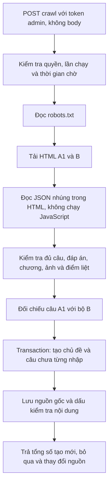

# API cào câu hỏi — gọi một lần, không truyền tham số

## 1. Cách gọi

Khởi động lại backend để migrate bảng `crawl_records` và trường `questions.source_url`, rồi gọi:

```http
POST http://localhost:8080/api/v1/admin/questions/crawl
Authorization: Bearer ACCESS_TOKEN_ADMIN
```

**Không gửi body, query hoặc URL nguồn.** Token chỉ dùng để xác thực quyền admin như các API quản trị khác.

Trong Postman:

1. Chọn `POST`.
2. Nhập URL trên.
3. Tab Authorization → Bearer Token → dán access token admin.
4. Tab Body → chọn **none**; không gửi cả `{}`.
5. Bấm Send và chờ response. Đây là request đồng bộ, không phải một background job.

Ví dụ terminal, thay token mẫu bằng token thật:

```sh
curl -X POST 'http://localhost:8080/api/v1/admin/questions/crawl' \
  -H 'Authorization: Bearer ACCESS_TOKEN_ADMIN'
```

Bạn không cần tự tạo chủ đề trước khi cào. Crawler tự tạo/tìm các chủ đề tương ứng và nhập câu hỏi cùng các phương án, đáp án đúng, lời giải, dấu điểm liệt và URL ảnh.

## 2. Những nguồn đã tìm và kiểm tra

Kiểm tra ngày **25/10/2026**. Tên phiên bản trong nguồn là bộ CSGT 2025; không đồng nghĩa đã xác nhận mọi nội dung là quy định mới nhất tại thời điểm sử dụng.

| Link | Đặc điểm quan sát được | Cách sử dụng trong dự án |
|---|---|---|
| [HocLaixeOnline — A1](https://hoclaixeonline.com/hang/a1) | Trang HTML chứa dữ liệu có cấu trúc cho 250 câu A1 | Crawler đang sử dụng |
| [HocLaixeOnline — B](https://hoclaixeonline.com/hang/b) | Trang HTML chứa dữ liệu có cấu trúc cho 600 câu hạng B | Crawler đang sử dụng |
| [HocLaixeOnline — danh mục câu hỏi](https://hoclaixeonline.com/cau-hoi) | Danh mục và liên kết từng câu | Tham khảo và truy vết nguồn |
| [Dữ Liệu Pháp Luật — bộ câu hỏi](https://dulieuphapluat.vn/cong-cu/600-cau-hoi-ly-thuyet-lai-xe.html) | Có các trang nhóm câu hỏi và thông tin đáp án/căn cứ | Nguồn tham khảo thay thế; chưa viết adapter, không tự fallback |
| [Cổng Chính phủ — giới thiệu bộ 600 câu](https://xaydungchinhsach.chinhphu.vn/600-cau-hoi-dung-cho-sat-hach-lai-xe-co-gioi-duong-bo-119250513095211625.htm) | Nguồn cơ quan nhà nước giới thiệu bộ câu hỏi | Đối chiếu xuất xứ; không dùng làm nguồn HTML cho crawler hiện tại |
| [Cục CSGT — hướng dẫn sử dụng bộ câu hỏi](https://www.csgt.vn/upload/services/2071319603_H%C6%B0%E1%BB%9Bng%20d%E1%BA%ABn%20s%E1%BB%AD%20d%E1%BB%A5ng%20b%E1%BB%99%20c%C3%A2u%20h%E1%BB%8Fi%20s%C3%A1t%20h%E1%BA%A1ch%20GPLX%20%28CV%202262.07.5.2025%29.pdf) | Tài liệu PDF hướng dẫn sử dụng | Đối chiếu nghiệp vụ; chưa làm parser PDF |

Crawler chọn hai trang tổng hợp của cùng một nguồn để lấy cả bộ trong ít request và tránh trộn các cách đánh số khác nhau. Không truy cập API riêng của website, không đăng nhập, không vượt CAPTCHA.

`robots.txt` được đọc trước mỗi lần chạy. Khi kiểm tra, nguồn cho phép đường dẫn công khai và cấm `/api/`, `/auth/`; crawler chỉ đọc `/hang/a1` và `/hang/b`. Robots là chỉ dẫn truy cập tự động, không phải giấy phép tái sử dụng nội dung. Nguồn gốc câu được lưu lại; cần rà soát quyền sử dụng trước khi phân phối lại nội dung bên thứ ba trong sản phẩm công khai.

## 3. Mặc định tải gì?

| Bộ | Số câu theo cấu trúc đã kiểm tra | Số cờ điểm liệt trong trang nguồn |
|---|---:|---:|
| A1 | 250 | 20 |
| B | 600 | 60 |

Vì model hiện tại gắn mỗi câu với **một** `license_type`, lần đầu sẽ tạo tối đa **850 bản ghi**: 250 cho A1 và 600 cho B. Đây không phải 850 nội dung câu hỏi khác nhau; nhiều câu A1 cũng xuất hiện trong bộ B.

Không tự nhập A, C1, C, D hoặc tự gán toàn bộ câu ô tô sang A1. Những hạng này cần adapter/mapping được kiểm tra riêng nếu muốn bổ sung.

Nguồn đánh dấu điểm liệt có thể khác nhau giữa hai hạng cho cùng số câu. Crawler giữ cờ của từng trang hạng, kiểm tra riêng tổng 20/60, đồng thời đối chiếu nội dung, lựa chọn và đáp án giữa hai bộ.

Các nhóm chủ đề tự tạo có tiền tố `CSGT 2025 - Chương ...`:

1. Quy định chung và quy tắc giao thông đường bộ.
2. Văn hóa giao thông, đạo đức người lái xe, PCCC và cứu hộ, cứu nạn.
3. Kỹ thuật lái xe.
4. Cấu tạo và sửa chữa.
5. Báo hiệu đường bộ.
6. Giải thế sa hình và kỹ năng xử lý tình huống giao thông.

## 4. Luồng xử lý



Mỗi lần thành công chỉ cần ba lần tải: robots và hai trang tổng hợp. Giữa các lần tải bộ câu hỏi có khoảng nghỉ 500 ms. Không tải từng trang câu hỏi và không tải hàng trăm ảnh.

Giới hạn:

- Toàn bộ thao tác tối đa 60 giây theo context; mỗi HTTP request nguồn tối đa 20 giây.
- HTML tối đa 8 MiB/trang; robots tối đa 256 KiB.
- Không chạy hai lượt crawl đồng thời trong cùng instance backend.
- Sau lần thành công, đợi ít nhất 60 giây để gọi lại.
- Không nhận URL từ client; redirect ra host khác hoặc xuống HTTP bị từ chối.
- Nếu nguồn trả lỗi hoặc đổi cấu trúc, báo lỗi trước khi nhập. Không đoán đáp án hoặc tự chấp nhận bộ dữ liệu thiếu câu.

Các giới hạn số lượng hiện được cố định theo phiên bản nguồn đã kiểm tra. Nếu nguồn cập nhật thành bộ khác, cần kiểm tra và sửa adapter trong code; API không âm thầm nhập dữ liệu khác cấu trúc.

## 5. Response khi lần đầu nhập thành công

HTTP `200`, ví dụ database chưa có câu nào từ crawler và chưa có các chủ đề tương ứng:

```json
{
  "received": 850,
  "created": 850,
  "skipped": 0,
  "source_changed": 0,
  "categories_created": 6,
  "published": false,
  "source": "hoclaixeonline-csgt-2025",
  "banks": [
    {
      "license_type": "A1",
      "received": 250,
      "url": "https://hoclaixeonline.com/hang/a1"
    },
    {
      "license_type": "B",
      "received": 600,
      "url": "https://hoclaixeonline.com/hang/b"
    }
  ],
  "image_storage": "remote_url",
  "message": "Imported as drafts. Review questions before publishing. Existing questions are not overwritten."
}
```

| Trường | Ý nghĩa |
|---|---|
| `received` | Tổng bản ghi đã đọc/kiểm tra theo các hạng |
| `created` | Số câu mới được lưu vào database |
| `skipped` | Số câu đã có dấu nhập từ nguồn, không tạo lại |
| `source_changed` | Trong các câu bị bỏ qua, bao nhiêu câu nguồn khác so với lần nhập đầu |
| `categories_created` | Số chủ đề mới tạo ở lần này |
| `published` | `false`: các câu mới được nhập dưới dạng nháp |
| `source` | Mã nguồn/phiên bản dùng chống trùng |
| `banks` | Các trang/hạng đã đọc và số lượng |
| `image_storage` | `remote_url`: lưu link ảnh, không tải ảnh về ổ đĩa |

`source_changed` là tập con của `skipped`, không cộng thêm vào tổng. Với lần thành công: `created + skipped = received`.

Nếu backend có dữ liệu cũ hoặc đã chạy crawler, con số thực tế có thể khác phần `created`, `skipped`, `categories_created` của ví dụ.

## 6. Gọi lại có trùng hoặc mất nội dung đã sửa không?

Sau ít nhất 60 giây, gọi lại cùng API, không đổi bất cứ tham số nào.

Nếu nguồn không đổi và lần trước đã nhập đủ, response rút gọn:

```json
{
  "received": 850,
  "created": 0,
  "skipped": 850,
  "source_changed": 0,
  "categories_created": 0,
  "published": false
}
```

Chống trùng dựa trên khóa:

```text
nguồn + hạng bằng + ID câu tại nguồn
```

Ví dụ câu số 1 trong A1 và câu số 1 trong B là hai bản ghi theo hạng; nhưng gọi lại cùng nguồn/A1/1 thì không tạo câu thứ ba.

- Admin sửa nội dung sau khi crawl: crawler giữ nguyên bản đã sửa.
- Admin xuất bản câu: crawler không đưa câu đã có về nháp.
- Admin xóa câu: crawler không tự hồi sinh câu đó ở lần sau.
- Nguồn sửa nội dung: tăng `source_changed`, không tự ghi đè. So sánh là với bản nguồn được nhập lần đầu, không phải với nội dung admin hiện đang sửa.
- Nguồn không còn đáp ứng cấu trúc kiểm tra: cả lần crawl thất bại trước khi ghi.

Chống trùng này không dò tương đồng văn bản với những câu bạn đã nhập thủ công trước đây. Câu nhập thủ công chưa có bản ghi nguồn có thể trùng nội dung với câu crawler mới tạo.

Bảng `crawl_records` giữ nguồn, hạng, ID nguồn, ID câu trong DB, URL, hash nội dung và thời điểm nhập. Đừng xóa bảng này nếu còn muốn giữ cơ chế chống nhập lại.

## 7. Vì sao câu đã cào chưa xuất hiện cho người học?

Câu mới có `published=false`. API lấy nội dung từ website bên thứ ba nên không tự xác nhận chất lượng hoặc tự xuất bản cho người học.

Xem nội dung vừa nhập bằng token admin:

```http
GET http://localhost:8080/api/v1/admin/questions?license_type=A1&page=1&limit=100
Authorization: Bearer ACCESS_TOKEN_ADMIN
```

Đổi `license_type=B` để xem bộ B. Phân trang để xem các câu còn lại. Danh sách có thể bao gồm cả câu thủ công; câu crawler tạo có `source_url` dẫn tới trang nguồn.

Sau khi rà soát, dùng `PUT /api/v1/admin/questions/:id` với đầy đủ body như API quản trị hiện tại và `published=true`. Cần giữ đủ tiêu đề, nội dung, chủ đề, hạng bằng, lời giải và tập đáp án; không chỉ gửi riêng trường `published`.

Sau khi xuất bản, câu mới xuất hiện trong `/api/v1/practice/questions` và có thể được chọn vào đề thi. Crawler không tự tạo đề, không sửa cấu hình điểm đạt hoặc thời gian thi.

## 8. Ảnh được lưu như thế nào?

Ví dụ nguồn có `/cau-hoi/cau_36.webp`, crawler chuẩn hóa thành URL tuyệt đối thuộc `https://hoclaixeonline.com/cau-hoi/` rồi lưu vào `questions.image`.

File ảnh chưa được tải vào server của bạn. Việc hiển thị ảnh còn phụ thuộc website nguồn. Nếu sau này cần hoạt động độc lập/offline, cần bổ sung bước tải và lưu ảnh vào kho riêng.

Chỉ chấp nhận URL ảnh HTTPS cùng host nguồn và đúng tiền tố đường dẫn; không lưu URL tùy ý do trang nguồn cung cấp. Crawler không truy cập URL ảnh trong lần import.

## 9. Lỗi có thể gặp

| HTTP | Ý nghĩa | Cách xử lý |
|---|---|---|
| `400` | Có body/query không được hỗ trợ | Bỏ toàn bộ Params và chọn Body → none |
| `401` | Chưa đăng nhập hoặc token không hợp lệ | Đăng nhập/refresh token |
| `403` | Không có quyền admin | Kiểm tra `/auth/getProfile` và quyền tài khoản |
| `409` | Một lượt crawl khác đang chạy trong cùng instance | Đợi lượt đó kết thúc |
| `429` | Chưa đủ thời gian chờ sau lần thành công | Đợi theo header `Retry-After` rồi gọi lại |
| `502` | Nguồn lỗi, robots chặn hoặc cấu trúc dữ liệu thay đổi | Đọc message; kiểm tra nguồn/adapter, không có nhập dở bộ |
| `504` | Quá thời gian chờ | Kiểm tra mạng, nguồn, proxy; thử lại |
| `500` | Lỗi database/nội bộ | Xem log server |

Lỗi trong transaction sẽ rollback cả lô. Nếu client mất kết nối đúng lúc commit, client có thể không biết đã thành công hay chưa; gọi lại sau thời gian chờ sẽ dùng bản ghi nguồn để tránh nhân đôi.

Không có cơ chế tự vượt CAPTCHA hoặc chuyển sang nguồn khác khi website từ chối truy cập. Tài liệu liệt kê nguồn thay thế để tham khảo; API hiện chỉ tích hợp HocLaixeOnline.

## 10. Mã nguồn và kiểm thử

| File | Vai trò |
|---|---|
| [crawler/router.go](../internal/crawler/router.go) | Endpoint không tham số, phân loại lỗi |
| [crawler/service.go](../internal/crawler/service.go) | Nguồn mặc định, giới hạn HTTP, điều phối hai bộ |
| [crawler/parser.go](../internal/crawler/parser.go) | Đọc JSON nhúng từ HTML và kiểm tra dữ liệu |
| [crawler/robots.go](../internal/crawler/robots.go) | Kiểm tra các quy tắc đường dẫn robots |
| [learning/crawl.go](../internal/learning/crawl.go) | Transaction import, chống trùng và giữ nguồn gốc |
| [crawler/crawler_test.go](../internal/crawler/crawler_test.go) | Test parser, nguồn lỗi, import và chạy thật tùy chọn |

Chạy test bình thường không gọi Internet:

```sh
go test ./internal/crawler ./internal/server
```

Chạy smoke test với nguồn thật, **luôn ghi vào SQLite tạm**, không ghi database dự án:

```sh
CRAWLER_LIVE=1 go test ./internal/crawler -run '^TestLiveCrawl$' -v
```

Smoke test thử nhập rồi gọi lại để xác nhận chống trùng; thời gian chờ giữa hai lượt được bỏ qua riêng trong test. API thật vẫn có cooldown 60 giây.

Kiểm chứng ngày 25/10/2026: nguồn thật đọc được 250 câu A1 và 600 câu B, nhập 850 câu nháp và 6 chủ đề; lần kế tiếp tạo 0 câu, bỏ qua 850 câu. Đây là kiểm tra vận hành parser/import, không phải xác nhận tính pháp lý hay độ chính xác chuyên môn của mọi câu hỏi.
