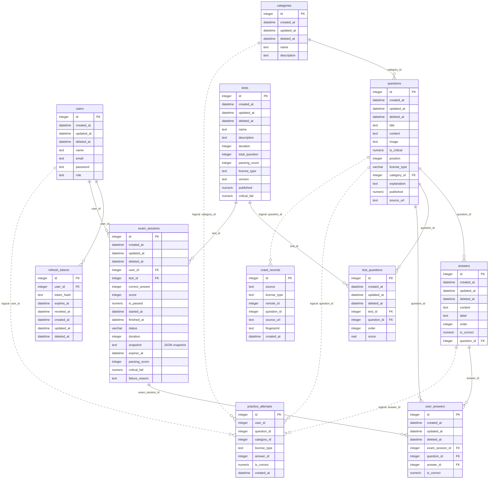

# ERD — Database ứng dụng thi bằng lái xe

Đối chiếu ngày 25/10/2026 với 11 model trong `internal/database/migrate.go` và schema SQLite tại `cmd/data/gorm.db` (chỉ đọc, không thay đổi dữ liệu).

## Cách xem

Mở file này bằng trình xem Markdown hỗ trợ Mermaid (ví dụ GitHub). Trong VS Code, dùng Markdown Preview có hỗ trợ Mermaid. File [ERD.mmd](ERD.mmd) là mã sơ đồ riêng để nhập vào công cụ Mermaid và xuất SVG/PNG.

- `PK`: khóa chính; `FK`: cột có ràng buộc khóa ngoại trong schema đã kiểm tra.
- `||` là một; `o{` là không hoặc nhiều bản ghi phía con.
- **Quy ước riêng của sơ đồ này:** nét liền biểu diễn quan hệ có FK; nét đứt biểu diễn liên kết logic qua ID chưa có FK trong database. Đây không phải phân loại identifying/non-identifying.
- Cardinality mô tả quan hệ nghiệp vụ hợp lệ; không khẳng định dữ liệu cũ không có bản ghi mồ côi hoặc mọi cột FK đều `NOT NULL`.
- Kiểu dữ liệu và tên cột dưới đây là của SQLite, có thể khác tên JSON của API.

## Sơ đồ đầy đủ

## Đọc sơ đồ theo luồng tạo đề và làm bài

1. **`users` → `refresh_tokens`:** một tài khoản có nhiều refresh token; chỉ lưu hash token trong `token_hash`.
2. **`categories` → `questions` → `answers`:** chủ đề chứa câu hỏi; mỗi câu có nhiều phương án. API kiểm tra tối thiểu hai phương án và đúng một phương án đúng. Quy tắc này không được thể hiện bằng FK.
3. **`tests` → `test_questions` ← `questions`:** đề và câu hỏi có quan hệ nhiều–nhiều qua bảng trung gian. `test_questions.order` giữ thứ tự câu trong đề. Khi tạo đề, API yêu cầu các câu đã xuất bản và cùng hạng bằng lái với đề.
4. **`users` → `exam_sessions` ← `tests`:** mỗi lần bắt đầu thi tạo một phiên mới. Một người có thể thi cùng đề nhiều lần.
5. **`exam_sessions` → `user_answers`:** lưu lựa chọn của người học theo từng câu trong phiên. `answers.is_correct` là đáp án chuẩn; `user_answers.is_correct` là kết quả lựa chọn của người thi.
6. **`practice_attempts`:** lưu từng lượt trả lời khi luyện tập; một người trả lời lại cùng câu tạo lượt mới. Các ID liên kết người dùng, câu, chủ đề, phương án hiện chưa có ràng buộc FK.
7. **`crawl_records`:** ghi nhận câu đã nhập từ nguồn để chống nhập trùng. `question_id` liên kết logic tới câu hỏi; `fingerprint` giúp nhận biết nội dung nguồn thay đổi.

## Vì sao bảng questions không có cột answers?

`Question.Answers` là trường quan hệ trong Go, không phải cột database. Phương án nằm ở bảng `answers`, nối bằng `answers.question_id = questions.id`. GORM dùng `Preload("Answers")` để lấy danh sách và đưa vào JSON trả về.

Tương tự, `Test.Questions` lấy dữ liệu từ `test_questions`; `ExamSession.UserAnswers` lấy từ `user_answers`. Các trường struct quan hệ không tạo thêm cột JSON trong bảng cha.

## Snapshot của phiên thi nằm ở đâu?

`exam_sessions.snapshot` là cột TEXT chứa JSON bản chụp đề, câu hỏi, phương án và đáp án chuẩn tại thời điểm bắt đầu thi. `Snapshot`, `SnapshotQuestion`, `SnapshotAnswer` là struct JSON, **không phải ba bảng database**.

Bản chụp giúp việc chấm và xem lại bài không phụ thuộc nội dung ngân hàng câu hỏi sau khi chỉnh sửa. API ẩn đáp án đúng và lời giải khi phiên còn đang làm; không trả nguyên cột snapshot cho client.

## Các ràng buộc unique cần biết

| Bảng | Cột hoặc nhóm cột unique | Mục đích |
|---|---|---|
| `refresh_tokens` | `token_hash` | Không trùng hash refresh token |
| `questions` | `(category_id, position)` | Không trùng vị trí trong chủ đề |
| `answers` | `(question_id, label)` | Không trùng nhãn trong một câu |
| `answers` | `(question_id, order)` | Không trùng thứ tự phương án |
| `test_questions` | `(test_id, question_id)` | Một câu chỉ xuất hiện một lần trong đề |
| `test_questions` | `(test_id, order)` | Không trùng thứ tự câu trong đề |
| `user_answers` | `(exam_session_id, question_id)` | Một lựa chọn được lưu cho mỗi câu trong phiên |
| `crawl_records` | `(source, license_type, remote_id)` | Không nhập lại cùng câu nguồn của cùng hạng |

Các nhóm trên là unique theo **tổ hợp**, không phải từng cột riêng lẻ. `users.email` hiện chưa có unique index trong model.

## Lưu ý khi đọc cột

- `tests.duration` là số phút, API dùng tên `duration_minutes`; `exam_sessions.duration` là thời gian làm bài tính bằng giây.
- `tests.total_question` được trả ra API dưới tên `total_questions`; `exam_sessions.correct_answer` tương ứng `correct_answers`.
- `created_at`, `updated_at`, `deleted_at` đến từ model nền ở chín bảng. `practice_attempts` và `crawl_records` chỉ có `created_at`, không có xóa mềm.
- `deleted_at` dùng cho xóa mềm: bản ghi vẫn còn trong database. Các unique index trên không bao gồm `deleted_at`.
- FK `test_questions.test_id` có `ON DELETE CASCADE` cho xóa vật lý. Xóa mềm không tự kích hoạt cascade của database.
- Bảng thống kê tiến độ hoặc danh sách câu sai không tồn tại riêng; ứng dụng tổng hợp từ dữ liệu luyện tập và phiên thi.

## Code và tài liệu liên quan

- [Danh sách model được migrate](../internal/database/migrate.go)
- [Model câu hỏi](../internal/question/model/question.go)
- [Model phiên thi](../internal/exam/model/exam_session.go)
- [Cấu trúc snapshot](../internal/exam/model/snapshot.go)
- [Model luyện tập](../internal/learning/service.go)
- [Model bản ghi crawl](../internal/learning/crawl.go)
- [Hướng dẫn chạy API và tạo bài thi](HUONG_DAN_API_TUNG_BUOC.md)
- [Giải thích model và database](MODEL_VA_DATABASE.md)
