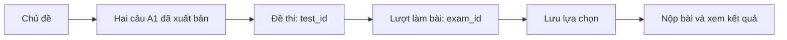

# Chạy backend và tạo một bài thi thử bằng Postman — từng bước theo code hiện tại

Cập nhật theo code trong dự án ngày 25/10/2026. Mục tiêu là làm được một vòng hoàn chỉnh: **đăng nhập → tạo câu hỏi hợp lệ → tạo đề → bắt đầu thi → lưu đáp án → nộp → xem kết quả**.

Mỗi mục thao tác HTTP có một cURL để import trực tiếp vào Postman. Các bước chạy Go/cấp quyền dùng terminal và được ghi rõ; chúng không phải API.

Luồng chính tạo một đề A1 minh họa gồm **2 câu, 10 phút, điểm đạt 2**, để bạn thử nhanh. Đây là cấu hình demo, không phải cấu trúc đề thi chính thức. Hai câu demo không dùng ảnh để tránh các URL ảnh mẫu không tồn tại.

**Đi theo bước 0–15 trước.** Các mục 16 trở đi là thao tác bổ sung, bao gồm dùng dữ liệu crawler thay câu demo.

## Bản đồ các bước

| Bước | Việc cần làm | Token dùng |
|---|---|---|
| 0 | Chuẩn bị biến Postman | Chưa cần |
| 1 | Chạy server, gọi health | Chưa cần |
| 2 | Đăng ký admin | Chưa cần |
| 3 | Cấp quyền bằng terminal | Không phải HTTP |
| 4 | Login admin và kiểm tra quyền | Admin |
| 5 | Register/login người học | Người học |
| 6 | Tạo chủ đề demo | Admin |
| 7 | Tạo câu demo 1, đã xuất bản | Admin |
| 8 | Tạo câu demo 2, đã xuất bản | Admin |
| 9 | Kiểm tra cả hai câu trước khi tạo đề | Admin |
| 10 | Tạo đề hai câu | Admin |
| 11 | Người học xem danh sách đề | Người học |
| 12 | Bắt đầu phiên thi | Người học |
| 13 | Lưu đáp án cho cả hai câu | Người học |
| 14 | Nộp bài, kiểm tra kết quả | Người học |
| 15 | Xem lịch sử và chi tiết bài | Người học |



## 0. Chuẩn bị Postman và hiểu các biến

### 0.1. Tạo một Environment

Trong Postman, tạo Environment, ví dụ `Driving Local`, rồi chọn environment đó trước khi Send.

Tạo các biến đầu vào:

| Biến | Giá trị để thực hành |
|---|---|
| `base_url` | `http://localhost:8080` — không thêm `/` ở cuối |
| `admin_email` | `admin.demo@example.com` |
| `admin_password` | `DemoPassword123!` |
| `learner_email` | `learner.demo@example.com` |
| `learner_password` | `DemoPassword123!` |

Nếu email đã tồn tại, dùng mật khẩu đúng của tài khoản đó hoặc chọn email demo khác. Không cần đăng ký lại tài khoản đang có.

Những biến sau được script lưu tự động khi bạn chạy đúng thứ tự:

| Biến | Ý nghĩa |
|---|---|
| `admin_token`, `admin_refresh_token` | Token của admin |
| `learner_token`, `learner_refresh_token` | Token của người học |
| `category_id` | Chủ đề vừa tạo |
| `question_id_1`, `question_id_2` | Hai câu hỏi sẽ đưa vào đề |
| `correct_answer_id_1`, `correct_answer_id_2` | Đáp án đúng lấy từ API admin, dùng riêng cho bài kiểm tra demo |
| `test_id` | Đề thi dùng chung |
| `exam_id` | Lượt làm bài của người đang đăng nhập |
| `exam_answer_id_1`, `exam_answer_id_2` | ID đáp án đã đối chiếu với snapshot của lượt thi |

**Không điền ID đoán trước như 1, 55 hoặc 101.** Dùng ID thực từ response. Một đề có thể có nhiều phiên thi, nên `test_id` và `exam_id` không thay thế cho nhau.

### 0.2. Import cURL cho từng mục

1. Copy toàn bộ khối bắt đầu bằng `curl` của mục đó.
2. Dùng chức năng **Import** của Postman, dán cURL và import thành request.
3. Chọn environment `Driving Local`.
4. Nếu mục đó có script, mở phần **Scripts → Post-response** của request, dán script **trước khi bấm Send**. Ở một số giao diện phần này mang tên Tests.
5. Bấm Send và kiểm tra status/response đúng như mô tả trước khi sang bước tiếp theo.

**Import cURL không tự import script nằm bên dưới.** Bạn phải dán script riêng, hoặc tự lưu các trường response vào Environment bằng tay.

Các cURL trong tài liệu dùng `{{biến}}` theo Postman. Nếu chạy trực tiếp trong terminal, bạn phải thay biến bằng giá trị thật; shell không tự hiểu cú pháp `{{...}}`.

Biến ID trong JSON được đặt **không có dấu ngoặc kép** để gửi số. Ví dụ `"test_id": {{test_id}}` sẽ thành `"test_id": 20` sau khi Postman thay biến. Nếu biến còn trống, request sẽ không phải JSON hợp lệ.

## 1. Chạy server và kiểm tra health

### 1.1. Chạy trong terminal, không import vào Postman

Mở terminal tại thư mục gốc dự án, nơi có `go.mod`:

```sh
cd /Users/hando/projectgo/go-backend
```

Nếu chưa có `.env`, tạo từ mẫu; lệnh sau không ghi đè file đang có:

```sh
if [ ! -f .env ]; then cp .env.example .env; fi
```

Mở `.env`, đặt `JWT_SECRET` của bạn. Mặc định server dùng:

```text
DATABASE_PATH=cmd/data/gorm.db
LISTEN_ADDR=:8080
```

Rồi chạy:

```sh
go run ./cmd/server
```

Giữ terminal này mở. Nếu cổng 8080 đang có backend cũ chạy, dừng tiến trình cũ hoặc dùng địa chỉ khác rồi sửa `base_url`. Sau thay đổi code, cần chạy lại server mới.

Nếu gặp lỗi không ghi được Go build cache trong môi trường bị giới hạn:

```sh
GOCACHE=/tmp/driving-go-build-cache go run ./cmd/server
```

Server dùng `AutoMigrate` khi khởi động. `DATABASE_PATH` trong biến môi trường của terminal, nếu đã đặt, sẽ có ưu tiên hơn giá trị được nạp từ `.env`; hãy dùng cùng database cho server và CLI cấp quyền.

### 1.2. GET /health — cURL Postman

```bash
curl --request GET '{{base_url}}/health'
```

**Mong đợi:** HTTP `200`, body `{"status":"ok"}`. Nếu chưa được bước này, chưa cần thử các API khác.

## 2. POST /auth/register — đăng ký tài khoản admin tương lai

```bash
curl --request POST '{{base_url}}/auth/register' \
  --header 'Content-Type: application/json' \
  --data-raw '{
  "name": "Quan tri demo",
  "email": "{{admin_email}}",
  "password": "{{admin_password}}"
}'
```

**Mong đợi:** HTTP `201`. Tài khoản vừa đăng ký có `data.role = "learner"` — đây là đúng thiết kế.

Nếu HTTP `409` báo email đã tồn tại, không đăng ký lại; đi tiếp với tài khoản đó nếu bạn biết mật khẩu, hoặc đổi email trong Environment.

## 3. Cấp quyền admin — chạy trong terminal thứ hai

Đây là lệnh quản trị cục bộ, **không có cURL tương ứng**. Backend không cho client tự nâng quyền qua body đăng ký.

```sh
cd /Users/hando/projectgo/go-backend
go run ./cmd/admin -email admin.demo@example.com -role admin
```

Nếu đã đổi `admin_email` trong Postman, thay email trong lệnh bằng đúng email đó. Chạy CLI với cùng `DATABASE_PATH` mà server sử dụng.

**Mong đợi:** thông báo `Updated role to admin for user ...`.

## 4. Đăng nhập admin và kiểm tra quyền

### 4.1. POST /auth/login — lấy token admin

```bash
curl --request POST '{{base_url}}/auth/login' \
  --header 'Content-Type: application/json' \
  --data-raw '{
  "email": "{{admin_email}}",
  "password": "{{admin_password}}"
}'
```

**Script Post-response của request này:**

```javascript
pm.test("Login admin thành công", () => pm.response.to.have.status(200));
if (pm.response.code === 200) {
  const d = pm.response.json().data;
  pm.environment.set("admin_token", d.access_token);
  pm.environment.set("admin_refresh_token", d.refresh_token);
}
```

Token nằm trong `data.access_token`, không nằm trực tiếp ở root của response. Script phía trên lưu token cho các request sau.

### 4.2. GET /auth/getProfile — xác nhận admin

```bash
curl --request GET '{{base_url}}/auth/getProfile' \
  --header 'Authorization: Bearer {{admin_token}}'
```

**Script Post-response của request này:**

```javascript
pm.test("Tài khoản đã có quyền admin", () => {
  pm.response.to.have.status(200);
  pm.expect(pm.response.json().role).to.eql("admin");
});
```

**Mong đợi:** HTTP `200`, `role: "admin"`. Nếu vẫn là `learner`, kiểm tra email và database của lệnh cấp quyền. Chưa tạo câu hỏi khi bước kiểm tra quyền còn lỗi.

## 5. Đăng ký và đăng nhập người học

### 5.1. POST /auth/register — tạo người học

```bash
curl --request POST '{{base_url}}/auth/register' \
  --header 'Content-Type: application/json' \
  --data-raw '{
  "name": "Nguoi hoc demo",
  "email": "{{learner_email}}",
  "password": "{{learner_password}}"
}'
```

**Mong đợi:** `201`; nếu đã tồn tại, dùng tài khoản/mật khẩu đã có. Không cấp quyền admin cho tài khoản này.

### 5.2. POST /auth/login — lưu token người học

```bash
curl --request POST '{{base_url}}/auth/login' \
  --header 'Content-Type: application/json' \
  --data-raw '{
  "email": "{{learner_email}}",
  "password": "{{learner_password}}"
}'
```

**Script Post-response của request này:**

```javascript
pm.test("Login người học thành công", () => pm.response.to.have.status(200));
if (pm.response.code === 200) {
  const d = pm.response.json().data;
  pm.environment.set("learner_token", d.access_token);
  pm.environment.set("learner_refresh_token", d.refresh_token);
}
```

Từ đây có hai token riêng. Các request quản lý nội dung dùng `admin_token`; request thi và lịch sử dùng `learner_token`. Token quyết định chủ sở hữu bài, không gửi `user_id` trong body.

## 6. POST /api/v1/admin/categories — tạo chủ đề demo

```bash
curl --request POST '{{base_url}}/api/v1/admin/categories' \
  --header 'Authorization: Bearer {{admin_token}}' \
  --header 'Content-Type: application/json' \
  --data-raw '{
  "name": "Chủ đề thực hành API",
  "description": "Dữ liệu minh họa cho luồng tạo đề và thi thử"
}'
```

**Script Post-response của request này:**

```javascript
pm.test("Tạo chủ đề thành công", () => pm.response.to.have.status(201));
if (pm.response.code === 201) pm.environment.set("category_id", pm.response.json().id);
```

**Mong đợi:** `201`. ID nằm ở `id` ngay trong response, không phải `data.id`.

Nếu bạn muốn dùng câu đã crawl thay vì câu demo, có thể chọn nhánh ở **mục 19** sau khi đã hoàn tất đăng nhập. Nhánh đó thay thế việc tạo chủ đề/câu ở bước 6–8, rồi quay về bước 9. Không cần làm cả hai nhánh.

## 7. POST /api/v1/admin/questions — tạo câu 1 đã xuất bản

```bash
curl --request POST '{{base_url}}/api/v1/admin/questions' \
  --header 'Authorization: Bearer {{admin_token}}' \
  --header 'Content-Type: application/json' \
  --data-raw '{
  "title": "Demo API - Câu 1",
  "content": "Trong dữ liệu minh họa này, hãy chọn phương án A.",
  "image": "",
  "explanation": "Phương án A được quy ước là đúng cho câu demo 1.",
  "license_type": "A1",
  "category_id": {{category_id}},
  "is_critical": true,
  "published": true,
  "answers": [
    {
      "content": "Phương án A của câu 1",
      "label": "A",
      "order": 1,
      "is_correct": true
    },
    {
      "content": "Phương án B của câu 1",
      "label": "B",
      "order": 2,
      "is_correct": false
    }
  ]
}'
```

**Script Post-response của request này:**

```javascript
pm.test("Lưu câu hỏi thành công", () => pm.expect(pm.response.code).to.be.oneOf([200, 201]));
if ([200, 201].includes(pm.response.code)) {
  const q = pm.response.json();
  const correct = q.answers.find(a => a.is_correct === true);
  if (!correct) throw new Error("Câu hỏi không có đáp án đúng");
  pm.environment.set("question_id_1", q.id);
  pm.environment.set("correct_answer_id_1", correct.id);
}
```

**Mong đợi:** `201`, `license_type: "A1"`, `published: true`, hai đáp án và đúng một đáp án đúng. Script lưu `question_id_1` và `correct_answer_id_1`.

Đây là câu điểm liệt vì `is_critical=true`. Tạo câu đã bao gồm tạo đáp án; không cần gọi API thêm đáp án riêng.

## 8. POST /api/v1/admin/questions — tạo câu 2 đã xuất bản

```bash
curl --request POST '{{base_url}}/api/v1/admin/questions' \
  --header 'Authorization: Bearer {{admin_token}}' \
  --header 'Content-Type: application/json' \
  --data-raw '{
  "title": "Demo API - Câu 2",
  "content": "Trong dữ liệu minh họa thứ hai, hãy chọn phương án B.",
  "image": "",
  "explanation": "Phương án B được quy ước là đúng cho câu demo 2.",
  "license_type": "A1",
  "category_id": {{category_id}},
  "is_critical": false,
  "published": true,
  "answers": [
    {
      "content": "Phương án A của câu 2",
      "label": "A",
      "order": 1,
      "is_correct": false
    },
    {
      "content": "Phương án B của câu 2",
      "label": "B",
      "order": 2,
      "is_correct": true
    }
  ]
}'
```

**Script Post-response của request này:**

```javascript
pm.test("Lưu câu hỏi thành công", () => pm.expect(pm.response.code).to.be.oneOf([200, 201]));
if ([200, 201].includes(pm.response.code)) {
  const q = pm.response.json();
  const correct = q.answers.find(a => a.is_correct === true);
  if (!correct) throw new Error("Câu hỏi không có đáp án đúng");
  pm.environment.set("question_id_2", q.id);
  pm.environment.set("correct_answer_id_2", correct.id);
}
```

**Mong đợi:** `201`. Script lưu `question_id_2` và `correct_answer_id_2`. Câu này là câu thường; phương án **B** đúng.

## 9. GET chi tiết hai câu — chặn lỗi published/license trước khi tạo đề

Điều kiện bắt buộc của cả hai câu là `published=true` và `license_type="A1"`. Đặt `published=true` ở **đề** không xuất bản các **câu hỏi** bên trong.

### 9.1. GET /api/v1/admin/questions/:id — kiểm tra câu 1

```bash
curl --request GET '{{base_url}}/api/v1/admin/questions/{{question_id_1}}' \
  --header 'Authorization: Bearer {{admin_token}}'
```

**Script Post-response của request này:**

```javascript
pm.test("Câu đủ điều kiện tạo đề A1", () => {
  pm.response.to.have.status(200);
  const q = pm.response.json();
  pm.expect(q.published).to.eql(true);
  pm.expect(q.license_type).to.eql("A1");
  pm.expect(q.answers.length).to.be.at.least(2);
  pm.expect(q.answers.filter(a => a.is_correct === true).length).to.eql(1);
});
```

### 9.2. GET /api/v1/admin/questions/:id — kiểm tra câu 2

```bash
curl --request GET '{{base_url}}/api/v1/admin/questions/{{question_id_2}}' \
  --header 'Authorization: Bearer {{admin_token}}'
```

**Script Post-response của request này:**

```javascript
pm.test("Câu đủ điều kiện tạo đề A1", () => {
  pm.response.to.have.status(200);
  const q = pm.response.json();
  pm.expect(q.published).to.eql(true);
  pm.expect(q.license_type).to.eql("A1");
  pm.expect(q.answers.length).to.be.at.least(2);
  pm.expect(q.answers.filter(a => a.is_correct === true).length).to.eql(1);
});
```

**Chỉ đi tiếp khi cả hai request đều đạt các kiểm tra.** Nếu đang dùng câu crawler còn nháp, thực hiện xuất bản ở mục 19. Không đổi nhầm câu hạng B thành A1 chỉ để vượt kiểm tra.

## 10. POST /api/v1/admin/tests — tạo một đề thi thử

```bash
curl --request POST '{{base_url}}/api/v1/admin/tests' \
  --header 'Authorization: Bearer {{admin_token}}' \
  --header 'Content-Type: application/json' \
  --data-raw '{
  "name": "Đề thực hành API - 2 câu A1",
  "description": "Đề demo để kiểm tra luồng API, không phải cấu hình thi chính thức",
  "license_type": "A1",
  "version": "demo-v1",
  "duration_minutes": 10,
  "passing_score": 2,
  "critical_fail": true,
  "published": true,
  "question_ids": [
    {{question_id_1}},
    {{question_id_2}}
  ]
}'
```

**Script Post-response của request này:**

```javascript
pm.test("Tạo đề thành công", () => pm.response.to.have.status(201));
if (pm.response.code === 201) {
  const t = pm.response.json();
  pm.environment.set("test_id", t.id);
  pm.test("Đề gồm hai câu đã xuất bản", () => {
    pm.expect(t.total_questions).to.eql(2);
    pm.expect(t.published).to.eql(true);
  });
}
```

**Mong đợi:** `201`, `total_questions: 2`; script lưu `test_id`.

| Trường | Ý nghĩa |
|---|---|
| `question_ids` | Hai ID câu hỏi từ bước trước |
| `license_type` | Phải trùng hạng bằng của cả hai câu |
| `duration_minutes` | Thời gian một lượt làm bài, tính bằng phút |
| `passing_score` | Điểm đạt; không được lớn hơn số câu |
| `critical_fail` | Bật quy tắc sai/bỏ trống câu điểm liệt thì trượt |
| `published` | Cho phép người học thấy và bắt đầu đề |
| `version` | Nhãn phiên bản do admin đặt, không tự tải quy định thi |

Lúc này mới tạo **đề**, chưa tạo lượt thi của người học.

## 11. GET /api/v1/tests — người học xem đề đã xuất bản

```bash
curl --request GET '{{base_url}}/api/v1/tests?license_type=A1&page=1&limit=20' \
  --header 'Authorization: Bearer {{learner_token}}'
```

**Mong đợi:** `200`, mảng `data` có đề vừa tạo. Danh sách có phân trang và sắp xếp ID mới nhất trước. Nếu không thấy đề, kiểm tra `published`, hạng bằng và đúng server/database.

## 12. POST /api/v1/exams — bắt đầu một lượt thi

```bash
curl --request POST '{{base_url}}/api/v1/exams' \
  --header 'Authorization: Bearer {{learner_token}}' \
  --header 'Content-Type: application/json' \
  --data-raw '{
  "test_id": {{test_id}}
}'
```

**Script Post-response của request này:**

```javascript
pm.test("Bắt đầu phiên thành công", () => pm.response.to.have.status(201));
if (pm.response.code === 201) {
  const session = pm.response.json();
  pm.environment.set("exam_id", session.id);
  pm.test("Phiên đang làm và có hai câu", () => {
    pm.expect(session.status).to.eql("DOING");
    pm.expect(session.exam.questions.length).to.eql(2);
  });
  for (const i of [1, 2]) {
    const qid = Number(pm.environment.get(`question_id_${i}`));
    const aid = Number(pm.environment.get(`correct_answer_id_${i}`));
    const q = session.exam.questions.find(q => q.id === qid);
    if (!q || !q.answers.some(a => a.id === aid)) {
      throw new Error(`ID câu/đáp án ${i} đã thay đổi; tải lại dữ liệu admin trước khi tạo phiên mới`);
    }
    pm.environment.set(`exam_answer_id_${i}`, aid);
  }
}
```

**Mong đợi:** `201`, `status: "DOING"`. ID phiên nằm ở root `id`; ID đề vẫn ở `test_id`.

Script dùng đáp án mà bạn đã biết từ API admin để tự kiểm tra demo. API người học đang thi **không tiết lộ đáp án đúng**. Đây không phải cách app người học ngoài thực tế tìm đáp án: app thực tế gửi ID phương án người dùng chọn.

Response có `started_at`, `expires_at`, `server_time` và `exam.questions`. Chưa chấm nên `score=0`, `is_passed=false` lúc này không có nghĩa đã trượt.

Mỗi lần Send request này tạo **một phiên mới**. Để mở lại phiên đang làm, dùng GET ở mục 15.2, không POST lại.

## 13. PUT đáp án — lưu lựa chọn cho hai câu

Các ID gửi lên phải thuộc snapshot của phiên đang làm. Không lấy `answer_id` bằng cách đoán A=1, B=2.

### 13.1. PUT /api/v1/exams/:id/answers/:question_id — lưu câu 1

```bash
curl --request PUT '{{base_url}}/api/v1/exams/{{exam_id}}/answers/{{question_id_1}}' \
  --header 'Authorization: Bearer {{learner_token}}' \
  --header 'Content-Type: application/json' \
  --data-raw '{
  "answer_id": {{exam_answer_id_1}}
}'
```

**Script Post-response của request này:**

```javascript
pm.test("Đã lưu câu 1", () => {
  pm.response.to.have.status(200);
  const q = pm.response.json().exam.questions.find(q => q.id === Number(pm.environment.get("question_id_1")));
  pm.expect(q.selected_answer_id).to.eql(Number(pm.environment.get("exam_answer_id_1")));
});
```

### 13.2. PUT /api/v1/exams/:id/answers/:question_id — lưu câu 2

```bash
curl --request PUT '{{base_url}}/api/v1/exams/{{exam_id}}/answers/{{question_id_2}}' \
  --header 'Authorization: Bearer {{learner_token}}' \
  --header 'Content-Type: application/json' \
  --data-raw '{
  "answer_id": {{exam_answer_id_2}}
}'
```

**Script Post-response của request này:**

```javascript
pm.test("Đã lưu câu 2", () => {
  pm.response.to.have.status(200);
  const q = pm.response.json().exam.questions.find(q => q.id === Number(pm.environment.get("question_id_2")));
  pm.expect(q.selected_answer_id).to.eql(Number(pm.environment.get("exam_answer_id_2")));
});
```

**Mong đợi:** cả hai request trả `200`, mỗi câu có `selected_answer_id`. Backend trả lại toàn bộ phiên thi, chưa trả đúng/sai.

Chờ cả hai request lưu thành công rồi mới nộp bài. Nếu request lưu thất bại, lựa chọn trên màn hình chưa chắc đã nằm trong database.

## 14. POST /api/v1/exams/:id/submit — nộp bài

```bash
curl --request POST '{{base_url}}/api/v1/exams/{{exam_id}}/submit' \
  --header 'Authorization: Bearer {{learner_token}}'
```

**Script Post-response của request này:**

```javascript
pm.test("Nộp bài thành công", () => pm.response.to.have.status(200));
if (pm.response.code === 200) {
  const r = pm.response.json();
  pm.test("Đúng hai câu và đạt", () => {
    pm.expect(r.correct_answers).to.eql(2);
    pm.expect(r.score).to.eql(2);
    pm.expect(r.is_passed).to.eql(true);
  });
}
```

Không gửi body. Server chấm từ những lựa chọn đã lưu, không nhận `score` hoặc `is_passed` của client.

Response rút gọn nếu làm đúng hai câu và nộp trước hạn:

```json
{
  "status": "COMPLETED",
  "correct_answers": 2,
  "total_questions": 2,
  "score": 2,
  "passing_score": 2,
  "is_passed": true
}
```

Nếu đã quá hạn thì trạng thái là `TIMEOUT`; vẫn có thể đạt nếu các đáp án đúng được lưu trước hạn. Nếu lưu sau hạn sẽ nhận `409`.

Sau khi chấm, response có lời giải và `is_correct`. Ở cấp câu hỏi, `is_correct` nói bạn làm đúng/sai; ở cấp phương án, trường đó chỉ phương án đúng.

Submit lại trả kết quả đã chấm, không tạo lượt thi mới. Lưu/đổi đáp án sau khi đóng bài bị từ chối.

## 15. Xem lại bài và lịch sử

### 15.1. GET /api/v1/exams — lịch sử của người học

```bash
curl --request GET '{{base_url}}/api/v1/exams?page=1&limit=20' \
  --header 'Authorization: Bearer {{learner_token}}'
```

**Mong đợi:** `200`, `data` chứa phiên vừa làm. Chỉ trả bài của người có token, không phải toàn bộ người dùng.

### 15.2. GET /api/v1/exams/:id — chi tiết hoặc tiếp tục phiên

```bash
curl --request GET '{{base_url}}/api/v1/exams/{{exam_id}}' \
  --header 'Authorization: Bearer {{learner_token}}'
```

Nếu `DOING` và chưa hết giờ, dùng câu hỏi cùng lựa chọn đã lưu để tiếp tục. Nếu `COMPLETED`/`TIMEOUT`, hiển thị kết quả và lời giải.

Bạn đã hoàn thành một vòng thi thử. Các phần tiếp theo dùng khi cần thử thêm hành vi khác.

## 16. Đổi lựa chọn, bỏ chọn và thử trường hợp trượt

Chỉ thực hiện khi có phiên `DOING` còn hạn. Nếu đã nộp bài ở bước 14, chạy lại **bước 12** để lấy `exam_id` mới trước khi thử.

### 16.1. PUT — đổi lựa chọn câu 1

Trong response bắt đầu phiên, chọn ID của phương án khác thuộc câu 1 và đặt vào biến mới `selected_answer_id` ở Environment. Biến này do bạn nhập khi thử thay lựa chọn.

```bash
curl --request PUT '{{base_url}}/api/v1/exams/{{exam_id}}/answers/{{question_id_1}}' \
  --header 'Authorization: Bearer {{learner_token}}' \
  --header 'Content-Type: application/json' \
  --data-raw '{
  "answer_id": {{selected_answer_id}}
}'
```

**Mong đợi:** `200` và câu 1 được cập nhật lựa chọn; không tạo thêm câu trả lời trùng trong cùng phiên.

### 16.2. PUT — bỏ chọn câu 1

```bash
curl --request PUT '{{base_url}}/api/v1/exams/{{exam_id}}/answers/{{question_id_1}}' \
  --header 'Authorization: Bearer {{learner_token}}' \
  --header 'Content-Type: application/json' \
  --data-raw '{
  "answer_id": 0
}'
```

`answer_id: 0` xóa lựa chọn. Thiếu trường `answer_id` không có cùng ý nghĩa và sẽ bị từ chối.

### 16.3. POST submit — xem lý do trượt

```bash
curl --request POST '{{base_url}}/api/v1/exams/{{exam_id}}/submit' \
  --header 'Authorization: Bearer {{learner_token}}'
```

Với câu demo 1 là điểm liệt, sai hoặc bỏ trống câu này làm `is_passed=false`, `failure_reason="critical_question"` khi đề bật `critical_fail`.

Nếu không vi phạm điểm liệt nhưng chưa đủ điểm, lý do là `insufficient_score`. `COMPLETED` chỉ nghĩa bài đã nộp, không có nghĩa đạt.

## 17. Ôn tập, ôn câu sai và tiến bộ

### 17.1. GET /api/v1/practice/questions — lấy câu để ôn

```bash
curl --request GET '{{base_url}}/api/v1/practice/questions?license_type=A1&page=1&limit=20' \
  --header 'Authorization: Bearer {{learner_token}}'
```

Có thể thêm `category_id`, `is_critical=true` hoặc `search`. Chỉ câu đã xuất bản xuất hiện. Mảng `data` chưa có đáp án đúng/lời giải.

### 17.2. POST /api/v1/practice/questions/:id/answer — ôn câu 1

```bash
curl --request POST '{{base_url}}/api/v1/practice/questions/{{question_id_1}}/answer' \
  --header 'Authorization: Bearer {{learner_token}}' \
  --header 'Content-Type: application/json' \
  --data-raw '{
  "answer_id": {{correct_answer_id_1}}
}'
```

**Mong đợi:** `200`, `attempt.is_correct=true`; lời giải nằm ở `question.explanation`. Không cần `exam_id` và không sửa điểm bài thi cũ.

Nếu admin đã thay câu/đáp án từ lần lấy ID gần nhất, hãy tải lại câu và dùng ID đáp án hiện tại. Mỗi POST ôn tập tạo một lượt mới; gửi lặp sẽ tăng số lượt trong thống kê.

### 17.3. GET /api/v1/practice/wrong-questions — ôn câu sai

```bash
curl --request GET '{{base_url}}/api/v1/practice/wrong-questions?license_type=A1&page=1&limit=20' \
  --header 'Authorization: Bearer {{learner_token}}'
```

Câu có lần làm gần nhất sai/bỏ trống sẽ nằm trong danh sách nếu vẫn xuất bản. Ôn đúng lại thì câu có thể được loại khỏi danh sách. Nếu bạn chỉ đi theo luồng chính và đúng cả hai câu, danh sách rỗng là bình thường.

### 17.4. GET /api/v1/progress — xem tiến bộ

```bash
curl --request GET '{{base_url}}/api/v1/progress?license_type=A1' \
  --header 'Authorization: Bearer {{learner_token}}'
```

Các trường chính: `completed_exams`, `passed_exams`, `pass_rate`, `categories`, `recent_exams`, `suggested_category_id`, `wrong_question_ids`.

Độ chính xác theo chủ đề tính theo các lượt trả lời từ thi/ôn, không phải số câu đã thuộc. Nếu dùng tài khoản đã có lịch sử, chỉ số còn bao gồm các lần làm trước.

## 18. POST /auth/refresh — khi token người học hết hạn

```bash
curl --request POST '{{base_url}}/auth/refresh' \
  --header 'Content-Type: application/json' \
  --data-raw '{
  "refresh_token": "{{learner_refresh_token}}"
}'
```

**Script Post-response của request này:**

```javascript
pm.test("Refresh thành công", () => pm.response.to.have.status(200));
if (pm.response.code === 200) {
  const d = pm.response.json().data;
  pm.environment.set("learner_token", d.access_token);
  pm.environment.set("learner_refresh_token", d.refresh_token);
}
```

Lưu cả hai token mới; refresh token cũ không sử dụng lại được. Nếu refresh thất bại do token hết hạn/bị thu hồi, login lại.

Với admin, dùng request tương tự nhưng thay `learner_refresh_token` bằng `admin_refresh_token`, đồng thời đổi script lưu thành `admin_token` và `admin_refresh_token`. Không ghi nhầm token admin vào biến người học.

## 19. Nhánh dùng câu đã crawl — có bước xuất bản bắt buộc

Nhánh này thay thế bước **6–8**. Sau khi xuất bản hai câu, quay về **bước 9**, rồi tạo đề và làm bài như luồng chính. Thực hiện sau khi đã có token admin/người học.

### 19.1. POST /api/v1/admin/questions/crawl — lấy dữ liệu nếu chưa có

```bash
curl --request POST '{{base_url}}/api/v1/admin/questions/crawl' \
  --header 'Authorization: Bearer {{admin_token}}'
```

Không body/query. Nếu database đã có các câu crawl, có thể bỏ qua request này và sang 19.2. Nếu gọi lại sau một lần thành công, đợi ít nhất 60 giây.

Nguồn mặc định là A1 và B; câu mới được lưu với `published=false`. `created: 0` có thể nghĩa đã nhập trước đó và đang bỏ qua, không phải mất dữ liệu.

### 19.2. GET /api/v1/admin/questions — chọn hai câu A1 và chuẩn bị body xuất bản

```bash
curl --request GET '{{base_url}}/api/v1/admin/questions?license_type=A1&page=1&limit=100' \
  --header 'Authorization: Bearer {{admin_token}}'
```

**Script Post-response của request này:**

```javascript
pm.test("Lấy câu A1 thành công", () => pm.response.to.have.status(200));
if (pm.response.code === 200) {
  const candidates = pm.response.json().data.filter(q =>
    q.license_type === "A1" && q.source_url &&
    q.category_id > 0 && q.explanation && q.explanation.trim() &&
    Array.isArray(q.answers) && q.answers.length >= 2 &&
    q.answers.filter(a => a.is_correct === true).length === 1
  );
  if (candidates.length < 2) throw new Error("Trang này chưa đủ 2 câu nguồn hợp lệ; kiểm tra crawl hoặc tăng page");
  for (const [index, q] of candidates.slice(0, 2).entries()) {
    const i = index + 1;
    pm.environment.set(`question_id_${i}`, q.id);
    const body = {
      title: q.title,
      content: q.content,
      image: q.image || "",
      explanation: q.explanation,
      license_type: q.license_type,
      category_id: q.category_id,
      is_critical: q.is_critical,
      published: true,
      answers: q.answers.map(a => ({
        content: a.content, label: a.label, order: a.order, is_correct: a.is_correct
      }))
    };
    pm.environment.set(`publish_body_${i}`, JSON.stringify(body));
  }
}
```

Script chọn hai câu nguồn hợp lệ đầu tiên trong trang và lưu đầy đủ body PUT vào `publish_body_1`, `publish_body_2`. **Nó chưa xuất bản câu.** Bạn xem nội dung hai biến này và rà soát câu/đáp án/ảnh trước khi Send hai request tiếp theo.

Mục này dùng dữ liệu từ nguồn thật nên không gán `example.com` vào ảnh. Không chọn các câu mẫu thiếu chủ đề/đáp án. Nếu trang chưa đủ hai câu, tăng `page` hoặc kiểm tra kết quả crawl.

### 19.3. PUT /api/v1/admin/questions/:id — xuất bản câu nguồn 1

```bash
curl --request PUT '{{base_url}}/api/v1/admin/questions/{{question_id_1}}' \
  --header 'Authorization: Bearer {{admin_token}}' \
  --header 'Content-Type: application/json' \
  --data-raw '{{publish_body_1}}'
```

**Script Post-response của request này:**

```javascript
pm.test("Lưu câu hỏi thành công", () => pm.expect(pm.response.code).to.be.oneOf([200, 201]));
if ([200, 201].includes(pm.response.code)) {
  const q = pm.response.json();
  const correct = q.answers.find(a => a.is_correct === true);
  if (!correct) throw new Error("Câu hỏi không có đáp án đúng");
  pm.environment.set("question_id_1", q.id);
  pm.environment.set("correct_answer_id_1", correct.id);
}
```

Trong Postman, raw body phải đúng là `{{publish_body_1}}`, **không bọc thêm dấu ngoặc kép hoặc `{}`**. Khi Send, biến được thay bằng object JSON đầy đủ đã chuẩn bị ở 19.2.

### 19.4. PUT /api/v1/admin/questions/:id — xuất bản câu nguồn 2

```bash
curl --request PUT '{{base_url}}/api/v1/admin/questions/{{question_id_2}}' \
  --header 'Authorization: Bearer {{admin_token}}' \
  --header 'Content-Type: application/json' \
  --data-raw '{{publish_body_2}}'
```

**Script Post-response của request này:**

```javascript
pm.test("Lưu câu hỏi thành công", () => pm.expect(pm.response.code).to.be.oneOf([200, 201]));
if ([200, 201].includes(pm.response.code)) {
  const q = pm.response.json();
  const correct = q.answers.find(a => a.is_correct === true);
  if (!correct) throw new Error("Câu hỏi không có đáp án đúng");
  pm.environment.set("question_id_2", q.id);
  pm.environment.set("correct_answer_id_2", correct.id);
}
```

**Mong đợi:** cả hai request `200`, `published=true`, `license_type=A1`. PUT thay cả tập đáp án, vì vậy ID đáp án có thể thay đổi. Script bắt buộc lấy lại `correct_answer_id_1/2` từ response mới; không giữ ID đáp án trước PUT.

Bây giờ quay về **bước 9 → 10 → 11 → 12 → 13 → 14**. Đề demo vẫn gồm hai câu, nhưng dùng nội dung nguồn thay vì câu minh họa. Script ở bước 12 đối chiếu ID đáp án mới với snapshot, không đoán đáp án A/B.

Bạn không cần xuất bản toàn bộ 850 bản ghi chỉ để thử một đề hai câu. Backend chưa có API chỉ cập nhật riêng `published`; phải PUT đầy đủ câu như trên.

## 20. GET /api/v1/admin/tests/:id — kiểm tra cấu trúc đề vừa tạo

```bash
curl --request GET '{{base_url}}/api/v1/admin/tests/{{test_id}}' \
  --header 'Authorization: Bearer {{admin_token}}'
```

**Mong đợi:** `200`, có cấu hình đề và `questions` là danh sách liên kết, mỗi phần tử chứa `question_id`, `order`, `test_id` và object `question` có nội dung câu, chủ đề, phương án và đáp án đúng. Đọc tiêu đề tại `questions[i].question.title`, nội dung tại `questions[i].question.content`, phương án tại `questions[i].question.answers`. Đây là API admin xem trọn đề, không phải response phiên thi của người học.

## 21. POST /api/v1/admin/tests/generate — thử sinh đề ngẫu nhiên từ chủ đề demo

Mục này tùy chọn và dành cho nhánh **tạo câu demo ở bước 6–8**: chủ đề đó có một câu điểm liệt và một câu thường. Nếu dùng nguồn crawl, cần chọn chủ đề có đủ đúng loại câu trước khi dùng quota này.

```bash
curl --request POST '{{base_url}}/api/v1/admin/tests/generate' \
  --header 'Authorization: Bearer {{admin_token}}' \
  --header 'Content-Type: application/json' \
  --data-raw '{
  "name": "Đề ngẫu nhiên demo",
  "description": "Đề demo để kiểm tra luồng API, không phải cấu hình thi chính thức",
  "license_type": "A1",
  "version": "demo-v1",
  "duration_minutes": 10,
  "passing_score": 2,
  "critical_fail": true,
  "published": true,
  "quotas": [
    {
      "category_id": {{category_id}},
      "count": 2,
      "critical_count": 1
    }
  ]
}'
```

`count=2, critical_count=1` là tổng hai câu, trong đó một câu điểm liệt, không phải ba câu. HTTP `201` trả ID đề mới. Nếu muốn thi đề này, đặt `test_id` thành response `id`, rồi quay về bước 12.

Không tự ghi đè `test_id` trong script của mục này để tránh bạn vô tình đổi đề khi đang theo luồng chính. Thiếu câu phù hợp sẽ bị từ chối; không tự lấy câu khác hạng để bù.

## 22. Sửa hoặc xóa dữ liệu demo — tùy chọn

### 22.1. PUT /api/v1/admin/tests/:id — sửa cấu hình đề

```bash
curl --request PUT '{{base_url}}/api/v1/admin/tests/{{test_id}}' \
  --header 'Authorization: Bearer {{admin_token}}' \
  --header 'Content-Type: application/json' \
  --data-raw '{
  "name": "Đề thực hành API - 2 câu A1",
  "description": "Đề demo để kiểm tra luồng API, không phải cấu hình thi chính thức",
  "license_type": "A1",
  "version": "demo-v1",
  "duration_minutes": 10,
  "passing_score": 2,
  "critical_fail": true,
  "published": true,
  "question_ids": [
    {{question_id_1}},
    {{question_id_2}}
  ]
}'
```

Gửi toàn bộ cấu hình và danh sách câu hợp lệ, giống lúc tạo. Ví dụ muốn thử “đủ điểm nhưng trượt điểm liệt”, bạn có thể đổi `passing_score` từ 2 thành 1, rồi **bắt đầu phiên mới** và cố ý sai câu demo 1.

Sửa đề không đổi snapshot và điểm đạt đã lưu của các phiên bắt đầu trước đó.

### 22.2. DELETE /api/v1/admin/tests/:id — gỡ đề demo

```bash
curl --request DELETE '{{base_url}}/api/v1/admin/tests/{{test_id}}' \
  --header 'Authorization: Bearer {{admin_token}}'
```

Chỉ Send nếu muốn gỡ đề. Thành công HTTP `204`, body rỗng. Lịch sử phiên đã bắt đầu vẫn còn snapshot. Nếu đã sinh thêm đề khác dùng cùng câu, câu vẫn còn được đề đó tham chiếu.

### 22.3. DELETE /api/v1/admin/questions/:id — xóa câu demo 1

```bash
curl --request DELETE '{{base_url}}/api/v1/admin/questions/{{question_id_1}}' \
  --header 'Authorization: Bearer {{admin_token}}'
```

Câu còn thuộc đề chưa xóa sẽ bị từ chối. Không chạy request xóa này nếu bạn muốn giữ câu nguồn đã rà soát.

### 22.4. DELETE /api/v1/admin/questions/:id — xóa câu demo 2

```bash
curl --request DELETE '{{base_url}}/api/v1/admin/questions/{{question_id_2}}' \
  --header 'Authorization: Bearer {{admin_token}}'
```

### 22.5. DELETE /api/v1/admin/categories/:id — xóa chủ đề demo

```bash
curl --request DELETE '{{base_url}}/api/v1/admin/categories/{{category_id}}' \
  --header 'Authorization: Bearer {{admin_token}}'
```

Chỉ áp dụng chủ đề demo bạn vừa tạo; không xóa chủ đề dùng chung của nguồn. Chủ đề còn câu hỏi chưa xóa sẽ bị từ chối. DELETE thành công trả `204`, không parse body rỗng thành JSON.

## 23. Bảng xử lý lỗi trong lúc làm theo

| Lỗi | Cách xử lý cụ thể |
|---|---|
| Postman báo không resolve `{{...}}` | Chọn đúng Environment; dán script trước Send hoặc tự đặt biến |
| `invalid request body` | Kiểm tra biến ID có giá trị số; body raw JSON; không gửi chuỗi thay số |
| Login thất bại sau register 409 | Email đã tồn tại không có nghĩa mật khẩu demo đúng; dùng tài khoản/mật khẩu thật hoặc email demo mới |
| `403 admin role required` | Chạy CLI cho đúng email/DB; kiểm tra profile admin |
| `test requires published questions of the same license` | Chạy hai GET ở bước 9; nếu dùng crawl, hoàn tất cả hai PUT ở mục 19 |
| `invalid test configuration` | Đảm bảo có 1–200 câu, điểm đạt không lớn hơn số câu, thời gian 1–180 phút, version/name/hạng hợp lệ |
| `404` ở câu/đề | Dùng ID từ response hiện tại, không ID minh họa của database khác |
| `404` ở phiên | Kiểm tra đúng `exam_id` và đúng token người đã bắt đầu phiên |
| `question or answer does not belong to this exam` | Có thể dùng ID đáp án cũ sau PUT; lấy đúng lựa chọn trong snapshot |
| `409 exam is completed or expired` | Phiên không còn cho sửa; tạo phiên mới nếu muốn thi lại |
| `score=0` ở DOING | Chưa chấm, không phải kết quả cuối |
| Đủ điểm nhưng `is_passed=false` | Đọc `failure_reason`; sai/bỏ trống điểm liệt có thể làm trượt |
| Câu crawl không hiện ở practice | Câu mới là nháp; cần rà soát và xuất bản |
| Crawl `429` | Đợi ít nhất 60 giây sau lần thành công |
| Crawl `502`/`504` | Nguồn/mạng lỗi hoặc cấu trúc thay đổi; có thể dùng nhánh demo 6–8 để tiếp tục thử API |

## 24. Giải thích ngắn về model, thời hạn và response

- `Question.Answers` là quan hệ tới bảng `answers` qua `question_id`, không phải một cột `answers` bị thiếu trong bảng `questions`.
- `test_id` chỉ đề; `exam_id` chỉ một lượt làm đề của một người. POST bắt đầu luôn tạo lượt mới.
- Lượt thi lưu bản sao nội dung và đáp án lúc bắt đầu. Admin sửa ngân hàng sau đó không thay kết quả của lượt đang làm.
- Thời hạn do server quyết định. Đóng app không dừng đồng hồ. Khi đọc/lưu/nộp và một số API lịch sử/thống kê, server xử lý bài đã hết hạn; chưa có worker quét liên tục.
- Login/refresh trả token trong `data`. Tạo câu/chủ đề/đề/phiên trả object trực tiếp. Danh sách thường trả `data`, `total`, `page`, `limit`. Không áp dụng một cách lấy `data.id` cho mọi response.
- `image` là URL ảnh, chưa phải file lưu trong server. Dữ liệu demo ở luồng chính dùng chuỗi rỗng; nguồn crawler giữ URL ảnh thật của nguồn.

## 25. Checklist đã tạo được một bài thi thử

- [ ] Health trả 200.
- [ ] Profile của token admin có `role=admin`.
- [ ] Có token riêng của người học.
- [ ] Hai ID câu khác nhau, cùng A1, đã xuất bản và mỗi câu có đúng một đáp án đúng.
- [ ] POST tạo đề trả 201 và lưu được `test_id`.
- [ ] POST bắt đầu trả 201 và lưu được `exam_id`.
- [ ] Hai PUT lưu đáp án đều trả 200 trước khi nộp.
- [ ] Submit trả 200; luồng chọn đúng cho kết quả 2/2 và đạt.
- [ ] Lịch sử và GET chi tiết đọc lại được bài vừa làm.

## Tài liệu và code để đối chiếu

- [Danh mục API](API.md)
- [Crawler không tham số và các nguồn dữ liệu](CRAWL_DU_LIEU.md)
- [Model và database](MODEL_VA_DATABASE.md)
- [README chạy dự án](../read_me.md)
- [Router server](../internal/server/router.go)
- [Router quản trị/ôn tập](../internal/learning/delivery/router.go)
- [Kiểm tra câu và cấu hình đề](../internal/learning/service.go)
- [Router phiên thi](../internal/exam/delivery/router.go)
- [Logic thời hạn và chấm điểm](../internal/exam/usecase/usecase.go)


## 26. Đọc lỗi validation mới

Xem [VALIDATION_ERRORS.md](VALIDATION_ERRORS.md) để hiểu cấu trúc lỗi, tên trường và ví dụ sửa request. Các thông báo chung như `test requires published questions of the same license` trong phần giải thích trước đây đã được tách thành lỗi cụ thể: ID câu chưa xuất bản hoặc hạng bằng lái thực tế không khớp hạng của đề.
