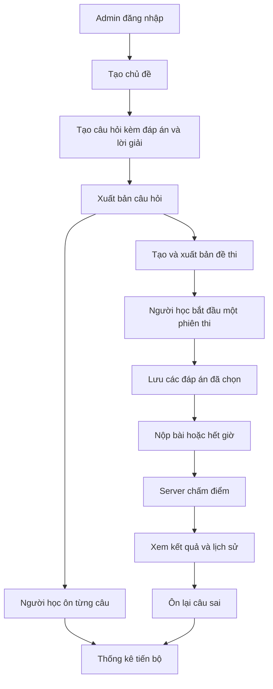
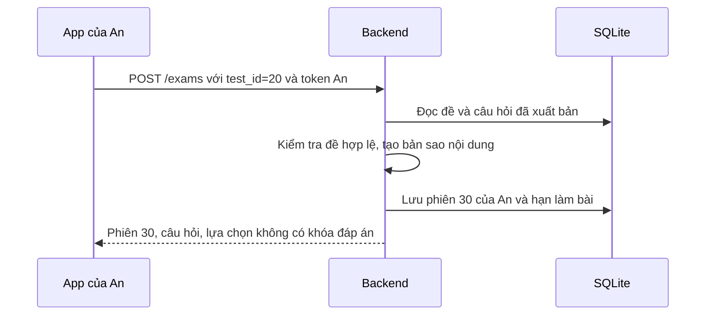
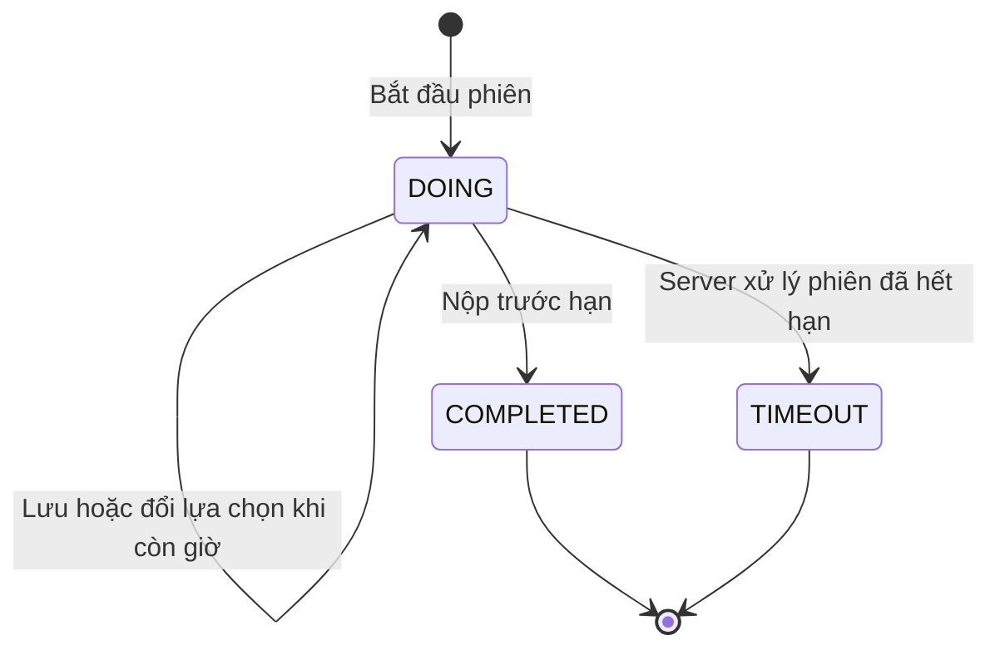

# Hiểu API ôn thi bằng lái từ đầu — hướng dẫn từng bước

Tài liệu này giải thích cách **backend hiện tại** hoạt động, theo một ví dụ từ lúc chưa có câu hỏi đến lúc người học thi xong và ôn lại câu sai.

Bạn có thể đọc rồi thao tác bằng Postman. Chưa cần xây giao diện để thử các API.

**Quy ước:** các ID, token, thời gian và nội dung câu hỏi trong tài liệu là ví dụ. Khi thao tác thật, hãy thay ID bằng giá trị server vừa trả về. Các response ghi “rút gọn” chỉ hiển thị những trường đang giải thích; server có thể trả thêm thời gian tạo/cập nhật và thông tin liên quan. Các cấu hình thi ở đây chỉ để học cách dùng API, không phải quy định thi chính thức.

## Mục lục

1. [Bức tranh tổng thể](#1-bức-tranh-tổng-thể)
2. [Những khái niệm cần phân biệt](#2-những-khái-niệm-cần-phân-biệt)
3. [Cách đọc một request API](#3-cách-đọc-một-request-api)
4. [Chạy server và chuẩn bị Postman](#4-chạy-server-và-chuẩn-bị-postman)
5. [Đăng ký, đăng nhập và lấy quyền admin](#5-đăng-ký-đăng-nhập-và-lấy-quyền-admin)
6. [Admin tạo chủ đề](#6-admin-tạo-chủ-đề)
7. [Admin tạo hai câu hỏi](#7-admin-tạo-hai-câu-hỏi)
8. [Admin tạo đề thi](#8-admin-tạo-đề-thi)
9. [Người học bắt đầu làm bài](#9-người-học-bắt-đầu-làm-bài)
10. [Lưu đáp án, đổi đáp án và bỏ chọn](#10-lưu-đáp-án-đổi-đáp-án-và-bỏ-chọn)
11. [Nộp bài và hiểu kết quả](#11-nộp-bài-và-hiểu-kết-quả)
12. [Hết giờ, mất mạng và tiếp tục bài](#12-hết-giờ-mất-mạng-và-tiếp-tục-bài)
13. [Ôn tập từng câu và ôn câu sai](#13-ôn-tập-từng-câu-và-ôn-câu-sai)
14. [Đọc thống kê tiến bộ](#14-đọc-thống-kê-tiến-bộ)
15. [Sinh đề ngẫu nhiên](#15-sinh-đề-ngẫu-nhiên)
16. [Sửa, xóa và nhập hàng loạt nội dung](#16-sửa-xóa-và-nhập-hàng-loạt-nội-dung)
17. [Dữ liệu lưu ở đâu và snapshot là gì](#17-dữ-liệu-lưu-ở-đâu-và-snapshot-là-gì)
18. [Ghép API với màn hình ứng dụng](#18-ghép-api-với-màn-hình-ứng-dụng)
19. [Lỗi thường gặp và cách xử lý](#19-lỗi-thường-gặp-và-cách-xử-lý)
20. [Bài thực hành ngắn và bản đồ mã nguồn](#20-bài-thực-hành-ngắn-và-bản-đồ-mã-nguồn)

## 1. Bức tranh tổng thể

Ứng dụng có hai công việc lớn:

- **Quản trị viên chuẩn bị nội dung:** tạo chủ đề, câu hỏi, đáp án, lời giải và đề thi.
- **Người học sử dụng nội dung:** ôn câu hỏi hoặc bắt đầu một lượt thi, trả lời, nộp bài, xem kết quả.



Nếu trình xem Markdown không hiển thị sơ đồ, hãy đọc chuỗi này:

```text
Admin: Chủ đề → Câu hỏi + đáp án → Đề thi
Người học: Chọn đề → Tạo phiên thi → Lưu lựa chọn → Nộp → Xem kết quả
```

**API là các cửa giao tiếp giữa giao diện và server.** Ví dụ, nút “Bắt đầu thi” trên giao diện sẽ gọi `POST /api/v1/exams`. Nút “Nộp bài” sẽ gọi một API khác. Chỉ tạo API chưa tạo ra các nút hoặc màn hình; frontend sẽ gọi chúng để hiện thực giao diện.

## 2. Những khái niệm cần phân biệt

| Tên trong code/API | Nghĩa | Ví dụ |
|---|---|---|
| `category` | Chủ đề phân loại câu hỏi | Chủ đề minh họa |
| `question` | Một câu hỏi trong ngân hàng | “Chọn phương án A trong ví dụ này” |
| `answer` | Một phương án có thể chọn | A hoặc B |
| `test` | Một đề thi gồm nhiều câu hỏi và cấu hình | Đề demo gồm 2 câu, làm trong 10 phút |
| `exam` / `exam_session` | Một lượt làm đề của một người | An làm đề demo lần thứ nhất |
| `user_answer` | Lựa chọn người học đã lưu trong phiên thi | Ở phiên 30, câu 101 chọn đáp án 1002 |
| `practice_attempt` | Một lần trả lời trong chế độ ôn tập | An ôn câu 101 và chọn đáp án 1001 |
| `snapshot` | Bản sao nội dung đề tại lúc bắt đầu phiên | Đề và đáp án dùng riêng cho phiên 30 |

### 2.1. Đề thi và phiên thi khác nhau như thế nào?

Giả sử có đề `test_id = 20`.

- An bắt đầu làm: server tạo `exam_id = 30`.
- An làm lại: server tạo `exam_id = 31`.
- Bình làm cùng đề: server tạo `exam_id = 32`.

Ba lượt thi dùng cùng một đề nhưng có thời gian bắt đầu, đáp án và kết quả riêng.

```text
Đề 20
├── Phiên 30: An làm lần 1
├── Phiên 31: An làm lần 2
└── Phiên 32: Bình làm lần 1
```

Vì vậy, khi lưu đáp án và nộp bài, bạn cần **ID phiên thi**, không dùng ID đề thi thay thế.

### 2.2. Các ID trong ví dụ xuyên suốt

| Giá trị minh họa | Ý nghĩa | Lấy ở đâu khi chạy thật? |
|---|---|---|
| `10` | ID chủ đề | Response tạo chủ đề: `id` |
| `101` | ID câu hỏi thứ nhất | Response tạo câu hỏi: `id` |
| `1001`, `1002` | ID hai lựa chọn của câu 101 | Response câu hỏi: `answers[].id` |
| `102` | ID câu hỏi thứ hai | Response tạo câu hỏi thứ hai: `id` |
| `1003`, `1004` | ID hai lựa chọn của câu 102 | Response câu hỏi thứ hai: `answers[].id` |
| `20` | ID đề thi | Response tạo đề: `id` |
| `30` | ID phiên thi | Response bắt đầu thi: `id` |

**Không tự nhập các số này vào database để cố làm giống tài liệu.** Nếu server trả chủ đề có ID 1 thì các request tiếp theo phải dùng `category_id: 1`.

`answer_id` là ID một bản ghi đáp án, không phải số thứ tự A=1, B=2. Phương án A có thể mang ID 1001.

## 3. Cách đọc một request API

Ví dụ:

```http
PUT http://localhost:8080/api/v1/exams/30/answers/101
Authorization: Bearer TOKEN_NGUOI_HOC
Content-Type: application/json

{
  "answer_id": 1002
}
```

Đọc request này như sau:

> Người đang đăng nhập muốn lưu lựa chọn 1002 cho câu 101 trong phiên thi 30.

| Thành phần | Vai trò |
|---|---|
| `PUT` | Lưu hoặc thay đổi lựa chọn |
| `http://localhost:8080` | Địa chỉ backend |
| `/api/v1` | Tiền tố nhóm API mới |
| `/exams/30` | Phiên thi cần thao tác |
| `/answers/101` | Câu hỏi cần lưu lựa chọn |
| Header `Authorization` | Xác định người gửi là ai |
| Header `Content-Type` | Cho server biết body là JSON |
| Body `answer_id` | Phương án được chọn |

### 3.1. Method thường gặp

| Method | Cách hiểu trong dự án |
|---|---|
| `GET` | Lấy dữ liệu để hiển thị |
| `POST` | Tạo dữ liệu hoặc thực hiện hành động như bắt đầu/nộp bài |
| `PUT` | Thay dữ liệu hoặc lưu lựa chọn |
| `DELETE` | Xóa nội dung theo quy tắc của hệ thống |

Riêng GET phiên thi/lịch sử/thống kê có thể đồng thời chấm những bài đã hết giờ. Nghĩa là các API đọc này còn giúp server cập nhật trạng thái hết hạn.

### 3.2. Path, query và body

```text
/api/v1/exams/30             → 30 là tham số đường dẫn (path)
/api/v1/tests?page=1&limit=20 → page và limit là bộ lọc (query)
{"test_id": 20}             → dữ liệu gửi trong body
```

Trong tài liệu kỹ thuật, `:id` là chỗ cần thay bằng số thật. Ví dụ `/exams/:id` trở thành `/exams/30`; không gửi nguyên ký tự `:id`.

### 3.3. Response không phải lúc nào cũng có `data`

Backend hiện có các dạng response sau:

| API | Cách lấy dữ liệu |
|---|---|
| Login | Token ở `data.access_token` |
| Tạo chủ đề/câu hỏi/đề | ID ở ngay `id` |
| Bắt đầu/xem/nộp phiên thi | ID ở ngay `id`; câu hỏi ở `exam.questions` |
| Danh sách câu hỏi/đề/lịch sử | Mảng ở `data`; đi kèm `total`, `page`, `limit` |
| Lấy chủ đề | Mảng ở `data`, không có phân trang |
| Trả lời ôn tập | Kết quả ở `attempt`, lời giải ở `question` |
| Thống kê | Các chỉ số nằm trực tiếp trong response |

Đừng mặc định mọi API đều trả `response.data.id`. Ví dụ tạo phiên trả `response.id` nếu `response` là JSON body đã giải mã.

## 4. Chạy server và chuẩn bị Postman

### 4.1. Chạy backend

Mở terminal tại thư mục gốc dự án, nơi có `go.mod`:

```sh
go run ./cmd/server
```

Backend cần `JWT_SECRET` trong `.env` hoặc biến môi trường. Nếu chưa có `.env`, dùng `.env.example` làm mẫu rồi đặt khóa bí mật của bạn. Nếu đã có `.env`, giữ các thiết lập đang dùng.

Mặc định:

```text
HTTP: http://localhost:8080
SQLite: cmd/data/gorm.db
```

Chạy từ thư mục gốc giúp đường dẫn tương đối `.env` và database trỏ đúng vị trí. Server tự migrate schema khi khởi động.

Gọi:

```http
GET http://localhost:8080/health
```

Response:

```json
{"status":"ok"}
```

Endpoint này xác nhận HTTP server hoạt động; không khẳng định ngân hàng câu hỏi đã đủ dữ liệu để thi.

### 4.2. Thao tác trong Postman

Với mỗi request:

1. Chọn method: GET, POST, PUT hoặc DELETE.
2. Nhập URL đầy đủ.
3. Nếu API cần đăng nhập, mở tab Authorization, chọn Bearer Token và dán **access token**.
4. Nếu có body, chọn Body → raw → JSON rồi dán JSON mẫu.
5. Bấm Send, đọc HTTP status và response.
6. Ghi lại ID/token cần dùng cho bước tiếp theo.

Nếu dùng tab Bearer Token, chỉ dán chuỗi token; không dán thêm chữ `Bearer` vào ô token. Nếu tự nhập header thì dùng đầy đủ `Authorization: Bearer <token>`.

Để tránh nhầm quyền, nên giữ hai token riêng: `admin_token` và `learner_token`.

`localhost` là máy đang chạy client. Nếu thử từ điện thoại thật, cần dùng địa chỉ máy chạy backend mà điện thoại có thể truy cập; `localhost` trên điện thoại không phải máy tính của bạn.

## 5. Đăng ký, đăng nhập và lấy quyền admin

### 5.1. Tạo tài khoản quản trị tương lai

```http
POST http://localhost:8080/auth/register
Content-Type: application/json

{
  "name": "Quan tri demo",
  "email": "admin.demo@example.com",
  "password": "DemoPassword123!"
}
```

Thành công: HTTP `201`. Response rút gọn:

```json
{
  "status_code": 201,
  "message": "Register success",
  "data": {
    "id": 1,
    "name": "Quan tri demo",
    "email": "admin.demo@example.com",
    "role": "learner"
  }
}
```

Lúc mới đăng ký, tài khoản vẫn là `learner`. Backend không cho tự gửi `role: "admin"` để nâng quyền.

**Dữ liệu thay đổi:** tạo tài khoản trong bảng `users`, mật khẩu được hash trước khi lưu. Register chưa cấp token để gọi API học/thi; bạn cần login.

### 5.2. Chủ server cấp quyền admin

Chạy trong terminal tại thư mục gốc, dùng cùng cấu hình database với server:

```sh
go run ./cmd/admin -email admin.demo@example.com -role admin
```

Lệnh này chỉ cấp quyền cho tài khoản đã tồn tại. Nếu chạy lệnh trên một database khác, quyền ở database server đang sử dụng sẽ không thay đổi.

### 5.3. Đăng nhập tài khoản admin

```http
POST http://localhost:8080/auth/login
Content-Type: application/json

{
  "email": "admin.demo@example.com",
  "password": "DemoPassword123!"
}
```

HTTP `200`, response minh họa:

```json
{
  "status_code": 200,
  "message": "Login success",
  "data": {
    "id": 1,
    "name": "Quan tri demo",
    "email": "admin.demo@example.com",
    "access_token": "TOKEN_ADMIN_THUC_TE",
    "refresh_token": "REFRESH_TOKEN_ADMIN_THUC_TE",
    "expires_in": 43200
  }
}
```

Lưu `data.access_token` thành token admin. `expires_in` có đơn vị giây; cấu hình hiện tại là 12 giờ.

Kiểm tra quyền:

```http
GET http://localhost:8080/auth/getProfile
Authorization: Bearer TOKEN_ADMIN_THUC_TE
```

```json
{
  "id": 1,
  "name": "Quan tri demo",
  "email": "admin.demo@example.com",
  "role": "admin"
}
```

### 5.4. Tạo một tài khoản người học

Gọi register và login tương tự, nhưng dùng email khác:

```json
{
  "name": "An",
  "email": "an.demo@example.com",
  "password": "DemoPassword123!"
}
```

Không chạy lệnh nâng quyền cho An. Lưu access token của An thành token người học.

### 5.5. Token quyết định người dùng, không gửi `user_id`

Khi An gọi API bắt đầu thi, body chỉ cần `test_id`. Server đọc token để biết đây là An và tự gắn phiên thi vào tài khoản An.

Vì vậy không cần và không nên thiết kế frontend gửi `user_id` để chọn người sở hữu phiên thi.

### 5.6. Khi access token hết hạn

```http
POST http://localhost:8080/auth/refresh
Content-Type: application/json

{
  "refresh_token": "REFRESH_TOKEN_HIEN_TAI"
}
```

Response có cặp token mới trong `data`. Phải lưu **cả access token mới và refresh token mới**. Refresh token cũ bị thu hồi sau khi đổi thành công, không dùng lại được.

Nếu refresh cũng bị từ chối, người dùng cần đăng nhập lại. Không dùng refresh token thay access token trong header của API thi.

## 6. Admin tạo chủ đề

Dùng token admin:

```http
POST http://localhost:8080/api/v1/admin/categories
Authorization: Bearer TOKEN_ADMIN
Content-Type: application/json

{
  "name": "Chủ đề demo",
  "description": "Dùng để thử luồng API"
}
```

HTTP `201`, response rút gọn:

```json
{
  "id": 10,
  "name": "Chủ đề demo",
  "description": "Dùng để thử luồng API"
}
```

**Ghi lại `id = 10` làm `category_id`.** Chủ đề giúp gom câu hỏi để ôn theo nhóm, sinh đề theo nhóm và tính tiến bộ theo nhóm.

**Dữ liệu thay đổi:** thêm một bản ghi trong bảng `categories`.

Xem lại danh sách chủ đề bằng token admin hoặc người học:

```http
GET http://localhost:8080/api/v1/categories
Authorization: Bearer TOKEN_NGUOI_HOC
```

Response rút gọn:

```json
{
  "data": [
    {"id": 10, "name": "Chủ đề demo", "description": "Dùng để thử luồng API"}
  ]
}
```

## 7. Admin tạo hai câu hỏi

Ta sẽ tạo:

- Câu 101 là câu điểm liệt, đáp án A đúng.
- Câu 102 là câu thường, đáp án A đúng.

Nội dung dưới đây chỉ là dữ liệu thử luồng, không phải câu hỏi giao thông thật.

### 7.1. Tạo câu hỏi thứ nhất

```http
POST http://localhost:8080/api/v1/admin/questions
Authorization: Bearer TOKEN_ADMIN
Content-Type: application/json

{
  "title": "Câu demo 1",
  "content": "Trong ví dụ này, hãy chọn phương án A.",
  "image": "",
  "explanation": "Đáp án A được quy ước là đáp án đúng cho ví dụ 1.",
  "license_type": "A1",
  "category_id": 10,
  "is_critical": true,
  "published": true,
  "answers": [
    {"content": "Phương án A", "label": "A", "order": 1, "is_correct": true},
    {"content": "Phương án B", "label": "B", "order": 2, "is_correct": false}
  ]
}
```

HTTP `201`, response rút gọn:

```json
{
  "id": 101,
  "title": "Câu demo 1",
  "content": "Trong ví dụ này, hãy chọn phương án A.",
  "explanation": "Đáp án A được quy ước là đáp án đúng cho ví dụ 1.",
  "license_type": "A1",
  "category_id": 10,
  "is_critical": true,
  "published": true,
  "answers": [
    {"id": 1001, "question_id": 101, "content": "Phương án A", "label": "A", "order": 1, "is_correct": true},
    {"id": 1002, "question_id": 101, "content": "Phương án B", "label": "B", "order": 2, "is_correct": false}
  ]
}
```

Một request tạo luôn câu hỏi và các phương án. Không cần gọi API tạo đáp án riêng sau đó.

**Dữ liệu thay đổi:** thêm một dòng `questions` và hai dòng `answers`. Server tự cấp ID và thứ tự câu hỏi trong chủ đề (`position`).

### 7.2. Ý nghĩa các trường

| Trường | Giải thích |
|---|---|
| `title` | Tiêu đề ngắn của câu hỏi |
| `content` | Nội dung để người học đọc |
| `image` | Đường dẫn ảnh do admin cung cấp; API này không upload file ảnh |
| `explanation` | Lời giải để xem sau khi trả lời/nộp bài |
| `license_type` | Hạng bằng mà câu hỏi thuộc về, ví dụ `A1` |
| `category_id` | Chủ đề đã tạo trước đó |
| `is_critical` | Câu có được đánh dấu là câu điểm liệt hay không |
| `published` | `true`: dùng được trong ôn tập/đề; `false`: bản nháp |
| `answers[].label` | Nhãn hiển thị như A, B |
| `answers[].order` | Thứ tự hiển thị phương án, bắt đầu từ 1 |
| `answers[].is_correct` | Admin xác định phương án đúng |

Quy tắc hiện tại: ít nhất hai phương án, đúng một phương án đúng; không trùng nhãn, thứ tự hoặc nội dung giữa các phương án. Chủ đề phải tồn tại. Câu đã xuất bản phải có lời giải.

Nếu bạn bỏ `published`, giá trị là `false`; câu sẽ chưa xuất hiện ở API ôn tập của người học.

### 7.3. Tạo câu thứ hai

Gọi cùng API, body:

```json
{
  "title": "Câu demo 2",
  "content": "Trong ví dụ thứ hai, cũng hãy chọn phương án A.",
  "image": "",
  "explanation": "Đáp án A được quy ước là đáp án đúng cho ví dụ 2.",
  "license_type": "A1",
  "category_id": 10,
  "is_critical": false,
  "published": true,
  "answers": [
    {"content": "Phương án A", "label": "A", "order": 1, "is_correct": true},
    {"content": "Phương án B", "label": "B", "order": 2, "is_correct": false}
  ]
}
```

Giả sử server trả câu `102`, với đáp án A là `1003`, B là `1004`.

### 7.4. Kiểm tra ngân hàng câu hỏi

```http
GET http://localhost:8080/api/v1/admin/questions?license_type=A1&category_id=10&page=1&limit=20
Authorization: Bearer TOKEN_ADMIN
```

Response có mảng `data`, tổng số câu phù hợp `total`, `page` và `limit`.

Xem riêng một câu để sửa:

```http
GET http://localhost:8080/api/v1/admin/questions/101
Authorization: Bearer TOKEN_ADMIN
```

API quản trị trả khóa đáp án. API dành cho người học có response khác, được giải thích ở phần ôn tập.

## 8. Admin tạo đề thi

Đến đây đã có câu hỏi, nhưng chưa có đề thi. Tạo đề là chọn những câu nào sẽ nằm trong đề và đặt các quy tắc chấm bài.

```http
POST http://localhost:8080/api/v1/admin/tests
Authorization: Bearer TOKEN_ADMIN
Content-Type: application/json

{
  "name": "Đề demo hai câu",
  "description": "Đề dùng để hiểu luồng API",
  "license_type": "A1",
  "version": "demo-v1",
  "duration_minutes": 10,
  "passing_score": 1,
  "critical_fail": true,
  "published": true,
  "question_ids": [101, 102]
}
```

HTTP `201`, response rút gọn:

```json
{
  "id": 20,
  "name": "Đề demo hai câu",
  "license_type": "A1",
  "version": "demo-v1",
  "duration_minutes": 10,
  "total_questions": 2,
  "passing_score": 1,
  "critical_fail": true,
  "published": true
}
```

Ghi lại `id = 20` làm `test_id`.

### 8.1. Giải thích cấu hình

| Trường | Ý nghĩa trong ví dụ |
|---|---|
| `question_ids` | Đưa câu 101 rồi câu 102 vào đề |
| `duration_minutes` | Thời gian làm bài là 10 phút |
| `passing_score` | Cần ít nhất 1 câu đúng |
| `critical_fail` | Dù đủ điểm, sai/bỏ trống câu điểm liệt vẫn trượt |
| `published` | Người học thấy đề và có thể bắt đầu làm |
| `version` | Nhãn phiên bản do admin nhập, giúp nhận diện cấu hình/nội dung |

`version` không tự chọn bộ quy định pháp luật và không tự cập nhật câu hỏi. Nó là thông tin nhận diện mà admin quản lý.

Đề hiện hỗ trợ 1–200 câu, thời gian 1–180 phút. Điểm đạt từ 1 đến số câu. Mỗi câu đúng tính 1 điểm. Các câu phải đã xuất bản và cùng hạng bằng với đề.

### 8.2. Server lưu gì?

```text
Bảng tests:
  Đề 20, 10 phút, điểm đạt 1, bật quy tắc điểm liệt

Bảng test_questions:
  Đề 20 → câu 101 → thứ tự 1
  Đề 20 → câu 102 → thứ tự 2
```

Tạo đề chưa tạo lượt làm bài của người học. Chỉ khi người học bấm “Bắt đầu”, một phiên thi mới được tạo.

## 9. Người học bắt đầu làm bài

Từ phần này, dùng **token của An**, không dùng token admin để giả lập An. Phiên thi thuộc về người có token gửi request.

### 9.1. Lấy danh sách đề

```http
GET http://localhost:8080/api/v1/tests?license_type=A1&page=1&limit=20
Authorization: Bearer TOKEN_NGUOI_HOC
```

Response rút gọn:

```json
{
  "data": [
    {
      "id": 20,
      "name": "Đề demo hai câu",
      "duration_minutes": 10,
      "total_questions": 2,
      "passing_score": 1,
      "critical_fail": true,
      "license_type": "A1",
      "version": "demo-v1",
      "published": true
    }
  ],
  "total": 1,
  "page": 1,
  "limit": 20
}
```

Giao diện có thể hiển thị tên đề, số câu, thời gian và nút bắt đầu. API danh sách này không trả sẵn toàn bộ câu hỏi để làm bài.

### 9.2. Bắt đầu một phiên

```http
POST http://localhost:8080/api/v1/exams
Authorization: Bearer TOKEN_NGUOI_HOC
Content-Type: application/json

{
  "test_id": 20
}
```

HTTP `201`. Response minh họa đầy đủ cho đề hai câu:

```json
{
  "id": 30,
  "test_id": 20,
  "status": "DOING",
  "started_at": "2026-10-24T09:00:00+07:00",
  "expires_at": "2026-10-24T09:10:00+07:00",
  "server_time": "2026-10-24T09:00:00+07:00",
  "correct_answers": 0,
  "total_questions": 2,
  "score": 0,
  "passing_score": 1,
  "is_passed": false,
  "exam": {
    "name": "Đề demo hai câu",
    "license_type": "A1",
    "version": "demo-v1",
    "questions": [
      {
        "id": 101,
        "title": "Câu demo 1",
        "content": "Trong ví dụ này, hãy chọn phương án A.",
        "image": "",
        "category_id": 10,
        "is_critical": true,
        "answers": [
          {"id": 1001, "content": "Phương án A", "label": "A", "order": 1},
          {"id": 1002, "content": "Phương án B", "label": "B", "order": 2}
        ]
      },
      {
        "id": 102,
        "title": "Câu demo 2",
        "content": "Trong ví dụ thứ hai, cũng hãy chọn phương án A.",
        "image": "",
        "category_id": 10,
        "is_critical": false,
        "answers": [
          {"id": 1003, "content": "Phương án A", "label": "A", "order": 1},
          {"id": 1004, "content": "Phương án B", "label": "B", "order": 2}
        ]
      }
    ]
  }
}
```

Cần lưu lại:

- `id = 30`: ID phiên, dùng để tiếp tục/lưu/nộp bài.
- `expires_at`: hạn làm bài.
- `exam.questions`: các câu và phương án cần hiển thị.

`score: 0`, `is_passed: false` khi trạng thái là `DOING` có nghĩa **chưa chấm**, chưa phải kết luận trượt.

Khi đang làm, response không có khóa `is_correct` trong câu/đáp án và không có lời giải. Frontend không biết đáp án đúng từ API phiên thi này.

### 9.3. Bên trong server diễn ra gì?



Server lưu snapshot có khóa đáp án để chấm sau này, nhưng không gửi khóa đó về app lúc đang làm.

## 10. Lưu đáp án, đổi đáp án và bỏ chọn

### 10.1. An chọn B cho câu 101

Ta cố ý chọn sai câu điểm liệt để thấy cách chấm.

```http
PUT http://localhost:8080/api/v1/exams/30/answers/101
Authorization: Bearer TOKEN_NGUOI_HOC
Content-Type: application/json

{
  "answer_id": 1002
}
```

HTTP `200`. API trả lại **toàn bộ phiên thi**, với câu 101 có thêm lựa chọn đã lưu. Trích phần câu hỏi:

```json
{
  "id": 101,
  "selected_answer_id": 1002
}
```

Trên giao diện, có thể tô phương án B là đã chọn. Server chưa trả đúng/sai ở bước này.

**Dữ liệu thay đổi:** thêm/cập nhật bản ghi trong `user_answers` cho cặp `(phiên 30, câu 101)`.

### 10.2. An chọn A cho câu 102

```http
PUT http://localhost:8080/api/v1/exams/30/answers/102
Authorization: Bearer TOKEN_NGUOI_HOC
Content-Type: application/json

{
  "answer_id": 1003
}
```

Đây là request lưu câu thứ hai, không thay lựa chọn của câu thứ nhất.

### 10.3. Đổi lựa chọn

Nếu muốn đổi câu 101 sang A, gọi lại cùng URL với:

```json
{"answer_id": 1001}
```

Server cập nhật lựa chọn hiện có của câu 101, không tạo thêm một câu trả lời thứ hai cho cùng câu trong cùng phiên.

**Để đi tiếp đúng kịch bản trượt ở phần 11, hãy giữ câu 101 chọn B (`1002`).** Các thao tác đổi/bỏ chọn dưới đây chỉ giải thích khả năng của API.

### 10.4. Bỏ chọn

Gửi:

```json
{"answer_id": 0}
```

Điều này xóa lựa chọn đã lưu cho câu tương ứng. Nếu sau đó nộp bài, câu được tính là bỏ trống.

`0` khác với không gửi trường `answer_id`: thiếu trường là request không hợp lệ. Quy tắc `0` này chỉ áp dụng API lưu đáp án **phiên thi**, không áp dụng API trả lời ôn tập.

### 10.5. Những điều server kiểm tra

- Phiên 30 có thuộc người gửi token không?
- Phiên còn đang làm và còn thời gian không?
- Câu 101 có trong snapshot của phiên 30 không?
- Đáp án 1002 có thuộc câu 101 trong snapshot không?

Ví dụ gửi `answer_id: 1003` cho câu 101 sẽ bị từ chối, vì 1003 thuộc câu 102.

**Frontend phải chờ lưu thành công trước khi báo “đã lưu”.** Nếu chỉ tô lựa chọn trên màn hình mà chưa gửi API, server chưa có lựa chọn đó.

## 11. Nộp bài và hiểu kết quả

### 11.1. Gọi API nộp

Với kịch bản câu 101 chọn B, câu 102 chọn A:

```http
POST http://localhost:8080/api/v1/exams/30/submit
Authorization: Bearer TOKEN_NGUOI_HOC
```

Không cần body. Không gửi `score`, `is_passed`, `is_correct` từ frontend để nhờ server lưu. Server tự tính.

HTTP `200`. Response rút gọn:

```json
{
  "id": 30,
  "test_id": 20,
  "status": "COMPLETED",
  "finished_at": "2026-10-24T09:03:00+07:00",
  "correct_answers": 1,
  "total_questions": 2,
  "score": 1,
  "passing_score": 1,
  "is_passed": false,
  "failure_reason": "critical_question",
  "exam": {
    "name": "Đề demo hai câu",
    "license_type": "A1",
    "version": "demo-v1",
    "questions": [
      {
        "id": 101,
        "selected_answer_id": 1002,
        "is_correct": false,
        "explanation": "Đáp án A được quy ước là đáp án đúng cho ví dụ 1.",
        "answers": [
          {"id": 1001, "content": "Phương án A", "label": "A", "order": 1, "is_correct": true},
          {"id": 1002, "content": "Phương án B", "label": "B", "order": 2, "is_correct": false}
        ]
      },
      {
        "id": 102,
        "selected_answer_id": 1003,
        "is_correct": true,
        "explanation": "Đáp án A được quy ước là đáp án đúng cho ví dụ 2.",
        "answers": [
          {"id": 1003, "content": "Phương án A", "label": "A", "order": 1, "is_correct": true},
          {"id": 1004, "content": "Phương án B", "label": "B", "order": 2, "is_correct": false}
        ]
      }
    ]
  }
}
```

### 11.2. Vì sao đủ điểm nhưng vẫn trượt?

Cấu hình đề có:

```text
passing_score = 1
critical_fail = true
```

An đúng 1 câu nên đủ ngưỡng điểm. Nhưng An sai câu 101, là câu điểm liệt. Vì thế:

```text
score = 1
is_passed = false
failure_reason = critical_question
```

Điều kiện đạt trong code:

```text
Đạt = đủ điểm VÀ không vi phạm quy tắc điểm liệt của đề.
```

| Câu 101 — điểm liệt | Câu 102 — thường | Điểm | Kết quả với cấu hình ví dụ |
|---|---|---|---|
| Đúng | Đúng | 2 | Đạt |
| Đúng | Sai/bỏ trống | 1 | Đạt |
| Sai | Đúng | 1 | Trượt vì câu điểm liệt |
| Bỏ trống | Đúng | 1 | Trượt vì câu điểm liệt |
| Sai/bỏ trống | Sai/bỏ trống | 0 | Trượt; lý do điểm liệt được ưu tiên |

Nếu `critical_fail=false`, câu điểm liệt không làm trượt riêng; server xét ngưỡng điểm. Nếu thiếu điểm và không vi phạm quy tắc điểm liệt đang bật, lý do là `insufficient_score`.

### 11.3. Hai nghĩa của `is_correct`

Trong response sau khi chấm:

- `exam.questions[i].is_correct`: **người học làm câu này đúng hay sai**.
- `exam.questions[i].answers[j].is_correct`: **phương án này có phải đáp án đúng hay không**.

Câu 101 có `is_correct=false`, nhưng phương án A trong câu vẫn có `is_correct=true`. Hai trường nói về hai đối tượng khác nhau.

### 11.4. Nộp hai lần hoặc sửa sau khi nộp

- Gọi submit lần nữa: trả kết quả đã có, không chấm thành một lượt mới. `server_time` có thể khác vì là thời điểm request mới.
- Gọi lưu đáp án sau khi nộp: HTTP `409` vì bài đã đóng.
- Muốn thi lại: gọi `POST /api/v1/exams` với `test_id: 20` để tạo phiên khác.

Chờ mọi request lưu đáp án hoàn tất rồi mới submit. API submit chỉ chấm các lựa chọn **server đã lưu**, không biết những lựa chọn còn nằm ở giao diện hoặc hàng đợi mạng.

## 12. Hết giờ, mất mạng và tiếp tục bài

### 12.1. Trạng thái phiên thi



| Trạng thái | Ý nghĩa |
|---|---|
| `DOING` | Đang làm, chưa chấm |
| `COMPLETED` | Đã nộp trước hạn và được chấm |
| `TIMEOUT` | Hết hạn, chấm các lựa chọn đã lưu |

`TIMEOUT` không mặc định là trượt. Nếu các lựa chọn đã lưu đủ điểm và không phạm quy tắc điểm liệt, kết quả vẫn có thể đạt.

### 12.2. Đồng hồ do ai quyết định?

Server tính:

```text
expires_at = started_at + duration_minutes
```

Ví dụ bắt đầu 09:00, thời lượng 10 phút thì hạn là 09:10. Đúng lúc 09:10 đã được xem là hết hạn.

Frontend có thể hiển thị đếm ngược dựa trên `expires_at` và `server_time`. Hãy parse thời gian theo múi giờ có trong chuỗi; đừng giả định mọi giá trị đều là giờ địa phương của điện thoại.

Chỉnh giờ điện thoại hoặc gửi thêm thời lượng từ frontend không thay đổi hạn đã lưu trên server.

### 12.3. Không mở app thì server có tự chấm ngay giây hết hạn không?

Hiện chưa có background worker chạy liên tục để cập nhật mọi phiên đúng giây hết hạn.

Khi có request xem phiên, lưu đáp án, nộp bài, đọc lịch sử, tiến bộ hoặc danh sách câu sai, backend có xử lý hết hạn theo luồng tương ứng. Lúc đó bài quá hạn được chấm và chuyển sang `TIMEOUT`.

Điều quan trọng: dù DB chưa được cập nhật trạng thái ngay khi app đóng, server vẫn không cho lưu thêm đáp án sau hạn. `finished_at` của bài timeout được tính tại hạn kết thúc, không phải lúc người dùng mở app lại.

### 12.4. Mở lại app để tiếp tục bài

Nếu frontend còn lưu `exam_id=30`, gọi:

```http
GET http://localhost:8080/api/v1/exams/30
Authorization: Bearer TOKEN_NGUOI_HOC
```

Response có câu hỏi và `selected_answer_id` đã lưu. Nếu còn `DOING`, phục hồi màn hình thi. Nếu `COMPLETED` hoặc `TIMEOUT`, hiển thị kết quả.

Nếu không còn nhớ ID, gọi lịch sử:

```http
GET http://localhost:8080/api/v1/exams?page=1&limit=20
Authorization: Bearer TOKEN_NGUOI_HOC
```

Response rút gọn:

```json
{
  "data": [
    {
      "id": 30,
      "test_id": 20,
      "status": "COMPLETED",
      "score": 1,
      "passing_score": 1,
      "is_passed": false,
      "failure_reason": "critical_question"
    }
  ],
  "total": 1,
  "page": 1,
  "limit": 20
}
```

Lịch sử chỉ chứa các phiên của người gửi token, mới nhất trước. Không có bộ lọc `status` riêng ở API này; frontend có thể xem trường trạng thái của các bản ghi trả về.

**Đừng gọi POST bắt đầu chỉ để mở lại một bài đang làm.** Mỗi POST bắt đầu tạo phiên mới và thời gian mới, không tự tìm lại phiên cũ.

### 12.5. Khi mất mạng

| Tình huống | Cách xử lý ở app |
|---|---|
| Chọn đáp án nhưng request thất bại | Hiển thị chưa lưu, thử gửi lại khi còn hạn |
| Không biết request lưu có thành công không | GET phiên để đối chiếu lựa chọn server đã có |
| Mất response của submit | GET phiên hoặc submit lại để lấy kết quả |
| Mở lại sau khi hết hạn | GET phiên để nhận kết quả timeout |
| Mất response của request bắt đầu | Kiểm tra lịch sử trước khi tạo phiên mới |

App cần tự quản lý trạng thái lưu và mạng; API hiện chưa cung cấp chế độ thi offline rồi đồng bộ sau hạn.

## 13. Ôn tập từng câu và ôn câu sai

### 13.1. Ôn tập khác làm bài thi

| Ôn tập | Thi thử |
|---|---|
| Chọn câu để học | Chọn một đề để làm |
| Không cần `exam_id` | Phải tạo phiên thi |
| Trả lời xong xem lời giải ngay | Chờ nộp/hết giờ để xem lời giải |
| Mỗi POST ghi một lượt luyện | Mỗi câu có một lựa chọn hiện tại trong phiên |
| Không có đồng hồ phiên thi | Có hạn thời gian phía server |

### 13.2. Lấy câu hỏi để ôn

```http
GET http://localhost:8080/api/v1/practice/questions?license_type=A1&category_id=10&page=1&limit=20
Authorization: Bearer TOKEN_NGUOI_HOC
```

Response rút gọn:

```json
{
  "data": [
    {
      "id": 101,
      "title": "Câu demo 1",
      "content": "Trong ví dụ này, hãy chọn phương án A.",
      "category_id": 10,
      "is_critical": true,
      "answers": [
        {"id": 1001, "content": "Phương án A", "label": "A", "order": 1},
        {"id": 1002, "content": "Phương án B", "label": "B", "order": 2}
      ]
    }
  ],
  "total": 2,
  "page": 1,
  "limit": 20
}
```

Ví dụ này rút gọn mảng để chỉ hiển thị câu 101; với hai câu phù hợp, response thực còn có câu 102.

Chỉ câu đã xuất bản được trả về. Danh sách chưa có khóa đáp án/lời giải.

Bộ lọc có thể dùng:

| Query | Ví dụ | Tác dụng |
|---|---|---|
| `license_type` | `A1` | Chọn hạng bằng |
| `category_id` | `10` | Chọn chủ đề |
| `is_critical` | `true` | Chỉ câu điểm liệt |
| `search` | `demo` | Tìm trong tiêu đề/nội dung |
| `page` | `1` | Trang cần lấy |
| `limit` | `20` | Số phần tử tối đa mỗi trang |

Mặc định trang 1, giới hạn 20; server giới hạn tối đa 100 phần tử/trang. `total` là tổng số câu phù hợp bộ lọc, không phải số câu chỉ trong trang hiện tại.

### 13.3. Trả lời một câu ôn tập

```http
POST http://localhost:8080/api/v1/practice/questions/101/answer
Authorization: Bearer TOKEN_NGUOI_HOC
Content-Type: application/json

{
  "answer_id": 1001
}
```

HTTP `200`, response rút gọn:

```json
{
  "attempt": {
    "id": 50,
    "question_id": 101,
    "category_id": 10,
    "license_type": "A1",
    "answer_id": 1001,
    "is_correct": true,
    "created_at": "2026-10-24T09:05:00+07:00"
  },
  "question": {
    "id": 101,
    "explanation": "Đáp án A được quy ước là đáp án đúng cho ví dụ 1.",
    "answers": [
      {"id": 1001, "content": "Phương án A", "is_correct": true},
      {"id": 1002, "content": "Phương án B", "is_correct": false}
    ]
  }
}
```

Frontend dùng `attempt.is_correct` để hiện đúng/sai và `question.explanation` để hiện lời giải.

**Dữ liệu thay đổi:** thêm một dòng `practice_attempts`. Không tạo `exam_session`, không cập nhật lại điểm phiên 30.

Mỗi POST ôn tập được tính là một lượt luyện mới. Không tự động gửi lại nhiều lần chỉ để đọc lại response, vì sẽ tạo thêm lượt và ảnh hưởng thống kê.

### 13.4. Lấy danh sách câu sai

Ngay sau bài thi ở phần 11, An sai câu 101. Trước khi ôn đúng lại câu đó, gọi:

```http
GET http://localhost:8080/api/v1/practice/wrong-questions?license_type=A1
Authorization: Bearer TOKEN_NGUOI_HOC
```

Danh sách sẽ chứa câu 101 nếu câu vẫn còn xuất bản.

Sau khi An ôn câu 101 và trả lời đúng như phần 13.3, gọi lại danh sách câu sai: câu 101 được loại khỏi danh sách, vì lần làm gần nhất đã đúng.

```text
Thi sai câu 101 → Câu 101 nằm trong danh sách cần ôn
Ôn đúng câu 101 → Câu 101 được bỏ khỏi danh sách cần ôn
Sau đó làm sai lại → Câu 101 trở lại danh sách cần ôn
```

Các câu bỏ trống trong bài thi đã hoàn tất cũng được tính là cần ôn. Câu đã xóa/gỡ xuất bản không được trả về để học lại, dù ID có thể vẫn xuất hiện trong thông tin lịch sử.

Backend chưa có một loại “phiên ôn sai” riêng. Frontend thực hiện bằng cách lấy danh sách câu sai rồi gọi API trả lời ôn tập cho từng câu.

## 14. Đọc thống kê tiến bộ

```http
GET http://localhost:8080/api/v1/progress?license_type=A1
Authorization: Bearer TOKEN_NGUOI_HOC
```

Theo đúng kịch bản: bài thi có 1 câu đúng/2 câu và bị trượt; sau đó An ôn lại câu sai và trả lời đúng, response minh họa:

```json
{
  "completed_exams": 1,
  "passed_exams": 0,
  "pass_rate": 0,
  "categories": [
    {
      "category_id": 10,
      "attempts": 3,
      "correct": 2,
      "accuracy": 66.66666666666667
    }
  ],
  "recent_exams": [
    {
      "id": 30,
      "finished_at": "2026-10-24T09:03:00+07:00",
      "score": 1,
      "total": 2,
      "passed": false
    }
  ],
  "suggested_category_id": 10,
  "wrong_question_ids": []
}
```

### 14.1. Vì sao có 3 lượt trả lời?

```text
Trong bài thi:
  Câu 101: sai   → 1 lượt
  Câu 102: đúng  → 1 lượt

Trong ôn tập:
  Câu 101: đúng  → 1 lượt

Tổng: 3 lượt, đúng 2 lượt → accuracy = 2 / 3 × 100
```

Điểm bài thi cũ không đổi sau khi ôn đúng. Vì thế `passed_exams` vẫn bằng 0, nhưng danh sách câu cần ôn có thể đã rỗng.

### 14.2. Ý nghĩa chỉ số

| Trường | Ý nghĩa |
|---|---|
| `completed_exams` | Số bài đã chấm, gồm `COMPLETED` và `TIMEOUT` |
| `passed_exams` | Số bài có kết quả đạt |
| `pass_rate` | `passed_exams / completed_exams × 100`; không có bài thì bằng 0 |
| `categories[].attempts` | Tổng số lượt câu hỏi được tính từ thi và ôn |
| `categories[].correct` | Số lượt trả lời đúng |
| `categories[].accuracy` | Phần trăm lượt đúng |
| `recent_exams` | Tối đa 20 bài đã chấm gần nhất, mới nhất trước |
| `suggested_category_id` | Chủ đề có độ chính xác thấp nhất nếu chưa đạt 100% |
| `wrong_question_ids` | Câu có lần làm gần nhất sai/bỏ trống |

Đây là độ chính xác theo **lượt làm**, không phải tỷ lệ số câu đã thuộc. Làm lại một câu nhiều lần sẽ tạo nhiều lượt trong thống kê.

Nếu chưa học/thi, các danh sách có thể rỗng và chỉ số bằng 0. `suggested_category_id` có thể không xuất hiện; frontend cần xử lý trường hợp đó. Lấy tên chủ đề bằng cách đối chiếu ID với `/api/v1/categories`.

## 15. Sinh đề ngẫu nhiên

Đề cố định dùng `question_ids` do admin chọn. Đề ngẫu nhiên cho admin chỉ định **số lượng câu theo chủ đề**, backend chọn câu phù hợp rồi lưu thành đề.

Với đúng hai câu đã tạo ở trên:

```http
POST http://localhost:8080/api/v1/admin/tests/generate
Authorization: Bearer TOKEN_ADMIN
Content-Type: application/json

{
  "name": "Đề demo ngẫu nhiên",
  "description": "Chọn từ ngân hàng demo",
  "license_type": "A1",
  "version": "demo-v1",
  "duration_minutes": 10,
  "passing_score": 1,
  "critical_fail": true,
  "published": true,
  "quotas": [
    {"category_id": 10, "count": 2, "critical_count": 1}
  ]
}
```

Đọc quota này là:

> Lấy tổng cộng 2 câu thuộc chủ đề 10, trong đó chính xác 1 câu điểm liệt và 1 câu thường.

`critical_count` nằm **trong** `count`, không phải cộng thêm vào count.

HTTP `201`, response có ID đề mới, ví dụ `21`. Sau đó người học bắt đầu bằng `POST /api/v1/exams` với `test_id: 21`, giống đề cố định.

Nếu ngân hàng chỉ có hai câu phù hợp, đề sinh ra vẫn chỉ gồm hai câu đó; thứ tự có thể thay đổi. Muốn nội dung đa dạng phải có nhiều câu phù hợp để chọn.

Mỗi lần gọi generate tạo một đề mới. Khi nhiều người bắt đầu cùng đề đã sinh, backend không tự sinh lại bộ câu hỏi cho từng người. Đề đã sinh có danh sách câu cố định cho đến khi admin sửa.

Một chủ đề không được lặp lại trong quotas. Nếu thiếu số câu thường hoặc số câu điểm liệt yêu cầu, server báo lỗi và không tạo đề thiếu. `question_ids` nếu gửi kèm sẽ được thay bằng các ID được sinh.

## 16. Sửa, xóa và nhập hàng loạt nội dung

### 16.1. Sửa câu hỏi hoặc xuất bản bản nháp

```http
PUT http://localhost:8080/api/v1/admin/questions/101
Authorization: Bearer TOKEN_ADMIN
Content-Type: application/json
```

Body dùng **đầy đủ cấu trúc tạo câu hỏi** ở phần 7. Thay những trường cần sửa rồi gửi toàn bộ, bao gồm tập đáp án.

Không chỉ gửi:

```json
{"published": true}
```

vì endpoint này không phải cập nhật riêng một trường; nó cần cả tiêu đề, nội dung, hạng bằng, chủ đề và đáp án hợp lệ.

Khi sửa thành công, tập đáp án được thay thế và ID đáp án có thể đổi. Frontend quản trị và ôn tập phải dùng dữ liệu trả về/tải lại. Phiên thi đã bắt đầu vẫn dùng ID và nội dung của snapshot riêng.

Muốn chuyển đáp án đúng từ A sang B, thay `is_correct` của cả hai trong cùng request PUT câu hỏi. Cách này giữ điều kiện luôn có đúng một đáp án đúng sau khi cập nhật.

### 16.2. Sửa đề

```http
PUT http://localhost:8080/api/v1/admin/tests/20
Authorization: Bearer TOKEN_ADMIN
Content-Type: application/json
```

Gửi đầy đủ body như tạo đề ở phần 8, với cấu hình/danh sách câu mới. Thay đổi chỉ ảnh hưởng các phiên bắt đầu sau đó, không thay snapshot phiên đã có.

### 16.3. Xóa nội dung

| Request | Điều kiện/ảnh hưởng |
|---|---|
| `DELETE /api/v1/admin/tests/20` | Gỡ đề khỏi danh sách dùng tiếp; phiên đã bắt đầu vẫn có snapshot |
| `DELETE /api/v1/admin/questions/101` | Bị từ chối nếu câu vẫn thuộc một đề chưa xóa |
| `DELETE /api/v1/admin/categories/10` | Bị từ chối nếu chủ đề còn câu hỏi chưa xóa |

Thành công trả HTTP `204`, không có JSON body. Frontend không nên cố parse body rỗng như JSON.

Nếu cần xóa cả một bộ nội dung demo, thứ tự thường là đề → câu hỏi → chủ đề. Một câu có thể nằm trong nhiều đề, nên cần kiểm tra tất cả liên kết còn sử dụng.

### 16.4. Import nhiều câu hỏi

```http
POST http://localhost:8080/api/v1/admin/questions/import
Authorization: Bearer TOKEN_ADMIN
Content-Type: application/json

{
  "questions": [
    {
      "title": "Câu import demo",
      "content": "Chọn A trong dữ liệu minh họa này.",
      "image": "",
      "explanation": "A là đáp án được chọn cho ví dụ.",
      "license_type": "A1",
      "category_id": 10,
      "is_critical": false,
      "published": true,
      "answers": [
        {"content": "A demo", "label": "A", "order": 1, "is_correct": true},
        {"content": "B demo", "label": "B", "order": 2, "is_correct": false}
      ]
    }
  ]
}
```

Để nhập nhiều câu, thêm các object cùng cấu trúc vào mảng `questions`.

- Tối đa 500 câu/lần; request body tối đa 5 MiB ở API JSON mới.
- Import hiện nhận JSON, không nhận trực tiếp file Excel/CSV.
- Thành công trả HTTP `201`, có `data` chứa câu đã tạo và `imported` là số lượng.
- Các thao tác ghi nằm trong một transaction: nếu một câu bị lỗi thì toàn lô không được lưu dở dang.
- Lỗi nghiệp vụ trong vòng import có thể chỉ rõ dòng, ví dụ `row 2`; lỗi cấu trúc JSON/validator có thể trả thông tin theo tên trường.
- Nhập lại cùng dữ liệu sẽ tạo các câu mới, không tự nhận biết đó là bản cập nhật của lần nhập trước.

Ví dụ lỗi ở dòng thứ hai có thể là hai phương án cùng đúng. Backend hủy phần ghi của cả lô; sửa dữ liệu rồi gửi lại.

## 17. Dữ liệu lưu ở đâu và snapshot là gì

### 17.1. Bảng dữ liệu và hành động tương ứng

| Bảng | Dữ liệu chính | Khi nào được ghi? |
|---|---|---|
| `users` | Tài khoản, mật khẩu hash, quyền | Đăng ký/cấp quyền |
| `refresh_tokens` | Hash refresh token và hạn sử dụng | Login/refresh |
| `categories` | Chủ đề | Admin quản lý chủ đề |
| `questions` | Nội dung câu hỏi, lời giải, trạng thái xuất bản | Admin tạo/sửa/import |
| `answers` | Các lựa chọn và đáp án đúng | Cùng câu hỏi hoặc qua API quản trị đáp án |
| `tests` | Cấu hình đề | Admin tạo/sửa/sinh đề |
| `test_questions` | Liên kết và thứ tự câu hỏi trong đề | Lưu cấu trúc đề |
| `exam_sessions` | Người làm, đề, snapshot, hạn, trạng thái và kết quả | Bắt đầu/chấm phiên |
| `user_answers` | Đáp án người học chọn trong từng phiên | Lưu/bỏ chọn/chấm bài |
| `practice_attempts` | Mỗi lượt luyện tập | POST trả lời ôn tập |

### 17.2. Ví dụ snapshot

```text
09:00: An bắt đầu phiên 30.
       Câu 101 có nội dung cũ; A đúng.
       Backend lưu bản sao nội dung và khóa đáp án vào phiên 30.

09:02: Admin sửa câu 101 trong ngân hàng.
       Nội dung mới; B đúng; các ID đáp án có thể được tạo lại.

09:03: An nộp phiên 30.
       Backend chấm theo bản sao lúc 09:00.
       A vẫn là đáp án đúng đối với phiên 30.

09:05: Bình bắt đầu phiên mới từ đề đã cập nhật.
       Phiên mới lấy nội dung hiện tại và khóa đáp án hiện tại.
```

Snapshot làm cho bài đang thi và lịch sử có ý nghĩa ổn định. Nếu luôn chấm trực tiếp từ ngân hàng đang thay đổi, admin có thể vô tình làm thay đổi kết quả của người đang làm bài.

Frontend đang thi cần dùng câu hỏi/đáp án từ response phiên thi. Không thay chúng bằng dữ liệu vừa tải từ API ôn tập, vì hai nguồn có thể đang ở hai phiên bản khác nhau.

### 17.3. Vì sao có transaction?

Ví dụ tạo câu hỏi phải tạo cả câu hỏi và đáp án. Nếu chỉ tạo được câu hỏi rồi việc tạo đáp án lỗi, người học sẽ gặp câu không có lựa chọn.

Transaction gom thao tác liên quan thành một lần thành công hoặc thất bại cùng nhau. Backend dùng cách này cho lưu câu hỏi, import, tạo đề và các bước quan trọng của phiên thi.

### 17.4. API chỉ trả dữ liệu cần thiết

DB cần giữ đáp án đúng để chấm, nhưng response phiên `DOING` loại phần này trước khi gửi cho người học. Đó là lý do “DB có dữ liệu” không có nghĩa “API nào cũng trả dữ liệu đó”.

Chế độ ôn tập cố ý trả lời giải ngay sau khi trả lời. Vì vậy sản phẩm hiện là ứng dụng ôn/thi thử, không phải hệ thống thi có giám sát chống tra cứu đáp án từ mọi nguồn.

## 18. Ghép API với màn hình ứng dụng

### 18.1. Giao diện người học

| Màn hình/thao tác | API nên gọi | Dữ liệu cần giữ |
|---|---|---|
| Đăng nhập | `POST /auth/login` | Access token và refresh token |
| Hiện hồ sơ/quyền | `GET /auth/getProfile` | Tên, role |
| Chọn chủ đề ôn | `GET /api/v1/categories` | ID chủ đề |
| Danh sách câu ôn | `GET /api/v1/practice/questions` | ID câu và lựa chọn hiện tại |
| Kiểm tra câu ôn | `POST /api/v1/practice/questions/:id/answer` | Đúng/sai và lời giải |
| Danh sách đề | `GET /api/v1/tests` | ID đề |
| Bấm bắt đầu | `POST /api/v1/exams` | ID phiên, hạn và snapshot câu hỏi |
| Chọn phương án khi thi | `PUT /api/v1/exams/:id/answers/:question_id` | Trạng thái lưu thành công/thất bại |
| Mở lại bài | `GET /api/v1/exams/:id` | Lựa chọn server đã lưu |
| Bấm nộp | `POST /api/v1/exams/:id/submit` | Kết quả đã chấm |
| Lịch sử | `GET /api/v1/exams` | Các ID phiên để xem chi tiết |
| Ôn câu sai | `GET /api/v1/practice/wrong-questions` | Câu cần ôn |
| Tiến bộ | `GET /api/v1/progress` | Tỷ lệ và gợi ý chủ đề |

### 18.2. Giao diện quản trị

| Màn hình/thao tác | API |
|---|---|
| Danh sách chủ đề | `GET /api/v1/categories` |
| Tạo/sửa/xóa chủ đề | `POST /admin/categories`, `PUT/DELETE /admin/categories/:id` |
| Danh sách câu hỏi | `GET /admin/questions` |
| Chi tiết để sửa câu | `GET /admin/questions/:id` |
| Tạo/sửa/xóa câu | `POST /admin/questions`, `PUT/DELETE /admin/questions/:id` |
| Import | `POST /admin/questions/import` |
| Danh sách/chi tiết đề | `GET /admin/tests`, `GET /admin/tests/:id` |
| Tạo/sửa/xóa đề | `POST /admin/tests`, `PUT/DELETE /admin/tests/:id` |
| Sinh đề | `POST /admin/tests/generate` |

Các đường dẫn `/admin/...` trong bảng này đều có tiền tố đầy đủ là `/api/v1/admin/...`.

### 18.3. Mã giả cho luồng thi

```text
khi người học bấm Bắt đầu:
    gọi POST /exams với test_id
    lưu exam_id
    hiển thị response.exam.questions
    hiển thị đồng hồ từ expires_at và server_time

khi chọn đáp án:
    hiển thị "đang lưu"
    gọi PUT /exams/{exam_id}/answers/{question_id}
    thành công: cập nhật lựa chọn đã lưu
    thất bại: báo chưa lưu và cho thử lại nếu còn hạn

khi bấm Nộp:
    chờ các request lưu đáp án hoàn tất
    gọi POST /exams/{exam_id}/submit
    hiển thị điểm, đạt/trượt và lý do

khi mở lại app:
    lấy exam_id đã lưu hoặc tìm trong lịch sử
    gọi GET /exams/{exam_id}
    DOING: khôi phục bài
    COMPLETED/TIMEOUT: hiển thị kết quả
```

Đây là mã giả giải thích hành vi, không phải một SDK hay file code frontend có thể chạy trực tiếp.

## 19. Lỗi thường gặp và cách xử lý

| Hiện tượng | Nguyên nhân thường gặp | Cách kiểm tra |
|---|---|---|
| `401 Unauthorized` | Thiếu/sai/hết hạn access token | Kiểm tra Bearer token; refresh hoặc login |
| `403 Forbidden` khi tạo câu hỏi | Đang dùng token tài khoản learner | Gọi profile; cấp quyền đúng tài khoản và đúng DB |
| `404` khi lưu/xem phiên | Sai `exam_id` hoặc đang dùng token người khác | Đối chiếu ID phiên với tài khoản đã tạo |
| `400` khi lưu đáp án | Đáp án không thuộc câu hoặc câu không thuộc phiên | Lấy ID trực tiếp từ snapshot phiên |
| `409` khi lưu | Phiên đã nộp/hết giờ | GET phiên để xem trạng thái và kết quả |
| Tạo câu nhưng learner không thấy | Câu còn nháp hoặc bộ lọc không phù hợp | Kiểm tra `published`, hạng bằng và chủ đề |
| Tạo đề nhưng learner không thấy | Đề còn nháp hoặc lọc sai hạng bằng | Kiểm tra `published` của đề |
| Có đề nhưng bắt đầu bị từ chối | Câu trong đề đã bị gỡ xuất bản/chuyển hạng hoặc dữ liệu không hợp lệ | Admin kiểm tra lại câu và cấu hình đề |
| Tạo câu bị lỗi chủ đề | Gửi `category_id` không tồn tại | Tạo/lấy danh sách chủ đề trước |
| PUT câu chỉ gửi một trường bị lỗi | API cần toàn bộ dữ liệu câu hỏi | Gửi đủ cấu trúc như khi tạo |
| Đủ điểm nhưng trượt | Sai hoặc bỏ trống câu điểm liệt | Xem `failure_reason` và `critical_fail` |
| Điểm bằng 0 khi đang làm | Bài chưa chấm | Đọc `status`; chỉ hiện kết quả khi đã đóng |
| Nộp xong thiếu câu đã chọn trên UI | Request lưu chưa hoàn tất hoặc thất bại | Chờ lưu thành công trước khi submit |
| Ôn đúng mà điểm thi cũ không đổi | Lượt ôn và phiên thi là hai lịch sử riêng | Xem tiến bộ/câu sai thay vì sửa điểm thi cũ |
| Sinh đề lỗi thiếu câu | Quota yêu cầu nhiều hơn ngân hàng phù hợp | Kiểm tra riêng số câu thường và điểm liệt |
| Xóa thành công nhưng parse JSON lỗi | HTTP 204 không có body | Xử lý status 204 mà không parse body |
| Postman gọi được nhưng web bị chặn | Có thể do khác origin và chưa cấu hình CORS | Xem console trình duyệt; cấu hình theo môi trường triển khai |
| Gửi lại POST ôn làm tăng lượt | Mỗi request tạo một lượt luyện | Tránh gửi trùng không chủ ý |

Thông báo lỗi API mới thường có `message`. HTTP `500` là lỗi nội bộ; cần xem log backend để tìm nguyên nhân, không nên đoán bằng cách thay ID ngẫu nhiên.

### 19.1. Những việc API chưa tự làm

- Không tự nhập bộ câu hỏi giao thông chính thức.
- Không tự xác nhận thời gian/số câu/điểm đạt theo quy định mới nhất.
- Không tự cấp quyền admin từ form đăng ký.
- Không tự sinh giao diện từ các endpoint.
- Không tự upload ảnh từ trường `image`.
- Không tự tạo lại đề ngẫu nhiên mỗi khi người học mở cùng một đề.
- Không giữ nguyên thời gian còn lại khi app đóng; hạn thi vẫn tiếp tục chạy.
- Không tự biến các API cũ thành API learner: các route cũ chứa đáp án đã được giới hạn cho admin.

## 20. Bài thực hành ngắn và bản đồ mã nguồn

### 20.1. Đi theo thứ tự này trong Postman

| Bước | Việc làm | Kết quả cần ghi lại |
|---|---|---|
| 1 | Kiểm tra `/health` | Server hoạt động |
| 2 | Register admin, cấp quyền bằng CLI, login | Token admin |
| 3 | Register và login An | Token người học |
| 4 | Admin tạo chủ đề | `category_id` |
| 5 | Admin tạo câu 1 có điểm liệt | `question_id` và các `answer_id` |
| 6 | Admin tạo câu 2 thường | `question_id` và các `answer_id` |
| 7 | Admin tạo đề gồm hai câu | `test_id` |
| 8 | An bắt đầu đề | `exam_id` và snapshot |
| 9 | An lưu đáp án sai cho câu điểm liệt | HTTP 200, lựa chọn đã lưu |
| 10 | An lưu đáp án đúng cho câu thường | HTTP 200, lựa chọn đã lưu |
| 11 | An nộp bài | Đủ ngưỡng điểm nhưng trượt vì điểm liệt |
| 12 | An lấy danh sách câu sai | Có câu điểm liệt vừa sai |
| 13 | An ôn và trả lời đúng câu đó | Có lời giải, thêm lượt luyện |
| 14 | An lấy lại câu sai và progress | Câu sai được bỏ khỏi danh sách; lịch sử thi giữ nguyên |

Khi làm được 14 bước này, bạn đã đi qua phần chính của hệ thống từ chuẩn bị nội dung đến theo dõi tiến bộ.

### 20.2. Đọc code ở đâu nếu muốn hiểu sâu hơn?

| Muốn hiểu | File |
|---|---|
| Các module được gắn vào server ra sao | [internal/server/router.go](../internal/server/router.go) |
| Các route quản trị và ôn tập | [internal/learning/delivery/router.go](../internal/learning/delivery/router.go) |
| Tạo/sửa câu hỏi, đề và sinh đề | [internal/learning/service.go](../internal/learning/service.go) |
| Tính tiến bộ và câu sai | [internal/learning/progress.go](../internal/learning/progress.go) |
| Các route phiên thi | [internal/exam/delivery/router.go](../internal/exam/delivery/router.go) |
| Bắt đầu, lưu, hết giờ, chấm bài | [internal/exam/usecase/usecase.go](../internal/exam/usecase/usecase.go) |
| Cấu trúc snapshot | [internal/exam/model/snapshot.go](../internal/exam/model/snapshot.go) |
| Response phiên thi | [internal/exam/dto/response.go](../internal/exam/dto/response.go) |
| Kiểm tra quyền admin | [internal/middleware/admin.go](../internal/middleware/admin.go) |
| Kiểm tra đáp án hợp lệ | [internal/question/validation/answers.go](../internal/question/validation/answers.go) |
| Test các luồng thực tế | [internal/server/integration_test.go](../internal/server/integration_test.go) |

Tài liệu liên quan:

- [Danh mục API để tra nhanh](API.md).
- [Các request mẫu trong file HTTP](example.http).
- [Hướng dẫn chạy dự án](../read_me.md).
- [Tiến độ và lý do thiết kế](../work_follow.md).
