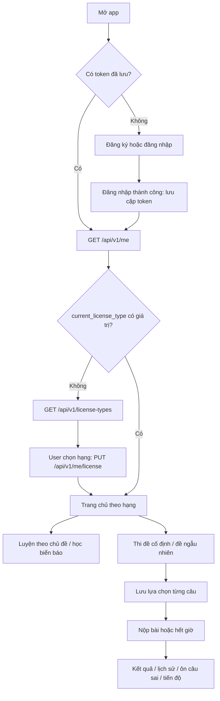

# Luồng tài khoản mới, API mobile/admin và kế hoạch hoàn thiện app

Đối chiếu mã nguồn ngày **09/11/2026**. Tài liệu này mô tả backend hiện có; các đề xuất ở cuối **chưa được triển khai**. Không mô tả phạm vi pháp lý của từng hạng bằng.

## 0. Phạm vi đã có và cách đọc tài liệu

Rà soát trực tiếp router, handler, service/usecase, DTO, model, giao diện admin và test trong working tree hiện tại, bao gồm thay đổi chưa commit. Đây là hiện trạng mã nguồn, không phải xác nhận dữ liệu trên server triển khai hay số câu thực tế trong database.

| Thành phần | Hiện trạng | Phạm vi sử dụng |
|---|---|---|
| Backend Go/Gin + GORM/SQLite | Đã có mã nguồn và kiểm thử | Xác thực, phân quyền, ngân hàng học liệu, luyện tập, thi, lịch sử, tiến độ, quản trị/import/crawl |
| Client admin web | Đã có HTML/CSS/JavaScript tại `internal/adminui/dist`, được BE phục vụ ở `/admin/` | Đăng nhập admin, tổng quan nội dung, quản lý chủ đề/câu/đề/biển/template, import/crawl, bulk publish, tra API |
| Client mobile learner | Chưa thấy mã nguồn ứng dụng mobile trong repository này | Các màn hình và xử lý ở mục 5 là đặc tả tích hợp với API đã có, chưa phải UI mobile đã hoàn thành |
| Công cụ cấp quyền | Đã có `cmd/admin/main.go` | Chủ server đổi role cho tài khoản đã tồn tại; không có API để learner tự nâng quyền |
| Tính năng mở rộng | Chưa triển khai theo phạm vi rà soát | Phân biệt rõ với chức năng hiện có bằng lộ trình ở mục 6 |

Backend khởi động từ `cmd/server/main.go`, đọc `DATABASE_PATH` (mặc định `cmd/data/gorm.db`), `LISTEN_ADDR` (mặc định `:8080`) và `JWT_SECRET`; khởi tạo database/migration trước khi đăng ký router. SQLite bật foreign keys, busy timeout 5 giây và giới hạn một connection. Không suy ra mức chịu tải production từ cấu hình này.

## 1. Quy ước tích hợp

- Base URL khi chạy local: `http://localhost:8080` (điều chỉnh theo cấu hình server). Trên điện thoại thật, dùng địa chỉ máy chạy backend trong mạng phù hợp; `localhost` của điện thoại không trỏ về máy tính.
- JSON request: `Content-Type: application/json`. API yêu cầu đăng nhập dùng `Authorization: Bearer <access_token>`.
- User được xác định từ token. Client không truyền `user_id` để chọn người ghi kết quả; không gửi role để tự cấp quyền.
- Admin dùng cùng cơ chế đăng nhập nhưng phải có role `admin`; tài khoản đăng ký mới luôn là learner.
- ID phải lấy từ response thực tế. `test_id` là đề cố định, `template_id` là cấu hình random, `exam_id` là phiên thi riêng của user, `question_id` là câu hỏi.
- Response không có một envelope chung cho mọi API: đăng nhập trả token trong `data`; `/me`, `/progress`, phiên thi trả object trực tiếp; danh mục trả `{data:[...]}`; danh sách phân trang trả `data`, `total`, `page`, `limit`.
- Các bộ lọc chỉ có tác dụng ở endpoint hỗ trợ; không suy ra mọi endpoint đều hỗ trợ toàn bộ query của parser chung.

### 1.1. Phân trang, token và lỗi dữ liệu

- API danh sách v1 dùng mặc định `page=1`, `limit=20`; limit lớn hơn 100 được giới hạn về 100. Client đọc lại `page`, `limit`, `total` trong response; page phải là số dương và không quá 1.000.000.
- Cấu hình server hiện tại cấp access token **30 giây**; login/refresh trả `expires_in=30` (đơn vị giây). Refresh token có thời hạn 7 ngày, mỗi lần refresh thành công thay cả cặp token và thu hồi refresh token cũ. Không mặc định token có thời hạn hàng giờ.
- Các handler dùng `httpapi.Bind` giới hạn body 5 MiB. Lỗi binding trả HTTP 400 cùng `message`, `status_code` và `errors[]` gồm `field`, `rule`, `message`; ví dụ field lồng nhau `questions[0].answers[0].content`. Lỗi nghiệp vụ có thể chỉ trả `message`, nên không bắt buộc mọi lỗi có `errors`.
- `DELETE` thành công ở nhóm quản trị v1 trả 204, không parse JSON body. Tạo bản ghi/phiên thường trả 201; đọc, sửa, luyện trả lời và nộp bài trả 200.
- Hạng đã chọn là tùy chọn lọc, không phải quyền truy cập: user có thể truyền hạng khác hợp lệ. API trả lời luyện kiểm tra câu xuất bản và phương án thuộc câu; bắt đầu thi cố định lấy hạng từ đề được chọn.
- Router hiện tại chưa gắn middleware CORS dù repository có file middleware tương ứng. Admin phục vụ cùng origin gọi API được; client web ở origin khác cần cấu hình CORS trước khi tích hợp trình duyệt.

## 2. Luồng tài khoản mới đăng nhập



1. Nếu chưa có tài khoản: `POST /auth/register` với `name`, `email`, `password`. Đăng ký trả hồ sơ, không trả cặp token; tiếp tục gọi login.
2. `POST /auth/login` với `email`, `password`. Lưu `data.access_token`, `data.refresh_token`, đọc `data.expires_in`, `role`, `current_license_type`. Dùng vùng lưu trữ bảo mật của nền tảng.
3. Gọi `GET /api/v1/me` để lấy hồ sơ hiện tại khi khởi động/khôi phục phiên. Nếu hạng rỗng, hiện màn hình chọn hạng.
4. `GET /api/v1/license-types` trả A1, A, B, C1, C, D với `code` và `name`. Lưu lựa chọn bằng `PUT /api/v1/me/license`, ví dụ `{"license_type":"A1"}`; chỉ chuyển màn hình sau khi lưu thành công.
5. Trang chủ tải đề, chủ đề, biển báo và tiến độ theo hạng. User mới có số đã làm/đã đạt bằng 0, lịch sử rỗng; tổng câu phụ thuộc dữ liệu xuất bản hiện có.
6. Học liệu là ngân hàng dùng chung theo hạng/chủ đề, không sao chép hay phân bổ một bộ câu riêng vào tài khoản. Lượt luyện và phiên thi được lưu riêng theo user.
7. Danh mục hạng được hỗ trợ không bảo đảm từng hạng đã có dữ liệu. Nếu chưa có nội dung, hiển thị trạng thái rỗng thay vì loading vô hạn hoặc tự đổi sang hạng khác.

**Quy tắc hạng:** query `license_type` rõ ràng ưu tiên hơn hạng trong hồ sơ. Các API học liệu, tiến độ và danh sách đề thường dùng hạng đã lưu khi không truyền query. Nếu chưa chọn hạng, nhiều danh sách trả mọi hạng để tương thích; UI mới nên hoàn tất bước chọn hạng trước. Lịch sử `/exams` không tự lọc theo hồ sơ. Random yêu cầu hạng từ request hoặc hồ sơ; chỉ có template_id không thay thế yêu cầu này.

## 3. API dành cho mobile/client

### 3.1. Xác thực và kiểm tra hệ thống

Các API công khai dùng được cho cả mobile và trang admin. `/health` chỉ dùng chẩn đoán kết nối, không phải kiểm tra đầy đủ database.

| Method | Endpoint | Quyền | Chức năng/chú thích |
|---|---|---|---|
| POST | `/auth/register` | Công khai | Đăng ký bằng name, email, password; luôn tạo learner, không cho tự cấp admin. |
| POST | `/auth/login` | Công khai | Đăng nhập bằng email/password; trả access_token, refresh_token và role trong data. |
| POST | `/auth/refresh` | Công khai | Gửi refresh_token để lấy cặp token mới; refresh token cũ bị thu hồi. |
| GET | `/health` | Công khai | Kiểm tra HTTP server; không kiểm tra toàn bộ trạng thái database. |

### 3.2. API learner sau đăng nhập

| Method | Endpoint | Quyền | Chức năng/chú thích |
|---|---|---|---|
| GET | `/auth/getProfile` | Đăng nhập | Lấy ID, tên, email, role và current_license_type của người hiện tại. |
| GET | `/api/v1/categories` | Đăng nhập | Danh sách chủ đề có type; lọc category_type/search. Learner chỉ nhận chủ đề có học liệu xuất bản phù hợp license_type (mặc định hạng đã lưu). Admin thấy cả chủ đề rỗng. |
| GET | `/api/v1/tests` | Đăng nhập | Đề cố định đã xuất bản; lọc hạng (mặc định đã lưu), category_type, search và phân trang. |
| POST | `/api/v1/exams` | Đăng nhập | Body {test_id}; tạo phiên thi mới và snapshot. Thi lại cũng gọi API này, nhận exam_id mới. |
| GET | `/api/v1/exams` | Đăng nhập | Lịch sử riêng của user; lọc license_type/category_type/status, phân trang. Không tự dùng hạng đã lưu. Mỗi mục có license_type; random có test_id=null và template_id. |
| GET | `/api/v1/exams/:id` | Đăng nhập | Lấy bài đang làm để tiếp tục, hoặc xem kết quả/lời giải khi kết thúc. :id là exam_id, không phải test_id. |
| PUT | `/api/v1/exams/:id/answers/:question_id` | Đăng nhập | Body {answer_id}; lưu/thay lựa chọn, answer_id=0 để bỏ chọn. Chỉ chủ phiên được sửa trước khi hết giờ. |
| POST | `/api/v1/exams/:id/submit` | Đăng nhập | Nộp và chấm ở server; xử lý điểm đạt, điểm liệt và hết giờ; nộp lại không tạo kết quả mới. |
| GET | `/api/v1/practice/questions` | Đăng nhập | Câu đã xuất bản, không lộ đáp án; lọc hạng (mặc định đã lưu), category_type/category_id/road_sign_id/sign_type/is_critical/search, phân trang. |
| POST | `/api/v1/practice/questions/:id/answer` | Đăng nhập | Body {answer_id}; lưu lượt luyện, trả đúng/sai cùng câu hỏi và lời giải. |
| GET | `/api/v1/practice/wrong-questions` | Đăng nhập | Câu sai/bỏ trống theo lần làm gần nhất; câu đã sửa đúng được loại ra; có bộ lọc và phân trang. |
| GET | `/api/v1/progress` | Đăng nhập | Tổng câu hiện hành, số câu đã làm/đạt/sai/chưa làm, completion_percentage; kèm thống kê lượt luyện, tỷ lệ đỗ và lịch sử gần nhất. Mặc định hạng đã lưu. |
| GET | `/api/v1/me` | Đăng nhập | Hồ sơ hiện tại, gồm current_license_type. |
| PUT | `/api/v1/me/license` | Đăng nhập | Body {license_type}; lưu hạng bằng mặc định cho người trong JWT, không thay phiên thi đang làm. |
| GET | `/api/v1/category-types` | Đăng nhập | Mã loại chủ đề và tên hiển thị cho tab mobile. |
| GET | `/api/v1/road-sign-types` | Đăng nhập | Mã nhóm biển báo và tên hiển thị. |
| POST | `/api/v1/exams/random` | Đăng nhập | Body {} hoặc {license_type,template_id,category_type}; tạo phiên riêng từ template đã xuất bản, test_id=null. Thiếu câu báo lỗi, không tạo đề công khai. |
| GET | `/api/v1/exam-templates` | Đăng nhập | Cấu hình random đã xuất bản; lọc license_type/category_type, phân trang; mặc định hạng đã lưu. |
| GET | `/api/v1/road-signs` | Đăng nhập | Học liệu biển đã xuất bản; lọc hạng, nhóm biển, chủ đề, tìm kiếm và phân trang. |
| GET | `/api/v1/road-signs/:id` | Đăng nhập | Chi tiết biển đã xuất bản theo hạng đã lưu hoặc license_type explicit. |
| GET | `/api/v1/road-signs/:id/questions` | Đăng nhập | Câu luyện đã xuất bản liên kết với biển, không trả đáp án đúng; dùng API practice để trả lời. |
| GET | `/api/v1/license-types` | Đăng nhập | Danh sách hạng bằng được hệ thống hỗ trợ; code gửi vào PUT /api/v1/me/license, name dùng hiển thị. |

### 3.3. Bộ lọc mobile cần sử dụng

| Nhóm API | Query chính |
|---|---|
| `/categories` | `license_type`, `category_type`, `search`; không phân trang |
| `/practice/questions`, `/practice/wrong-questions` | `license_type`, `category_type`, `category_id`, `road_sign_id`, `sign_type`, `is_critical`, `search`, `page`, `limit` |
| `/tests` | `license_type`, `category_type`, `search`, `page`, `limit` |
| `/exam-templates` | `license_type`, `category_type`, `search`, `page`, `limit` |
| `/road-signs` | `license_type`, `category_id`, `sign_type`, `search`, `page`, `limit` |
| `/exams` | `license_type`, `category_type`, `status`, `page`, `limit`; status là `DOING`, `COMPLETED` hoặc `TIMEOUT` |
| `/progress` | Các số đếm câu hỗ trợ hạng/chủ đề/biển/điểm liệt/tìm kiếm; không phân trang. Thống kê cũ chỉ theo hạng và category_type; xem lưu ý dưới đây |

Đổi bộ lọc phải reset về page 1. Lọc tại server trước phân trang; không tải một trang rồi tự bỏ các câu không thuộc hạng ở client.

## 4. API dành riêng cho admin

Admin cần chuẩn bị học liệu trước khi learner có thể học/thi. Trang quản trị local tại `/admin/`, danh mục API tại `/admin/api.json`; trang HTML truy cập được không đồng nghĩa có quyền đọc/sửa dữ liệu.

### 4.1. API quản trị hiện hành

| Method | Endpoint | Quyền | Chức năng/chú thích |
|---|---|---|---|
| POST | `/api/v1/admin/categories` | Admin | Tạo chủ đề: name, description, type; mặc định UNCATEGORIZED. |
| PUT | `/api/v1/admin/categories/:id` | Admin | Sửa tên/mô tả/type; không bỏ SIGN khi còn bản ghi biển báo. |
| DELETE | `/api/v1/admin/categories/:id` | Admin | Xóa mềm chủ đề; từ chối nếu còn câu hỏi. |
| GET | `/api/v1/admin/questions` | Admin | Cả nháp/xuất bản và khóa đáp án; lọc license_type/category_type/category_id/road_sign_id/sign_type/published/is_critical/search, phân trang. |
| GET | `/api/v1/admin/questions/:id` | Admin | Chi tiết câu hỏi, chủ đề, phương án và đáp án đúng. |
| POST | `/api/v1/admin/questions` | Admin | Tạo câu kèm đáp án; road_sign_id tùy chọn, phải khớp hạng/chủ đề. Ít nhất hai đáp án, đúng một đáp án đúng. |
| PUT | `/api/v1/admin/questions/:id` | Admin | Thay toàn bộ nội dung và tập đáp án. Đặt published để xuất bản/thu hồi; xuất bản cần lời giải. ID đáp án có thể đổi. |
| DELETE | `/api/v1/admin/questions/:id` | Admin | Xóa mềm câu hỏi; từ chối nếu đang thuộc một đề chưa xóa. |
| POST | `/api/v1/admin/questions/publish` | Admin | Body {question_ids:[...]}, 1–500 ID duy nhất. Xuất bản câu hợp lệ, trả published_ids và failed theo từng ID. Giữ nguyên nội dung và ID đáp án; câu lỗi không thay đổi. |
| POST | `/api/v1/admin/questions/import` | Admin | Body {questions:[...]}; 1–500 câu, tối đa 5 MiB, lỗi một dòng hoàn tác toàn bộ. Nhập lại có thể tạo trùng. |
| POST | `/api/v1/admin/questions/crawl` | Admin | Không body/query. Cào A1/B từ nguồn cố định, tạo chủ đề và câu nháp; chống trùng theo nguồn/hạng; cooldown 60 giây sau thành công. |
| GET | `/api/v1/admin/tests` | Admin | Danh sách đề nháp và xuất bản; lọc license_type/category_type/published/search, phân trang page/limit. |
| GET | `/api/v1/admin/tests/:id` | Admin | Chi tiết cấu hình và câu hỏi: questions[i].question, gồm chủ đề và đáp án đúng. |
| POST | `/api/v1/admin/tests` | Admin | Tạo đề cố định; category_type tùy chọn để giới hạn chủ đề. 1–200 câu đã xuất bản cùng hạng. |
| PUT | `/api/v1/admin/tests/:id` | Admin | Thay cấu hình và danh sách câu; published điều khiển xuất bản, critical_fail bật/tắt quy tắc điểm liệt. |
| DELETE | `/api/v1/admin/tests/:id` | Admin | Xóa mềm đề; giữ snapshot và lịch sử của phiên thi đã tạo. |
| POST | `/api/v1/admin/tests/generate` | Admin | Sinh và lưu đề bằng quotas: category_id, count, critical_count; không lặp câu, báo lỗi khi thiếu dữ liệu. |
| GET | `/api/v1/admin/road-signs` | Admin | Danh sách biển báo, gồm nháp; lọc/phân trang. |
| GET | `/api/v1/admin/road-signs/:id` | Admin | Chi tiết biển báo. |
| POST | `/api/v1/admin/road-signs` | Admin | Tạo biển báo; xem MOBILE_API.md về body và quy tắc. |
| PUT | `/api/v1/admin/road-signs/:id` | Admin | Cập nhật toàn bộ biển báo. |
| DELETE | `/api/v1/admin/road-signs/:id` | Admin | Xóa mềm biển báo; biển có câu tham chiếu bị chặn, cần bỏ liên kết trước. |
| GET | `/api/v1/admin/exam-templates` | Admin | Danh sách cấu hình đề ngẫu nhiên, gồm nháp; lọc/phân trang. |
| GET | `/api/v1/admin/exam-templates/:id` | Admin | Chi tiết cấu hình đề ngẫu nhiên. |
| POST | `/api/v1/admin/exam-templates` | Admin | Tạo cấu hình đề ngẫu nhiên; xem MOBILE_API.md về body và quy tắc. |
| PUT | `/api/v1/admin/exam-templates/:id` | Admin | Cập nhật toàn bộ cấu hình đề ngẫu nhiên. |
| DELETE | `/api/v1/admin/exam-templates/:id` | Admin | Xóa mềm cấu hình random; không thay snapshot các bài thi đã tạo. |

Admin dùng `GET /api/v1/categories` để lấy chủ đề, gồm chủ đề rỗng/nháp về học liệu. Không có endpoint `GET /api/v1/admin/categories` riêng. API `/me` và các danh mục type dùng chung. API admin không tự lọc theo hạng đang học của tài khoản; truyền hạng cần quản trị rõ ràng.

### 4.2. API legacy còn tồn tại

Các endpoint này yêu cầu admin. Tích hợp mới nên dùng nhóm `/api/v1/admin/*` để quản lý toàn bộ câu và đáp án nhất quán.

| Method | Endpoint | Quyền | Chức năng/chú thích |
|---|---|---|---|
| GET | `/question/getList` | Admin | API danh sách câu hỏi cũ; ưu tiên GET /api/v1/admin/questions. |
| POST | `/question/create` | Admin | API tạo câu hỏi cũ; giao diện mới dùng POST /api/v1/admin/questions để tạo cùng đáp án. |
| POST | `/questions/:question_id/answers` | Admin | Thêm phương án; phải giữ quy tắc đáp án hợp lệ. |
| GET | `/questions/:question_id/answers` | Admin | Danh sách phương án của một câu, có khóa đáp án đúng. |
| PUT | `/questions/:question_id/answers/:answer_id` | Admin | Sửa một phương án; bị chặn nếu làm câu có 0 hoặc 2 đáp án đúng. Đổi đáp án đúng nên PUT toàn câu hỏi. |
| DELETE | `/questions/:question_id/answers/:answer_id` | Admin | Xóa phương án; phải còn ít nhất hai phương án và đúng một đáp án đúng. |
| GET | `/answer/list_answer` | Admin | Danh sách đáp án theo API cũ; chỉ admin được truy cập. |

### 4.3. Luồng chuẩn bị dữ liệu

1. Tạo chủ đề và gán `type` thích hợp; chủ đề biển báo dùng `SIGN`.
2. Tạo biển báo theo hạng nếu cần; tạo câu hỏi, đáp án, giải thích và liên kết biển tương ứng.
3. Kiểm tra câu có ít nhất hai đáp án, đúng một đáp án đúng; nội dung xuất bản cần lời giải. Import/crawl phải được rà soát trước khi dùng cho learner.
4. Xuất bản câu hỏi bằng sửa câu hoặc bulk publish; bulk publish có kết quả thành công/thất bại từng ID, không mặc định mọi câu đều thành công.
5. Tạo và xuất bản đề cố định; hoặc cấu hình template random với quotas, thời lượng, passing_score và critical_fail.
6. Kiểm tra số câu xuất bản theo đúng hạng/chủ đề/điểm liệt đủ quota. Có template không đồng nghĩa luôn sinh được đề nếu ngân hàng đã bị thay đổi sau đó.
7. Dùng một tài khoản learner kiểm tra luồng thật. Admin đọc được nội dung nháp không chứng minh learner thấy được.

### 4.4. Client admin web đã triển khai

| Màn hình/chức năng | Hành vi đã có trong giao diện | Liên hệ BE và giới hạn |
|---|---|---|
| Đăng nhập và phiên | Login email/password, kiểm tra profile phải là admin; lưu cặp token trong `sessionStorage`; gom các request refresh đồng thời; logout xóa phiên local | Gọi `/auth/login`, `/auth/getProfile`, `/auth/refresh`; chưa thu hồi token server khi logout |
| Tổng quan | Tổng câu gồm nháp/xuất bản, tổng chủ đề, tổng đề và 5 đề mới nhất; lối tắt tạo câu/quản lý đề | Ghép nhiều API hiện có; không phải dashboard thống kê toàn bộ người học |
| Chủ đề | Danh sách, tạo, sửa, xóa; chọn loại chủ đề | Backend kiểm tra ràng buộc trước khi đổi loại/xóa |
| Ngân hàng câu hỏi | Lọc, phân trang, tạo/sửa/xóa; nhập nội dung, ảnh, lời giải, hạng, chủ đề, biển liên quan, điểm liệt; thêm/bớt phương án và chọn một đáp án đúng | Sửa gửi toàn bộ câu và phương án; ảnh là URL/đường dẫn, chưa có upload |
| Xuất bản hàng loạt | Chọn câu nháp, chọn trên trang, gửi lô, hiển thị kết quả thành công/thất bại | API publish không đổi ID đáp án; cần đọc kết quả từng câu |
| Đề cố định | Mở chi tiết đề, tạo/sửa/xóa, chọn câu đã xuất bản có phân trang, sắp xếp câu, cấu hình điểm/thời gian/điểm liệt và xuất bản | Đổi hạng/loại đề khi chọn câu sẽ reset lựa chọn; BE kiểm tra các câu thuộc đúng hạng/loại |
| Sinh đề bằng quota | Nhập số câu và số điểm liệt theo chủ đề để sinh một đề lưu vào danh sách | `/admin/tests/generate` tạo đề cố định dùng lại; khác với random riêng cho learner |
| Biển báo | Danh sách, lọc, tạo/sửa/xóa, trạng thái xuất bản | Chủ đề phải loại SIGN; xuất bản cần ảnh và ý nghĩa |
| Cấu hình random | Danh sách, lọc, tạo/sửa/xóa template theo hạng/loại và quota | Template lưu cấu hình; chưa phải cam kết ngân hàng luôn đủ câu |
| Nhập dữ liệu | Đọc file JSON hoặc dán JSON, tải mẫu, gọi import; nút crawl A1/B và hiển thị kết quả | Import không tự chống trùng; crawl chống trùng theo nguồn/hạng và có cooldown |
| Danh mục API | Hiển thị method, đường dẫn, quyền và chú thích theo nhóm | Đọc `/admin/api.json`; có test đối chiếu catalog với router thực |
| Trạng thái thao tác | Loading, trạng thái rỗng, thông báo lỗi, nút thử lại, khóa nút khi xử lý, xác nhận xóa | Chưa có màn hình quản trị user, audit hay báo cáo toàn hệ thống |

### 4.5. Dữ liệu quản trị và ràng buộc nghiệp vụ

- **Câu hỏi:** `title`, `content`, `image`, `explanation`, `license_type`, `category_id`, `road_sign_id` tùy chọn, `is_critical`, `published`, `answers[]`. Mỗi phương án có `content`, `label` tối đa 2 ký tự, `order` từ 1 và `is_correct`; ít nhất hai phương án, đúng một phương án đúng. Câu xuất bản phải có lời giải. PUT thay cả tập đáp án nên Client tải lại ID mới sau khi lưu.
- **Biển báo:** `code`, `name`, `image`, `meaning`, `description`, `sign_type`, `license_type`, `category_id`, `published`. Mã biển duy nhất trong cùng hạng đối với bản ghi chưa xóa; câu liên kết phải cùng hạng/chủ đề. Khi còn câu tham chiếu không đổi hạng/chủ đề biển; phải thu hồi câu xuất bản trước khi thu hồi biển.
- **Đề cố định:** `name`, `description`, `license_type`, `category_type` tùy chọn, `version`, `duration_minutes`, `passing_score`, `critical_fail`, `published`, `question_ids[]`. Có 1–200 câu, thời lượng 1–180 phút, điểm đạt từ 1 đến tổng câu; các câu phải đã xuất bản, đúng hạng và đúng loại nếu cấu hình loại. Thứ tự ID xác định thứ tự câu trong đề.
- **Sinh đề/template:** dùng cấu hình đề cùng `quotas[]` gồm `category_id`, `count`, `critical_count`; `count` là tổng câu của quota, đã bao gồm câu liệt. Template không nhận danh sách `question_ids`, không lặp chủ đề quota. Khi sinh phiên, BE chọn câu không trùng và báo lỗi nếu thiếu ngân hàng phù hợp.
- **Nháp và xuất bản:** không có API workflow duyệt nhiều cấp. `published` là cờ khả dụng; learner chỉ đọc học liệu đã xuất bản ở các danh sách tương ứng. Đề đã xuất bản vẫn có thể không bắt đầu được nếu câu bị thu hồi hoặc cấu hình/ngân hàng không còn hợp lệ.
- **Lịch sử:** phiên thi lưu snapshot nội dung, đáp án, hạng và phiên bản lúc bắt đầu. Sửa/xóa học liệu không viết lại snapshot của bài cũ. Tiến độ câu hiện hành lại dựa trên ngân hàng hiện đang xuất bản, nên tổng câu có thể đổi theo biên tập nội dung.

## 5. Các case mobile để hoàn chỉnh app

Bảng này là hướng dẫn xây dựng client từ backend hiện có, không khẳng định đã có mã nguồn UI mobile trong repository.

| Màn hình/case | API và thứ tự xử lý | Hành vi client cần có |
|---|---|---|
| Đăng ký | `/auth/register` → `/auth/login` | Kiểm tra dữ liệu nhập; email trùng trả 409; không coi đăng ký là đã có token |
| Đăng nhập/khôi phục | `/auth/login` → `/me` | Loading, sai thông tin, lỗi mạng, lưu token và điều hướng theo hạng |
| Access token hết hạn | `/auth/refresh` với refresh_token | Chỉ một refresh chạy cùng lúc; thay cả cặp token; refresh thất bại quay về login. Không tự retry POST tạo phiên/lượt luyện khi chưa biết request cũ đã thành công chưa |
| Chọn/đổi bằng | `/license-types` → `PUT /me/license` | Lưu thành công rồi xóa cache nội dung hạng cũ, reset trang và tải lại; cache phân theo user+hạng+bộ lọc |
| Trang chủ Dashboard | `/tests`, `/categories`, `/road-signs`, `/progress` | Tải các khối độc lập, lỗi một khối có nút thử lại riêng. Một DashboardViewModel điều phối repository hoặc view model con; hiện chưa có endpoint dashboard tổng hợp |
| Tab chủ đề | `/category-types` → `/categories?category_type=...` | Type là mã nhóm; category_id là chủ đề thực tế; hỗ trợ tab rỗng |
| Luyện câu hỏi | `/practice/questions` → `POST /practice/questions/:id/answer` với answer_id | Chỉ hiển thị kết quả/lời giải sau response; không tự lấy đáp án bằng API admin; lưu lượt luyện mỗi lần gửi |
| Ôn điểm liệt | `/practice/questions?is_critical=true` | Dùng cùng luồng trả lời; đây là bộ lọc ngân hàng, không phải một loại phiên riêng |
| Ôn câu sai | `/practice/wrong-questions` → API trả lời luyện tập | Câu sửa đúng sẽ ra khỏi danh sách. Khi danh sách co lại, tải lại trang đầu để tránh bỏ sót do offset thay đổi |
| Học biển báo | `/road-sign-types` → `/road-signs` → `/road-signs/:id` | Lọc hạng/nhóm biển, tìm kiếm, phân trang, placeholder khi ảnh không tải được |
| Luyện câu liên quan biển | `/road-signs/:id/questions` → API trả lời luyện tập | Không phải biển nào cũng có câu liên kết; hỗ trợ trạng thái chưa có câu |
| Thi cố định | `/tests` → `POST /exams` với test_id | Dùng đề của hạng đang chọn; lưu ID phiên trả về. Hạng phiên lấy từ đề, không lấy lại từ hồ sơ lúc nộp |
| Thi ngẫu nhiên | `/exam-templates` (nếu cho chọn) → `POST /exams/random` | Gửi `{}` hoặc hạng/template/type; server chọn câu. Không gọi API admin generate từ mobile |
| Đang làm bài | `GET /exams/:id`, `PUT /exams/:id/answers/:question_id` | Lưu đáp án từng câu; answer_id=0 để bỏ chọn. Hiển thị trạng thái đang lưu/đã lưu/lỗi; serialize cập nhật cùng câu để tránh request cũ ghi đè lựa chọn mới |
| Rời app/tiếp tục | `/exams?status=DOING` → `/exams/:id` | Có thể lấy DOING mọi hạng để tìm bài cũ; không tự tạo phiên mới khi mở lại app |
| Nộp bài | Chờ các request lưu đáp án hoàn tất → `POST /exams/:id/submit` | Body submit không mang danh sách đáp án. Chặn nhấn đúp; retry submit an toàn về kết quả, không tạo bài mới |
| Hết giờ | Đồng hồ từ server_time/expires_at → tải lại phiên | Server quyết định thời hạn. Nếu lưu đáp án trả 409, tải lại phiên và chuyển kết quả; không tự gia hạn bằng đồng hồ máy |
| Xem kết quả | `/exams/:id` sau kết thúc | Hiển thị score, passing_score, is_passed, failure_reason; dùng is_passed để kết luận đậu/rớt |
| Xem lịch sử | `/exams?license_type=A1` → chi tiết phiên | Truyền hạng rõ ràng; status lọc từng trạng thái. Random có test_id=null; không ép kiểu thành ID đề cố định |
| Thi lại | Fixed: POST /exams với test_id; random: POST /exams/random với hạng và template phù hợp | Tạo phiên mới; nếu đề/template đã gỡ, báo không còn khả dụng. Random không bảo đảm bộ câu khác lần trước |
| Tiến độ học | `/progress?license_type=A1` | Hiển thị mastered_questions/total_questions và completion_percentage; tải lại sau luyện/thi |
| Đăng xuất | Hiện chỉ xóa token/cache local | Chưa có API thu hồi phiên logout; không mô tả xóa token local là vô hiệu hóa token trên server |

### 5.1. Quy tắc thi và kết quả cần giữ đúng

- Server sinh snapshot khi bắt đầu và tự chấm điểm. Không gửi score/is_passed từ client để lưu kết quả.
- `passing_score` là ngưỡng điểm đậu; nếu bật `critical_fail`, sai/bỏ trống câu điểm liệt vẫn rớt dù đủ điểm (`failure_reason: "critical_question"`).
- Không hiển thị `is_passed=false` của phiên DOING như kết luận rớt; chờ COMPLETED/TIMEOUT.
- Lời giải/đáp án đúng của phiên chỉ được mở khi bài kết thúc.
- Bài thi giữ hạng lúc bắt đầu. Đổi hạng trong hồ sơ không chuyển bài cũ sang hạng mới, không reset thời gian thi.
- Hết hạn được xử lý khi có request liên quan (đọc phiên/lịch sử/progress/ôn sai…); chưa có worker tự đóng tất cả phiên ngay khi hết giờ.
- Nhiều phiên DOING có thể tồn tại. App cần chủ động cho chọn tiếp tục bài cũ; backend chưa áp đặt một phiên đang thi duy nhất.

### 5.2. Hiểu đúng tiến độ

Ví dụ rút gọn của `/api/v1/progress`:

```json
{
  "license_type": "A1",
  "total_questions": 250,
  "attempted_questions": 100,
  "mastered_questions": 80,
  "wrong_questions": 20,
  "unattempted_questions": 150,
  "completion_percentage": 32
}
```

Số liệu trên chỉ minh họa. Tổng thực tế lấy từ ngân hàng hiện đang xuất bản, chưa xóa, đúng bộ lọc. Mỗi câu tính một lần theo kết quả gần nhất của luyện tập hoặc bài thi đã kết thúc; làm lại sai có thể giảm số đã đạt. Câu bỏ trống trong bài đã đóng được tính sai. Bài đang thi chưa đóng góp vào các số đếm.

`completion_percentage = 100 * mastered_questions / total_questions`, bằng 0 khi tổng bằng 0. `total_questions = mastered_questions + wrong_questions + unattempted_questions`.

Các trường cũ `categories[].accuracy` tính theo lượt làm, không đồng nghĩa tỷ lệ câu đã đạt. `wrong_question_ids` có thể chứa ID lịch sử đã ngừng xuất bản và có phạm vi lọc khác; không lấy độ dài mảng này thay cho `wrong_questions`. Lọc category_type ở các số đếm mới vẫn tính câu trong đề tổng hợp; thống kê thi cũ lọc theo loại của snapshot đề.

### 5.3. Case lỗi và trạng thái rỗng

| Tình huống | Cách xử lý trên mobile |
|---|---|
| 400: sai input/filter | Hiển thị lỗi tại trường tương ứng; sửa request, không lặp request nguyên trạng |
| 400: random thiếu câu/điểm liệt hoặc chưa có template | Thông báo hạng/chủ đề chưa đủ dữ liệu để tạo đề; cho quay lại hoặc chọn đề cố định. Admin kiểm tra published, license, category và critical_count |
| 401: token không hợp lệ/hết hạn | Refresh một lần theo cơ chế quản lý phiên; nếu thất bại yêu cầu đăng nhập lại |
| 403: thiếu quyền admin | Client learner không gọi API admin; không đề nghị người dùng tự sửa role |
| 404: đề/câu/biển/phiên không khả dụng | Tải lại danh sách, bỏ tham chiếu cache cũ; phiên người khác không được đọc |
| 409: phiên đã đóng khi lưu đáp án | Tải lại phiên và mở kết quả |
| 5xx hoặc mất mạng | Giữ nội dung/đáp án đang nhập; cho thử lại phù hợp loại request; không mặc định mọi POST đều an toàn để retry |
| Request tạo phiên bị timeout mạng | Có thể server đã tạo thành công. Đọc lịch sử để tìm phiên trước khi tạo lại; hiện chưa có idempotency key |
| Refresh thành công nhưng POST luyện tập mất response | Có thể lượt luyện đã được ghi; retry có thể tạo thêm lượt. Cần idempotency cho bảo đảm mạnh hơn |
| Hạng mới chưa có học liệu | Hiện “Chưa có nội dung cho hạng này”; không hiển thị câu của hạng khác |
| Trang danh sách rỗng sau đổi filter | Reset page=1, kiểm tra total; không suy ra ngân hàng rỗng từ một trang vượt phạm vi |
| Đổi tài khoản/đổi hạng lúc request cũ chưa xong | Hủy hoặc bỏ response cũ, tránh ghi cache/UI sai user hoặc sai hạng |

### 5.4. Checklist nghiệm thu client

- Tài khoản mới đăng ký → login → chọn hạng → Trang chủ; không cần admin tạo dữ liệu riêng cho user.
- Lưu hạng, đăng xuất local và đăng nhập lại vẫn đọc đúng hạng đã lưu.
- User A không thấy lịch sử/tiến độ riêng của user B.
- Tải đúng học liệu đã xuất bản; hạng trống có UI phù hợp.
- Luyện sai → đúng → sai cập nhật đúng câu sai và số đã đạt, không cộng trùng số câu.
- Thi cố định/random, lưu lựa chọn, bỏ chọn, thoát app, tiếp tục, nộp và xem lời giải.
- Đổi hạng trong khi đang thi không làm thay đổi hạng của phiên cũ.
- Thi đủ điểm nhưng sai câu liệt vẫn hiển thị rớt; DOING không hiển thị kết luận cuối cùng.
- Mất mạng lúc lưu/nộp, token hết hạn, hết thời gian thi và nhấn đúp đều có xử lý.
- Danh sách dài phân trang đúng; thay bộ lọc quay về trang 1.

### 5.5. Hợp đồng dữ liệu cho Client learner

| Dữ liệu | Trường Client sử dụng | Quy tắc xử lý |
|---|---|---|
| Hồ sơ | `id`, `name`, `email`, `role`, `current_license_type` | `/me` trả object trực tiếp; `avatar_url` có trong DTO nhưng mapper hiện chưa gán, không coi là chức năng avatar đã có |
| Câu trước khi trả lời | `id`, `title`, `content`, `image`, `category_id`, `road_sign_id` nếu có, `is_critical`, `answers[]` | Mỗi answer có `id`, `content`, `label`, `order`; không có khóa đúng/sai hoặc lời giải. Render theo dữ liệu API, không hardcode số phương án |
| Kết quả luyện | `attempt` và `question` | `attempt` có `id`, `question_id`, `category_id`, `license_type`, `answer_id`, `is_correct`, `created_at`; `question` có lời giải và khóa đáp án. Dùng `attempt.is_correct` làm kết quả lần trả lời |
| Đề cố định | `id`, `name`, `license_type`, `category_type`, `version`, `duration_minutes`, `total_questions`, `passing_score`, `critical_fail` | Danh sách không phải nội dung bài thi; POST tạo phiên rồi lấy câu trong snapshot trả về |
| Template random | `id`, `name`, `license_type`, `category_type`, `config` | Đọc thời lượng/điểm/quota trong `config`; dùng ID làm `template_id`, không làm `test_id` |
| Phiên thi | `id`, `test_id`, `template_id` nếu có, `status`, `started_at`, `expires_at`, `server_time`, `finished_at` khi kết thúc, `exam` | `id` là exam_id. Nội dung ở `exam.questions`, tên/hạng/phiên bản ở `exam.name`, `exam.license_type`, `exam.version` |
| Lựa chọn trong phiên | `exam.questions[].selected_answer_id` | Khi chưa chọn, trường có thể bị bỏ khỏi JSON do omitempty; mặc định chưa chọn. PUT đáp án trả lại toàn bộ view phiên, không chỉ một answer |
| Kết quả thi | `correct_answers`, `total_questions`, `score`, `passing_score`, `is_passed`, `failure_reason` | Score là số câu đúng, không phải phần trăm. `failure_reason` là `critical_question` hoặc `insufficient_score` khi rớt; có thể vắng khi đậu |
| Chi tiết sau thi | `exam.questions[].is_correct`, `.explanation`, `.answers[].is_correct` | Chỉ có kết quả/lời giải sau kết thúc. Bỏ trống tính sai; snapshot giữ nội dung cũ kể cả admin đã sửa ngân hàng |
| Lịch sử | `data[]` với ID, hạng, loại ID đề/template, trạng thái, các mốc giờ và kết quả | Không có nội dung câu hay snapshot trong danh sách; cần GET chi tiết theo ID phiên |
| Biển báo | `id`, `code`, `name`, `image`, `meaning`, `description`, `sign_type`, `license_type`, `category_id`, `category` | Đọc bài biển không tạo lượt luyện và chưa ghi tiến độ đã xem biển; câu liên quan tải bằng endpoint riêng |

`answer_id=0` chỉ dùng bỏ chọn trong **phiên thi**. API luyện tập yêu cầu answer_id khác 0 và thuộc câu hiện hành; mỗi POST hợp lệ tạo thêm một lượt. Nếu admin thay đáp án trong lúc learner đang luyện, ID cũ có thể không còn hợp lệ: tải lại câu và cho chọn lại. Phiên thi đã tạo dùng ID từ snapshot nên không lấy ID mới của ngân hàng thay vào bài đang làm.

### 5.6. Luồng request mẫu để triển khai mobile

Các ID sau chỉ minh họa; thay bằng ID lấy từ API. Các request `/api/v1/*` đều gửi Bearer token.

```text
1. POST /auth/register                 {"name":"Người học","email":"learner@example.com","password":"example-password"}
2. POST /auth/login                    {"email":"learner@example.com","password":"example-password"}
3. GET  /api/v1/me
4. GET  /api/v1/license-types
5. PUT  /api/v1/me/license              {"license_type":"A1"}
6. GET  /api/v1/categories?license_type=A1
7. GET  /api/v1/practice/questions?license_type=A1&category_id=10&page=1&limit=20
8. POST /api/v1/practice/questions/101/answer   {"answer_id":301}
9. GET  /api/v1/progress?license_type=A1
```

Luồng thi cố định nối tiếp:

```text
1. GET  /api/v1/tests?license_type=A1
2. POST /api/v1/exams                              {"test_id":20}
3. GET  /api/v1/exams/501
4. PUT  /api/v1/exams/501/answers/101               {"answer_id":301}
5. PUT  /api/v1/exams/501/answers/101               {"answer_id":0}
6. PUT  /api/v1/exams/501/answers/101               {"answer_id":302}
7. POST /api/v1/exams/501/submit                   (không cần body)
8. GET  /api/v1/exams?license_type=A1
9. GET  /api/v1/practice/wrong-questions?license_type=A1
```

Thi random thay bước 1–2 bằng `GET /api/v1/exam-templates?license_type=A1`, rồi `POST /api/v1/exams/random` với `{"license_type":"A1","template_id":30}`. Các bước làm bài/nộp/xem kết quả dùng chung với thi cố định. Nếu dùng cấu hình mặc định, gửi JSON `{}` thay vì body rỗng. Không truyền template_id thì server chọn template xuất bản có ID mới nhất khớp hạng và `category_type`; bỏ category_type nghĩa là chọn template tổng hợp có loại rỗng, không phải mọi loại.

Khi mở lại bài, Client tính thời gian còn lại theo `expires_at - server_time` tại lúc nhận response và cập nhật đồng hồ hiển thị; khi app trở lại foreground, đọc lại phiên. Timeout vẫn có thể đạt nếu đủ điểm và không vi phạm điểm liệt; `TIMEOUT` mô tả cách kết thúc, `is_passed` mới là kết luận đậu/rớt.

### 5.7. Các số liệu mở rộng của màn hình tiến độ

Ngoài số đếm câu ở mục 5.2, BE hiện trả:

- `completed_exams`: số phiên COMPLETED và TIMEOUT; `passed_exams`: số phiên đạt trong phạm vi thống kê; `pass_rate`: phần trăm phiên đạt, bằng 0 khi chưa có phiên hoàn thành.
- `recent_exams`: tối đa 20 bài đã kết thúc, mới nhất trước; mỗi phần tử có `id`, `finished_at`, `score`, `total`, `passed`. Đây không phải toàn bộ lịch sử; dùng `/exams` để phân trang đầy đủ.
- `categories`: các mục `category_id`, `attempts`, `correct`, `accuracy`, tính theo lượt luyện và câu trong bài đã kết thúc. Client ghép tên bằng danh mục chủ đề; phần này không thay thế số câu đã thuộc.
- `suggested_category_id`: chủ đề có accuracy thấp nhất nếu nhỏ hơn 100%; có thể không có trường này. Đây là gợi ý đơn giản từ kết quả đã làm, chưa phải lịch ôn thông minh.
- Khi cùng một câu có nhiều kết quả, số đếm hiện hành chọn sự kiện mới nhất theo thời gian; nếu trùng thời gian ưu tiên kết quả thi, sau đó ID lớn hơn trong cùng nguồn. Câu chưa làm không có sự kiện và nằm trong `unattempted_questions`.

## 6. Đề xuất tính năng cần phát triển thêm

Đây là kế hoạch đề xuất dựa trên khoảng trống của code hiện tại, chưa phải API đã tồn tại. Đường dẫn dưới đây nếu có là tên đề xuất, không được gọi từ app trước khi triển khai.

| Ưu tiên | Tính năng | Phần cần bổ sung | Tiêu chí hoàn thành |
|---|---|---|---|
| P0 — trước phát hành rộng | Khôi phục tài khoản và quản lý phiên | Quên/đặt lại mật khẩu, đổi mật khẩu, logout thu hồi refresh token, quản lý thiết bị/phiên | User lấy lại tài khoản; logout server chặn refresh tiếp theo của phiên đó |
| P0 | Chống tạo trùng khi retry | Idempotency key cho bắt đầu thi/random và lượt luyện | Cùng key và cùng payload chỉ ghi một kết quả; khác payload được phát hiện |
| P0 | Kiểm tra ngân hàng trước xuất bản | API kiểm tra readiness theo hạng/template và báo thiếu quota/điểm liệt trên admin | Admin biết chính xác nhóm thiếu; UI mobile có trạng thái khả dụng rõ ràng |
| P0 | Vận hành và bảo vệ dịch vụ | Giới hạn request đăng nhập/refresh, giám sát lỗi, backup và thử phục hồi dữ liệu | Có quan sát lỗi và quy trình khôi phục đã kiểm tra |
| P1 — hoàn thiện trải nghiệm | Dashboard tổng hợp | Đề xuất `GET /api/v1/dashboard` trả tiến độ, nội dung gợi ý và bài đang làm theo hạng | Giảm số request; định nghĩa rõ mỗi khối và trạng thái rỗng |
| P1 | Ghi chú và bookmark cá nhân | CRUD note/bookmark theo user+câu, danh sách và xuất Markdown nếu cần | Không lộ ghi chú giữa user; xử lý được câu bị xóa/ngừng xuất bản |
| P1 | Bình luận/báo lỗi câu hỏi | CRUD comment, báo nội dung sai và luồng admin duyệt/phản hồi | Có quyền sửa/xóa, phân trang, moderation và trạng thái xử lý |
| P1 | Tiến độ học biển riêng | Đánh dấu đã đọc/đã thuộc biển; thống kê học liệu độc lập với câu luyện | Phân biệt “đã xem biển” và “đã trả lời đúng câu liên quan” |
| P1 | Ôn tập thông minh | Lịch ôn theo câu yếu, số lần sai và khoảng cách ôn; phiên ôn có trạng thái | Có kế hoạch ôn riêng theo user/hạng, tiếp tục được sau khi đóng app |
| P1 | Quản lý phiên đang thi | Chính sách tiếp tục/hủy bài, giới hạn phiên đồng thời và worker timeout | Client có hành vi rõ khi bắt đầu bài mới; bài hết hạn được đóng tự động |
| P1 | Học offline và đồng bộ | Gói nội dung có version, đồng bộ lượt luyện, xử lý xung đột và idempotency | Không mất/nhân đôi lượt luyện; quy định rõ thi nào cần online |
| P1 | Quản lý ảnh/học liệu | Upload ảnh, metadata, giới hạn kích thước, lưu trữ và dọn file | Admin không phải nhập đường dẫn ảnh thủ công; ảnh ổn định trên mobile |
| P2 — mở rộng | Quản trị người dùng và audit | Danh sách user, phân quyền kiểm soát, nhật ký sửa/xuất bản dữ liệu | Truy vết được ai thay nội dung và lúc nào |
| P2 | Hồ sơ và dữ liệu cá nhân | Sửa hồ sơ, avatar, xuất/xóa tài khoản và dữ liệu theo chính sách sản phẩm | Luồng rõ ràng, có xử lý các dữ liệu liên quan |
| P2 | Nhắc học và mục tiêu | Lịch học, mục tiêu, thông báo với tùy chọn bật/tắt | User chủ động chọn lịch, tránh gửi trùng |
| P2 | Quản lý phiên bản ngân hàng | Nguồn, ngày hiệu lực, kiểm duyệt và cập nhật bộ đề | Người biên tập kiểm tra được nguồn; snapshot cũ vẫn tái hiện đúng |

**Lộ trình đề xuất:** hoàn thành app online bằng API hiện có và checklist ở mục 5; ưu tiên P0 trước phát hành rộng; sau đó thêm note/bookmark, tiến độ biển và dashboard; offline và ôn tập thông minh triển khai khi đã chốt quy tắc đồng bộ.

## 7. Nguồn đối chiếu trong repository

- Router thực tế: `internal/server/router.go` và các router auth/learning/exam/question/answer/crawler.
- Catalog route: `internal/adminui/dist/api.json`; test `TestAdminUIAssetsAndAPICatalog` đối chiếu method/path với router.
- Hạng học: `internal/learning/mobile.go`; random: `internal/exam/usecase/random.go`.
- Lịch sử: `internal/exam/repository/repository.go`, `internal/exam/dto/mapper.go`.
- Tiến độ: `internal/learning/progress.go`.
- Payload chi tiết và ví dụ bổ sung: [MOBILE_API.md](MOBILE_API.md), [API.md](API.md), [ADMIN_LOCAL.md](ADMIN_LOCAL.md).

### 7.1. Kết quả kiểm tra lần cập nhật 09/11/2026

Đã chạy `go test ./...` thành công trên working tree hiện tại. Các package có test gồm `internal/common/httpapi`, `internal/crawler`, `internal/database`, `internal/server`; các package còn lại báo không có test riêng.

Những hành vi được bộ test hiện có kiểm tra gồm đăng ký/refresh và phân quyền; quyền sở hữu phiên; snapshot; tiếp tục/bỏ chọn/nộp lại; timeout/điểm liệt; import rollback; sinh đề/luyện/tiến độ; hạng mặc định và đổi hạng; biển báo/random; chọn câu phân trang; bulk publish; catalog API và tài nguyên admin; migration database.

Giới hạn xác minh: chưa chạy ứng dụng mobile, chưa kiểm thử thao tác admin bằng trình duyệt, chưa kiểm tra server triển khai hoặc crawl nguồn thật. Test API/tài nguyên admin không thay thế kiểm thử UI đầu cuối. Lần cập nhật này chỉ sửa tài liệu, giữ các thay đổi mã nguồn có sẵn của working tree.
