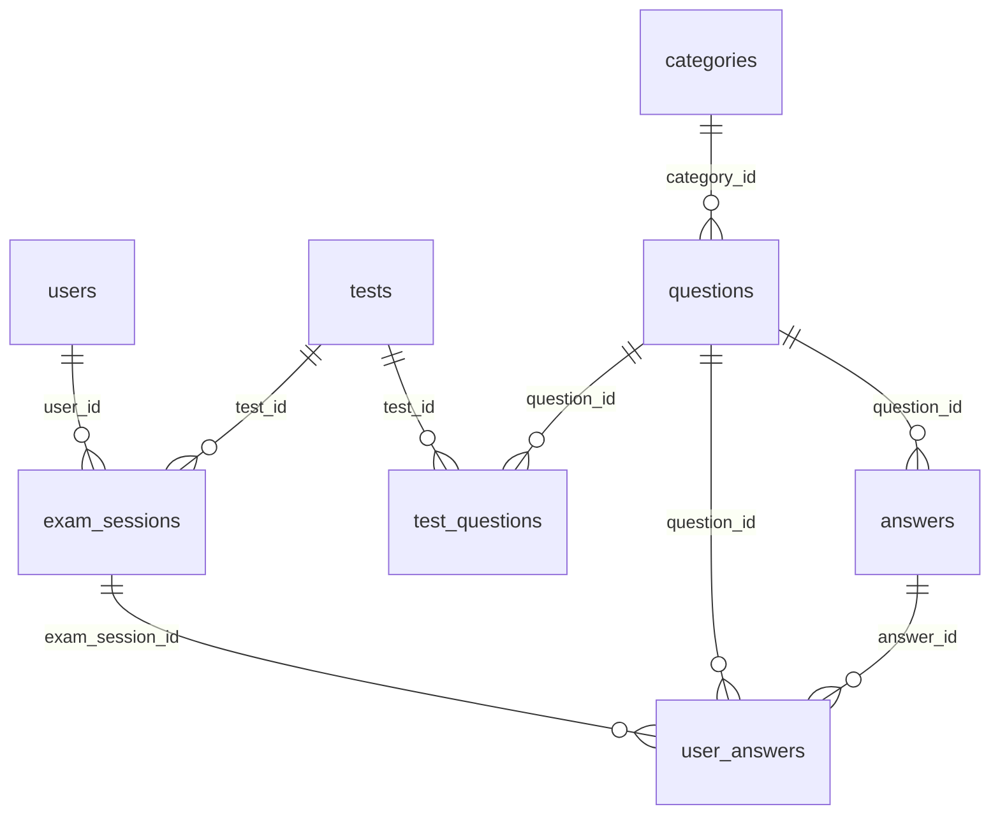

# Đối chiếu model Go và database SQLite

Kiểm tra ngày 25/10/2026 trên `cmd/data/gorm.db`. Đây là báo cáo đọc dữ liệu, không sửa/xóa các bản ghi hiện có.

## 1. Vì sao Question có Answers nhưng bảng questions không có cột answers?

Trong model:

```go
Answers []model.Answer `json:"answers"`
```

Đây là **quan hệ một-nhiều**: một câu hỏi có nhiều phương án. Các phương án nằm ở bảng `answers`, không nằm trong một cột `answers` của bảng `questions`.



Ví dụ thật trong database lúc kiểm tra:

**questions**

| id | title | category_id |
|---|---|---|
| 55 | Câu 36 | 4 |

**answers**

| id | question_id | label |
|---|---|---|
| 115 | 55 | A |
| 116 | 55 | B |
| 117 | 55 | C |
| 118 | 55 | D |

Bốn dòng đáp án cùng trỏ về câu hỏi 55. `question_id` không cần trùng `id` của đáp án.

Để xem trong công cụ quản lý SQLite:

```sql
SELECT id, question_id, label, content, is_correct
FROM answers
WHERE question_id = 55
  AND deleted_at IS NULL
ORDER BY "order";
```

Hoặc xem câu hỏi và đáp án cùng lúc:

```sql
SELECT q.id AS question_id,
       q.title,
       q.content AS question_content,
       a.id AS answer_id,
       a.label,
       a.content AS answer_content,
       a.is_correct
FROM questions AS q
LEFT JOIN answers AS a
  ON a.question_id = q.id AND a.deleted_at IS NULL
WHERE q.id = 55 AND q.deleted_at IS NULL
ORDER BY a."order";
```

Không cần thêm cột `answer`/`answers` vào `questions`. Thêm một bản sao JSON của đáp án vào đó sẽ tạo hai nơi lưu cùng dữ liệu, phải đồng bộ khi sửa đáp án.

## 2. Vì sao JSON API vẫn có answers?

Code repository dùng:

```go
db.Preload("Category").Preload("Answers").First(&question, id)
```

GORM đọc câu hỏi, lấy các dòng đáp án liên quan và điền vào `Question.Answers`. Sau đó Gin serialize thành JSON dạng:

```json
{
  "id": 55,
  "title": "Câu 36",
  "answers": [
    {"id": 115, "question_id": 55, "label": "A"},
    {"id": 116, "question_id": 55, "label": "B"},
    {"id": 117, "question_id": 55, "label": "C"},
    {"id": 118, "question_id": 55, "label": "D"}
  ]
}
```

Ví dụ JSON đã rút gọn. Trường `json:"answers"` đặt tên trong JSON; nó không yêu cầu SQLite có cột tên `answers`.

Nếu chỉ gọi `db.First(&question, id)` thì quan hệ `Answers` chưa được tải. Danh sách rỗng/nil trong model lúc đó không đủ để kết luận database không có đáp án.

Các API admin đọc câu hỏi hiện đã dùng `Preload("Answers")`. Riêng API phiên thi lấy câu hỏi và lựa chọn từ snapshot để giữ nguyên nội dung lúc bắt đầu; lúc đang thi, server chủ động không trả khóa đáp án đúng.

## 3. Bảng đối chiếu các model chính

| Model Go | Bảng SQLite | Trường quan hệ không phải cột trực tiếp |
|---|---|---|
| `Question` | `questions` | `Category` lấy qua `category_id`; `Answers` lấy qua `answers.question_id` |
| `Answer` | `answers` | Có cột `question_id` nối về câu hỏi |
| `Category` | `categories` | Không có trường quan hệ trong model hiện tại |
| `Test` | `tests` | `Questions` là danh sách dòng liên kết trong `test_questions` |
| `TestQuestion` | `test_questions` | `Question` lấy qua `question_id` |
| `ExamSession` | `exam_sessions` | `User`, `Test`, `UserAnswers` lấy qua khóa ngoại/bảng con |
| `UserAnswer` | `user_answers` | `Question`, `Answer` lấy qua `question_id`, `answer_id` |
| `User` | `users` | `RefreshTokens` lấy từ bảng `refresh_tokens` |
| `RefreshToken` | `refresh_tokens` | Có `user_id` nối về người dùng |
| `PracticeAttempt` | `practice_attempts` | Chỉ lưu ID và kết quả; chưa khai báo association/FK trong DB |
| `CrawlRecord` | `crawl_records` | Lưu dấu nhập và `question_id`; chưa khai báo association/FK trong DB |

Đã đối chiếu cột của 11 bảng trên với model được đăng ký trong migration, không phát hiện cột scalar cần thiết bị thiếu. Những trường slice/struct liên kết không được chuyển thành cột cùng tên.

`common.BaseModel` và `gorm.Model` được nhúng vào struct nên cung cấp `id`, `created_at`, `updated_at`, `deleted_at`; không có cột tên `BaseModel`.

Tên JSON cũng có thể khác tên cột. Ví dụ `Test.Duration` lưu cột `duration`, nhưng API trả `duration_minutes` nhờ JSON tag.

`Test.Questions` là quan hệ từ đề tới **bảng liên kết**. Quan hệ tổng thể giữa đề và câu hỏi là nhiều-nhiều thông qua `test_questions`, vì một câu có thể nằm trong nhiều đề.

`ExamSession.Snapshot` là trường string chứa JSON được lưu thật trong cột `snapshot`. Đây là bản sao lịch sử có chủ đích, khác với association `Answers` của ngân hàng câu hỏi.

## 4. Những lỗi dữ liệu thực sự tìm thấy

Tại thời điểm kiểm tra: có 853 câu hỏi và 2.650 phương án chưa xóa mềm.

| ID câu | Lỗi |
|---|---|
| 24 | Không có phương án chưa xóa; tham chiếu chủ đề không tồn tại |
| 25 | Có 2 phương án và cả 2 cùng `is_correct=true`; tham chiếu chủ đề không tồn tại |
| 26 | Không có phương án chưa xóa; tham chiếu chủ đề không tồn tại |

Ba câu này cũng là các câu có URL ảnh mẫu `https://example.com/sign.png` đã ghi nhận trước đó. Đây là lỗi dữ liệu mẫu, không phải do thiếu cột `answers`.

Các câu còn lại đáp ứng phép kiểm tra: ít nhất hai phương án chưa xóa và đúng một phương án đúng. Phép kiểm tra này không xác nhận nội dung chuyên môn hay tính đúng đắn của hình ảnh.

Không tự thêm đáp án/ảnh/chủ đề giả để làm cho kiểm tra hết lỗi. Để sửa ba câu mẫu, dùng API sửa cả câu hỏi với chủ đề thật và bộ đáp án đúng đã được xác định; hoặc xóa chúng nếu chủ dự án xác nhận không cần giữ dữ liệu mẫu.

SQL tự kiểm tra câu thiếu đáp án hoặc sai số lượng đáp án đúng:

```sql
SELECT q.id,
       q.title,
       COUNT(a.id) AS answer_count,
       SUM(CASE WHEN a.is_correct THEN 1 ELSE 0 END) AS correct_count
FROM questions AS q
LEFT JOIN answers AS a
  ON a.question_id = q.id AND a.deleted_at IS NULL
WHERE q.deleted_at IS NULL
GROUP BY q.id, q.title
HAVING COUNT(a.id) < 2
    OR SUM(CASE WHEN a.is_correct THEN 1 ELSE 0 END) <> 1;
```

Kiểm tra vi phạm khóa ngoại:

```sql
PRAGMA foreign_key_check;
```

Bật foreign key cho các lần ghi mới không tự sửa những bản ghi mồ côi đã tồn tại trước đó. Đợt kiểm tra này thấy 3 vi phạm ở bảng `questions`, ứng với ba ID nêu trên.

## 5. Những điểm còn có thể cải thiện ở model

- `PracticeAttempt` và `CrawlRecord` hiện có các cột ID nhưng chưa có ràng buộc FK tương ứng. Service kiểm tra dữ liệu ở luồng ghi; thao tác SQL thủ công vẫn có thể tạo tham chiếu sai. Nếu bổ sung FK, cần xác định chính sách lưu lịch sử và kiểm tra dữ liệu cũ trước migration.
- `User.Email` hiện chưa có unique index trong model. Kiểm tra email trùng ở service chưa thay thế được ràng buộc DB khi có request đăng ký đồng thời.
- Quy tắc đúng một đáp án đúng được kiểm tra ở service/transaction. Chỉnh trực tiếp bảng `answers` bằng công cụ database có thể phá quy tắc đó.

Các điểm trên là ghi nhận của đợt review, chưa thay đổi schema hoặc dữ liệu. Vấn đề người dùng hỏi về `Question.Answers` không đòi hỏi đổi schema.

## 6. Các vị trí code liên quan

- [Question model](../internal/question/model/question.go)
- [Answer model](../internal/answer/model/answer.go)
- [Repository tải câu hỏi và đáp án](../internal/question/repository/repository.go)
- [Danh sách model được migrate](../internal/database/migrate.go)
- [Quản lý câu hỏi và đáp án trong transaction](../internal/learning/service.go)
