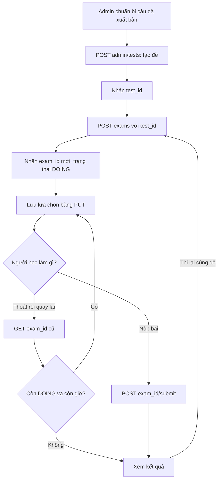

# Tạo đề mới, tiếp tục bài đang làm và thi lại

Tài liệu này giải thích như bạn đang thao tác trên app, sau đó đưa cURL để thử trong Postman. Đối chiếu code hiện tại; các số ID trong lời giải thích chỉ là ví dụ, không phải ID bắt buộc trong database.

## 1. Phân biệt ba việc trước đã

| Bạn muốn làm gì? | Hiểu đơn giản | API |
|---|---|---|
| Tạo bộ đề mới | Admin soạn một đề với các câu hỏi, thời gian và điểm đạt | `POST /api/v1/admin/tests` |
| Tiếp tục thi | Người học mở lại bài còn đang làm | `GET /api/v1/exams/{exam_id}` |
| Thi lại | Người học lấy một bài mới để làm lại cùng đề từ đầu | `POST /api/v1/exams` với `test_id` cũ |

Ví dụ: admin tạo **đề số 2**. Bạn làm lần đầu, server tạo **lượt thi số 10**. Bạn thi lại đề đó, server tạo **lượt thi số 11**.

- `test_id=2`: mã đề, dùng chung cho nhiều lần thi.
- `exam_id=10` hoặc `11`: mã từng lần làm bài.
- `question_id`: mã câu hỏi trong ngân hàng.
- `answer_id`: mã một phương án của câu, không phải chữ A/B/C.

**Muốn thi lại không cần tạo lại đề. Muốn tiếp tục không được bấm API bắt đầu một lượt mới.**

## 2. Chuẩn bị Postman

Bạn cần server đang chạy, một tài khoản admin để tạo đề và một tài khoản người học để thi. Nếu chưa có, xem phần đăng ký/đăng nhập trong [tutorial_dev.md](tutorial_dev.md).

Tạo và chọn Environment có các biến:

| Biến | Giá trị hoặc cách lấy |
|---|---|
| `base_url` | `http://localhost:8080` nếu dùng cấu hình mặc định |
| `admin_token` | Access token khi login admin |
| `learner_token` | Access token khi login người học |
| `category_id` | ID chủ đề ở bước tạo/chọn chủ đề |
| `question_id_1` | ID câu thứ nhất đã tạo/chọn |
| `question_id_2` | ID câu thứ hai đã tạo/chọn |
| `test_id` | ID đề trả về khi tạo đề |
| `exam_id` | ID lượt thi trả về khi bắt đầu |
| `answer_id_1` | ID phương án bạn chọn cho câu thứ nhất, lấy trong lượt thi |
| `answer_id_2` | ID phương án bạn chọn cho câu thứ hai, lấy trong lượt thi |

Import từng cURL bằng **Import → Raw text**. Mẫu bên dưới dùng biến Postman, không phải biến shell. Không gửi nguyên dấu `{{...}}` chưa có giá trị. ID trong JSON là số, không bọc dấu nháy.

Để dễ hiểu, tài liệu không dùng script tự lưu biến. Sau mỗi request tạo, bạn đọc `id` ở response rồi nhập vào Environment. Các response tạo chủ đề/câu/đề/lượt thi có `id` ngay ngoài cùng, không phải `data.id`.

## 3. Các bước tạo một bộ đề mới

Ta tạo đề demo **hai câu A1, 10 phút, đạt 2/2**, trong đó câu 1 là điểm liệt. Nội dung bên dưới chỉ để thử API, không phải đề hoặc kiến thức thi chính thức.

### Bước 1 — Tạo chủ đề cho câu demo

Dùng token admin:

```bash
curl --request POST '{{base_url}}/api/v1/admin/categories' \
  --header 'Authorization: Bearer {{admin_token}}' \
  --header 'Content-Type: application/json' \
  --data-raw '{
    "name": "Demo tạo đề mới",
    "description": "Chủ đề để kiểm tra luồng thi"
  }'
```

Mong đợi **201**. Lấy `id` trả về đặt vào `category_id`.

Nếu đã có chủ đề phù hợp, có thể lấy ID từ `GET /api/v1/categories` và bỏ qua thao tác tạo chủ đề mới.

### Bước 2 — Tạo câu 1, đáp án A đúng

```bash
curl --request POST '{{base_url}}/api/v1/admin/questions' \
  --header 'Authorization: Bearer {{admin_token}}' \
  --header 'Content-Type: application/json' \
  --data-raw '{
    "title": "Demo - Câu 1",
    "content": "Trong ví dụ này, hãy chọn phương án A.",
    "image": "",
    "explanation": "Câu demo này quy ước A là đáp án đúng.",
    "license_type": "A1",
    "category_id": {{category_id}},
    "is_critical": true,
    "published": true,
    "answers": [
      {"content":"Phương án A của câu 1","label":"A","order":1,"is_correct":true},
      {"content":"Phương án B của câu 1","label":"B","order":2,"is_correct":false}
    ]
  }'
```

Mong đợi **201**. Lưu `id` ngoài cùng thành `question_id_1`.

`published:true` nghĩa là câu được phép dùng. `is_critical:true` đánh dấu đây là câu điểm liệt. Các ID trong `answers` là mã phương án, không dùng chúng thay ID câu khi tạo đề.

### Bước 3 — Tạo câu 2, đáp án B đúng

```bash
curl --request POST '{{base_url}}/api/v1/admin/questions' \
  --header 'Authorization: Bearer {{admin_token}}' \
  --header 'Content-Type: application/json' \
  --data-raw '{
    "title": "Demo - Câu 2",
    "content": "Trong ví dụ này, hãy chọn phương án B.",
    "image": "",
    "explanation": "Câu demo này quy ước B là đáp án đúng.",
    "license_type": "A1",
    "category_id": {{category_id}},
    "is_critical": false,
    "published": true,
    "answers": [
      {"content":"Phương án A của câu 2","label":"A","order":1,"is_correct":false},
      {"content":"Phương án B của câu 2","label":"B","order":2,"is_correct":true}
    ]
  }'
```

Mong đợi **201**. Lưu `id` ngoài cùng thành `question_id_2`.

Nếu đã có câu thật trong ngân hàng, bạn không bắt buộc tạo hai câu demo trên. Chọn hai câu có ID khác nhau, cùng A1, đã xuất bản và có bộ đáp án hợp lệ, rồi gán vào hai biến. Quy ước “câu 1 đúng A, câu 2 đúng B” chỉ áp dụng hai câu demo, không áp dụng câu nguồn.

Câu mới crawl mặc định là nháp. Bạn rà soát rồi PUT đầy đủ nội dung câu với `published:true` trước khi tạo đề. Backend hiện chưa có PATCH chỉ cập nhật published. Đổi published không tự đưa câu vào đề; bước 4 mới thực hiện việc đó.

### Bước 4 — Tạo đề chứa hai câu vừa chuẩn bị

```bash
curl --request POST '{{base_url}}/api/v1/admin/tests' \
  --header 'Authorization: Bearer {{admin_token}}' \
  --header 'Content-Type: application/json' \
  --data-raw '{
    "name": "Đề demo A1 - 2 câu",
    "description": "Đề thử API, không phải cấu hình kỳ thi chính thức",
    "license_type": "A1",
    "version": "demo-v1",
    "duration_minutes": 10,
    "passing_score": 2,
    "critical_fail": true,
    "published": true,
    "question_ids": [{{question_id_1}}, {{question_id_2}}]
  }'
```

Mong đợi **201**. Lưu `id` thành **`test_id`**.

Bạn đang nói với server: “Tạo cho tôi một đề A1 gồm hai câu này, làm trong 10 phút, phải đúng hai câu mới đạt, và áp dụng quy tắc điểm liệt.”

| Trường | Ý nghĩa |
|---|---|
| `name` | Tên đề để hiển thị |
| `description` | Mô tả đề |
| `license_type` | Hạng bằng lái, phải khớp tất cả câu |
| `version` | Nhãn phiên bản do bạn đặt, không được trống |
| `duration_minutes` | Số phút làm bài, từ 1 đến 180 |
| `passing_score` | Số câu đúng tối thiểu để đạt; từ 1 đến tổng số câu |
| `critical_fail` | Có trượt khi sai/bỏ trống câu điểm liệt hay không |
| `published` | Cho người học thấy và bắt đầu đề này |
| `question_ids` | Danh sách mã câu theo thứ tự muốn xuất hiện trong đề |

Một đề có 1–200 câu không trùng ID. Các câu phải tồn tại, đã xuất bản, cùng hạng và có ít nhất hai phương án, đúng một phương án đúng. Ngay cả tạo đề nháp cũng vẫn cần câu đã xuất bản.

Mỗi lần bấm Send POST này thành công là **tạo thêm đề mới**. Muốn chỉnh đề vừa tạo, dùng PUT `/api/v1/admin/tests/{{test_id}}` với đầy đủ cấu hình và danh sách câu, không POST lại.

### Bước 5 — Xem toàn bộ đề vừa tạo

```bash
curl --request GET '{{base_url}}/api/v1/admin/tests/{{test_id}}' \
  --header 'Authorization: Bearer {{admin_token}}'
```

Mong đợi **200**. Cấu trúc đang có là:

```text
name                                    Tên đề
questions[0].question_id                 ID câu thứ nhất
questions[0].order                       Vị trí câu trong đề
questions[0].question.title              Tiêu đề câu
questions[0].question.content            Nội dung câu
questions[0].question.answers            Các phương án, có đáp án đúng cho admin
```

`questions[0].id` là ID dòng liên kết đề–câu, không phải ID câu hỏi. Muốn lấy ID câu, dùng `question_id` hoặc `question.id`.

Nếu vẫn thấy `question.id=0`, title/content rỗng, answers=null như response cũ, kiểm tra đã chạy bản backend có preload nội dung câu hay chưa. Khởi động lại bản code mới; không sửa published để chữa lỗi thiếu preload.

### Bước 6 — Người học tìm đề

```bash
curl --request GET '{{base_url}}/api/v1/tests?license_type=A1&page=1&limit=20' \
  --header 'Authorization: Bearer {{learner_token}}'
```

Mong đợi **200**, đề nằm trong `data`. Danh sách này chỉ đưa đề published, chưa có toàn bộ câu hỏi. Người học chọn đề, sau đó bắt đầu lượt thi ở phần tiếp theo.

Đến đây admin đã tạo xong một bộ đề. Một đề có thể dùng cho nhiều người và nhiều lần thi.

## 4. Bắt đầu làm đề lần đầu

### Bước 1 — Tạo một lượt thi

```bash
curl --request POST '{{base_url}}/api/v1/exams' \
  --header 'Authorization: Bearer {{learner_token}}' \
  --header 'Content-Type: application/json' \
  --data-raw '{"test_id": {{test_id}}}'
```

Mong đợi **201**. Response rút gọn có thể như sau; các số chỉ minh họa:

```json
{
  "id": 10,
  "test_id": 2,
  "status": "DOING"
}
```

Lấy **`id` ngoài cùng**, lưu vào **`exam_id`**. App cũng cần lưu mã này để mở lại bài.

Trong response thật, `exam.questions` là danh sách câu và phương án. Với hai câu demo:

- Tìm câu có ID bằng `question_id_1`, lấy ID phương án A đặt vào `answer_id_1`.
- Tìm câu có ID bằng `question_id_2`, lấy ID phương án B đặt vào `answer_id_2`.

Đây là cách chọn đúng để thử luồng demo. Trong app thật, lấy ID phương án người học bấm chọn, không lấy sẵn đáp án đúng từ API admin. Khi DOING, response phiên thi chưa tiết lộ đáp án đúng/lời giải.

### Bước 2 — Lưu lựa chọn câu 1

```bash
curl --request PUT '{{base_url}}/api/v1/exams/{{exam_id}}/answers/{{question_id_1}}' \
  --header 'Authorization: Bearer {{learner_token}}' \
  --header 'Content-Type: application/json' \
  --data-raw '{"answer_id": {{answer_id_1}}}'
```

Mong đợi **200**. Chỉ lúc nhận thành công mới biết server đã nhận lựa chọn. Câu trả về có `selected_answer_id`.

**Đến đây bạn có thể dừng thao tác để thử luồng tiếp tục. Đừng nộp bài nếu còn muốn thử làm tiếp.**

## 5. Tiếp tục bài đang DOING

### “Tôi thoát app rồi mở lại, gọi gì?”

Gọi GET với **exam_id cũ**:

```bash
curl --request GET '{{base_url}}/api/v1/exams/{{exam_id}}' \
  --header 'Authorization: Bearer {{learner_token}}'
```

Mong đợi **200**. Dùng đúng tài khoản đã bắt đầu bài.

| Response | Bạn làm gì tiếp? |
|---|---|
| `status=DOING` | Hiển thị câu hỏi, lựa chọn đã lưu và thời gian còn lại |
| `status=COMPLETED` | Bài đã nộp, mở màn kết quả |
| `status=TIMEOUT` | Đã hết giờ và được chấm, mở màn kết quả |
| 404 | Kiểm tra ID và tài khoản; bài người khác cũng trả 404 |

### “Làm sao đánh dấu lại những câu tôi đã chọn?”

Duyệt `exam.questions`. Mỗi câu có `selected_answer_id` thì đánh dấu phương án mang ID đó. Không có trường này thì coi câu chưa có lựa chọn được lưu.

Ví dụ minh họa một câu:

```json
{
  "id": 854,
  "selected_answer_id": 2700
}
```

Nghĩa là câu 854 đã chọn phương án 2700. Những lựa chọn chỉ tồn tại trong UI nhưng chưa gửi thành công thì GET không thể khôi phục chúng.

### “Tiếp tục có được làm lại 10 phút không?”

Không. Đồng hồ vẫn chạy từ lúc bắt đầu, kể cả khi tắt app hoặc đăng xuất. Đề 10 phút, đã trôi 6 phút thì còn khoảng 4 phút.

Response có `expires_at` (hạn kết thúc) và `server_time` (giờ server khi trả dữ liệu). App dùng để dựng đồng hồ; server quyết định có còn hạn hay không. Đến đúng thời điểm hết hạn đã được coi là hết giờ.

### “Tôi làm tiếp câu 2 thì gửi vào đâu?”

Vẫn dùng **exam_id cũ**:

```bash
curl --request PUT '{{base_url}}/api/v1/exams/{{exam_id}}/answers/{{question_id_2}}' \
  --header 'Authorization: Bearer {{learner_token}}' \
  --header 'Content-Type: application/json' \
  --data-raw '{"answer_id": {{answer_id_2}}}'
```

Đổi ý ở câu 1 thì gửi lại PUT của câu 1 với ID phương án khác. Muốn bỏ chọn câu 1:

```bash
curl --request PUT '{{base_url}}/api/v1/exams/{{exam_id}}/answers/{{question_id_1}}' \
  --header 'Authorization: Bearer {{learner_token}}' \
  --header 'Content-Type: application/json' \
  --data-raw '{"answer_id": 0}'
```

Bỏ chọn không phải nộp bài. Muốn thử kết quả đậu, nhớ chọn lại phương án đúng trước khi nộp.

### “Tôi quên exam_id rồi?”

Gọi lịch sử:

```bash
curl --request GET '{{base_url}}/api/v1/exams?page=1&limit=20' \
  --header 'Authorization: Bearer {{learner_token}}'
```

Trong `data`, tìm lượt đang `DOING` mà bạn muốn tiếp tục, lấy `id` của dòng đó đặt lại `exam_id`, rồi GET chi tiết như trên. Đổi page nếu bài không nằm ở trang đầu. Lịch sử có cả bài đang làm, không chỉ bài đã nộp.

Đừng gửi POST bắt đầu chỉ vì quên exam_id: thao tác đó tạo bài mới chứ không tìm lại bài cũ.

## 6. Nộp bài và đọc kết quả

Chờ tất cả request lưu lựa chọn thành công rồi gọi:

```bash
curl --request POST '{{base_url}}/api/v1/exams/{{exam_id}}/submit' \
  --header 'Authorization: Bearer {{learner_token}}'
```

Không cần body. Server tự chấm từ các lựa chọn đã lưu. Nếu chọn đúng hai câu demo và nộp trước hạn, response rút gọn là:

```json
{
  "status": "COMPLETED",
  "correct_answers": 2,
  "total_questions": 2,
  "score": 2,
  "passing_score": 2,
  "is_passed": true
}
```

- `COMPLETED` nghĩa đã nộp trước hạn, không đồng nghĩa đậu. Xem `is_passed`.
- Câu 1 demo là điểm liệt: sai hoặc để trống thì trượt với `failure_reason=critical_question`.
- Đúng câu 1 nhưng sai/trống câu 2 thì thiếu điểm, `failure_reason=insufficient_score`.
- Hết giờ thì `TIMEOUT`, vẫn có thể đậu nếu những lựa chọn đã lưu trước hạn đủ điều kiện.
- Nộp lại trả kết quả cũ. Không mở bài về DOING.
- Lưu/đổi đáp án sau nộp hoặc hết hạn trả 409. GET lại bài để xem kết quả.
- Không bắt buộc trả lời hết mới nộp; câu trống tính sai.

Khi đã chấm, có lời giải và đáp án đúng để xem lại. `score=0` khi bài còn DOING chỉ là chưa chấm, không phải kết luận bài làm sai hết.

## 7. Thi lại cùng đề

### “Tôi đã nộp, muốn làm lại từ đầu?”

Giữ nguyên **test_id**, gọi lại API bắt đầu:

```bash
curl --request POST '{{base_url}}/api/v1/exams' \
  --header 'Authorization: Bearer {{learner_token}}' \
  --header 'Content-Type: application/json' \
  --data-raw '{"test_id": {{test_id}}}'
```

Ví dụ lần đầu exam_id là 10, lần này response có `id=11`. Bạn phải đổi biến **exam_id thành 11**.

Bài mới có thời gian mới và chưa chọn phương án nào. Bài 10 với điểm cũ vẫn nằm trong lịch sử. Tất cả PUT lưu và POST nộp sau đó dùng ID 11.

Lấy câu/phương án từ response mới: nếu admin đã sửa ngân hàng hoặc đề, lượt mới có thể có câu và ID đáp án khác. Cập nhật `question_id_1/2`, `answer_id_1/2` theo đúng phiên mới nếu dữ liệu đã đổi.

### “Thi lại có tự đổi câu hay trộn đề không?”

Không. Bạn đang làm lại cùng đề đã lưu, theo cấu hình hiện tại. Muốn đề khác thì chọn test_id khác. Muốn sinh đề ngẫu nhiên phải dùng API admin `/api/v1/admin/tests/generate`, rồi bắt đầu test_id mới đó.

### “Bài cũ còn DOING nhưng tôi vẫn muốn làm lại?”

Backend hiện vẫn cho POST tạo lượt mới. Nhưng bài cũ **không tự xóa hay hủy**, không bị reset thời gian. App nên cho người học chọn:

- **Tiếp tục bài đang làm:** GET exam_id cũ.
- **Làm lại từ đầu:** POST cùng test_id, nhận exam_id mới.

Hiện chưa có API hủy hoặc tạm dừng lượt thi. Bài cũ sẽ được xử lý hết hạn khi các API liên quan kiểm tra lại. Không có worker quét trạng thái liên tục, nhưng deadline vẫn có hiệu lực.

### “Đề bị admin sửa hoặc xóa thì sao?”

Bài đã bắt đầu giữ bản sao nội dung/quy tắc lúc bắt đầu, nên xem lại/tiếp tục theo trạng thái và thời hạn của bài đó. Thi lại là bắt đầu mới: đề phải còn tồn tại, published, cấu hình và câu vẫn hợp lệ. Không thể lấy lịch sử cũ làm điều kiện bỏ qua kiểm tra đề hiện tại.

## 8. Sơ đồ để nhớ nhanh



## 9. Những lỗi dễ gặp khi thực hiện

| Bạn gặp gì? | Kiểm tra hoặc làm gì? |
|---|---|
| Tạo đề báo câu chưa xuất bản | GET câu kiểm tra, xuất bản câu trước; published của đề không xuất bản hộ câu |
| Câu A1 nhưng tạo đề B | Chọn câu và đề cùng hạng |
| Đề hai câu nhưng passing_score=4 | Đổi ngưỡng về 1 hoặc 2 |
| Admin thấy đề, learner không thấy | Kiểm tra published của đề, filter và page |
| Lượt mới không có lựa chọn cũ | Bình thường: đã gọi POST start, không phải GET resume |
| Bấm tiếp tục nhưng đồng hồ về đầu | App có thể đang gọi nhầm POST start hoặc tự tính lại thời gian |
| Chọn đáp án báo không thuộc phiên | Kiểm tra ID lấy từ chính response lượt thi, không nhầm ID câu/đáp án/link |
| Nộp mà điểm không như lựa chọn trên UI | Kiểm tra các PUT đã thành công trước submit chưa |
| PUT bị 409 | Bài đã đóng/hết hạn; GET xem kết quả, muốn làm lại thì POST lượt mới |
| GET bài trả 404 | Kiểm tra exam_id và đúng token chủ bài, không lấy test_id thay exam_id |
| Token hết hạn giữa bài | Refresh/login, sau đó GET lại cùng exam_id; giờ thi không dừng |
| Bấm bắt đầu hai lần | Tạo hai lượt; app khóa nút khi đang gửi |
| Mất response của POST bắt đầu | Đọc lịch sử trước khi thử tạo lại, vì server có thể đã tạo lượt |
| Mất response submit | GET kết quả hoặc submit lại; không tạo lượt mới chỉ để xem điểm |
| Nhiều lần đổi lựa chọn gửi song song | Gửi lần lượt theo câu, tránh request cũ đến sau ghi đè lựa chọn mới |

Không tạo lượt thi bằng token admin nếu bạn muốn kết quả nằm trong lịch sử learner. Admin gọi API thi thì đó là lượt của chính admin.

## 10. Một lượt thực hành ngắn để tự kiểm tra

1. Làm phần 3 để tạo đề hai câu mới, lưu test_id.
2. POST bắt đầu, lưu exam_id đầu tiên. Chọn đúng câu 1 rồi ngừng thao tác một chút.
3. GET lại cùng exam_id: phải thấy DOING nếu còn giờ và lựa chọn câu 1 còn được lưu.
4. Chọn đúng câu 2, nộp: mong đợi 2/2 và đậu.
5. GET lại exam_id cũ: xem kết quả, không sửa được nữa.
6. POST bắt đầu lại với cùng test_id: phải nhận exam_id khác, bài mới chưa chọn gì.
7. Lần này chỉ làm đúng câu 2, bỏ câu 1 và nộp: mong đợi trượt điểm liệt.
8. GET lịch sử: có cả hai lượt, không bị ghi đè.

Muốn ôn câu vừa sai, dùng GET `/api/v1/practice/wrong-questions` rồi POST `/api/v1/practice/questions/{question_id}/answer` với ID phương án bạn chọn. Ôn đúng không sửa điểm bài cũ; muốn kết quả thi mới thì làm lượt thi mới.

Tài liệu liên quan: [Danh mục API và các tình huống đầy đủ](tutorial_dev.md), [Đề mẫu A1 đã tạo trước đây](DE_THI_MAU_A1.md), [Giải thích lỗi validation](VALIDATION_ERRORS.md).
